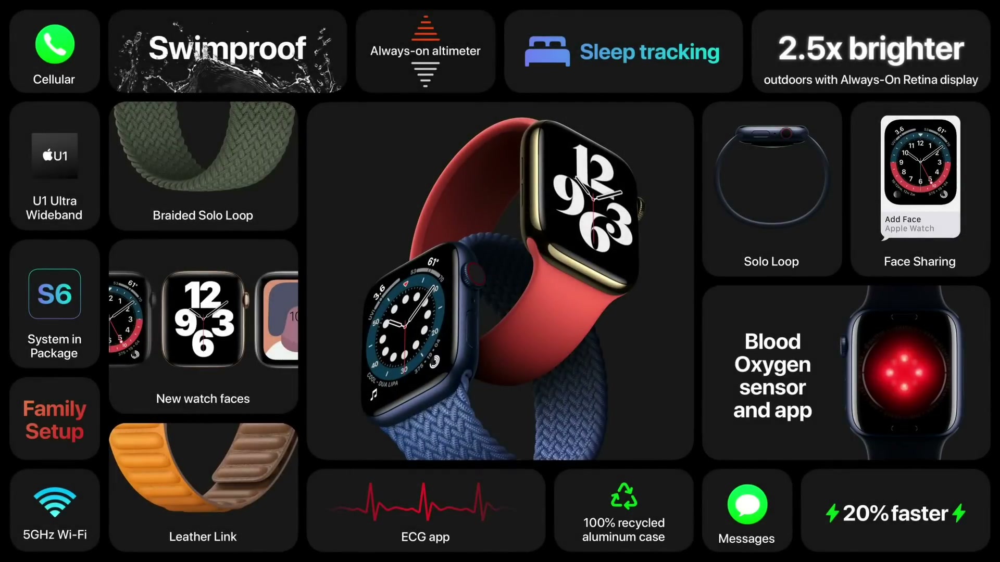
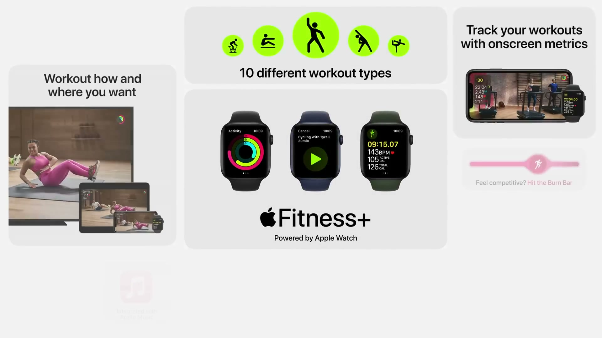
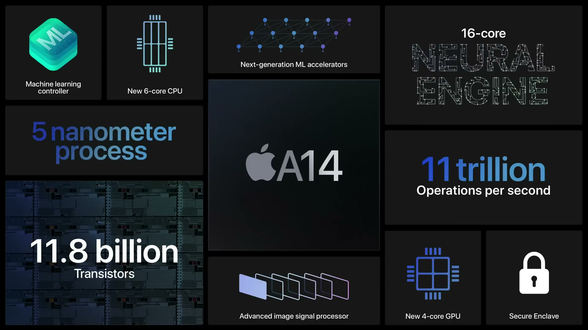

2020 年 9 月 15 日（現地時間）に開催されたオンラインイベント。Apple Watch と iPad の 2 製品を軸に、新しいサービスの Apple Fitness+ と Apple One も発表された。

---

## Apple Watch Series 6

*出典：Apple*

**ハイライト**

- **血中酸素ウェルネス**：新しい健康センサーと Blood Oxygen アプリで、15 秒で血中酸素濃度を測定できる新機能。睡眠中を含むバックグラウンド測定にも対応
- **S6 チップ**：iPhone 11 の A13 Bionic をベースにしたデュアルコアプロセッサで、前世代より最大 20% 高速
- **常時表示ディスプレイ**：手首を下げた状態の屋外での明るさが 2.5 倍に向上
- **高度計**：常時動作の高度計を新搭載し、標高の変化をリアルタイムに表示
- **新カラー**：ブルーアルミニウム、新しいゴールドステンレス、グラファイト、初の (PRODUCT)RED
- **新バンド**：Solo Loop、Braided Solo Loop、Leather Link を追加
- **新ウォッチフェイス**：GMT、Count-up、Chronograph Pro、Typograph、Memoji、Stripes など

### 血中酸素測定

赤色光と赤外光を手首に照射し、反射した光の量から血液の色を算出して酸素量を求める仕組み。測定はフィットネスとウェルネス目的で、いつでもどこでも手首から行える。測定値は Health アプリに保存される。

関連して、血中酸素などの指標を使う 3 つの健康研究が始まる。

- 喘息の管理：University of California, Irvine と Anthem
- 心不全の管理：University Health Network と University of Toronto
- 呼吸器疾患の早期兆候（新型コロナ、インフルエンザ）：Seattle Flu Study と University of Washington School of Medicine

### チップとディスプレイ

| 項目 | 内容 |
|------|------|
| チップ | 第 6 世代 System in Package（S6）。デュアルコア、前世代比で最大 20% 高速 |
| 常時表示ディスプレイ | 手首を下げた状態の屋外で 2.5 倍明るい |
| 高度計 | 常時動作で、1 日を通して標高を連続取得 |

### 新しいウォッチフェイス

- **GMT**：複数のタイムゾーンを同時に表示し、現在地を考慮する
- **Count-up**：任意の時点からの経過時間を計測する
- **Chronograph Pro**：複数の時間目盛りに加え、一定距離の移動時間から速度を測るタキメーターを備える
- **Typograph**：数字を 3 種類の書体と 4 種類のスクリプトで表示できる
- **アーティスト Geoff McFetridge とのアートフェイス**：数百万通りの組み合わせがあり、手首を上げるたびに違うアニメーションが動く
- **Memoji**：お気に入りの Memoji が触れると反応する
- **Stripes**：チームや装いに合わせた配色を選べる

watchOS 7 では開発者向けに、より専門的なウォッチフェイスを作る新しい仕組みも提供される。Dawn Patrol（波の状況）、Lumy（太陽の位置）、Notable（予約の確認）といったアプリが対応例。

### バンドとラインアップ

- **Solo Loop**：留め具・バックルのない 1 本の連続した形状。リキッドシリコーン製で伸縮し、泳げる。複数のサイズ展開で、7 色
- **Braided Solo Loop**：100% リサイクル糸と極細のシリコーン糸を編み込んだもの。5 色
- **Leather Link**：ループバックも留め具もない新しいレザーバンド
- **Apple Watch Nike**：Sport Band と Sport Loop の新色、新しい Nike ウォッチフェイス
- **Apple Watch Hermès**：新しい Attelage バンド（シングルトゥールとダブルトゥール）

### watchOS 7 の健康機能

- **Sleep アプリ**：モーションセンサーで睡眠を記録する
- **手洗い検出**：手洗いの動作と音を認識し、推奨の 20 秒まで続けるよう促す
- **VO2 Max**：動きと心拍数から、より低い範囲の VO2 Max まで測定できるようになり、全範囲をカバー。今年後半には、VO2 Max が低い水準に下がった場合の通知も提供予定

### 環境への取り組み

- アルミニウムケースは 100% リサイクルアルミニウム製
- Series 6 の Taptic Engine には 100% リサイクルのレアアースとタングステンを使用
- BFR、PVC、ベリリウム、水銀を含まず、ディスプレイガラスはヒ素不使用
- Apple Watch に USB 電源アダプタを同梱しなくなる

---

## Apple Watch SE

**ハイライト**

- **手頃なモデル**：Series 6 のデザイン要素と Apple Watch の基本機能を組み合わせた新モデル
- **大型ディスプレイ**：Series 6 と同じ、これまでで最大かつ最先端のディスプレイで、表示情報量が増加
- **S5 チップ**：Series 3 と比べて最大 2 倍高速
- **モーションセンサー**：加速度計、ジャイロスコープ、コンパス、高度計は Series 6 と同じ
- **転倒検出**：最新のモーションセンサーにより対応
- **セルラーモデル**：電話やメッセージが iPhone なしで使え、Family Setup にも対応

### ディスプレイと性能

Series 6 と同じ大型ディスプレイにより、文字盤で表示できる情報やアプリが増え、メッセージ、カレンダー、マップでも表示量が増える。ワークアウト中の指標も大きく読みやすくなる。チップは S5 を搭載し、Series 3 比で最大 2 倍の速さ。

### センサーと健康機能

加速度計、ジャイロスコープ、コンパス、高度計は Series 6 と同じ。最新のモーションセンサーを備えるため転倒検出に対応する。watchOS 7 の新機能も利用できる。一方、血中酸素センサーは Series 6 のみの機能。

### 3 モデルの位置づけ

| 項目 | Series 6 | SE | Series 3 |
|------|----------|----|----------|
| 位置づけ | 血中酸素センサーを備える最新モデル | 手頃で基本機能が充実 | エントリー価格で継続販売 |
| 血中酸素センサー | あり | — | — |
| チップ | S6 | S5 | — |

### Family Setup

iPhone を持たない子どもや高齢の家族の Apple Watch を、家族の iPhone でペアリングできる新機能。それぞれ専用の電話番号とアカウントを持つ。

- 連絡できる相手を指定でき、位置情報の自動通知も設定できる
- 子どもは Move 分数を記録でき、Activity と Workout の機能を使える
- 時計だけで Memoji を作成し、Messages のステッカーや Memoji フェイスで共有できる
- 新しい Schooltime モードで、おやすみモードと操作の制限により学習に集中させられる
- 対象は Apple Watch Series 4 以降のセルラーモデル（SE のセルラーモデルも含む）。提携キャリアで開始時から利用でき、今年後半に拡大予定

### 購入方法

Apple Watch 向けに、24 回払いの Apple Card Financing も発表された。

---

## Apple Fitness+

*出典：Apple*

**ハイライト**

- **新サービス**：Apple Watch を中心に作られた初のフィットネスサービスで、トレーナーの指導と音楽付きのワークアウトを提供
- **Apple Watch 連携**：iPhone、iPad、Apple TV で動画を再生すると、Watch の Workout アプリが自動で開始し、指標が画面にリアルタイム表示される
- **10 種類のワークアウト**：ヨガ、サイクリング、ダンス、トレッドミル、筋トレ、コアなど。毎週新しい内容を追加
- **機材不問**：どのメーカーの機材でも利用でき、ダンベルのみ、または器具なしでできるものが多い
- **ファミリー共有**：家族も追加料金なしで利用可能
- **プライバシー**：おすすめはオンデバイスの処理で生成し、消費カロリーや選んだワークアウト・トレーナーは Apple ID と紐づけて保存されない

### Apple Watch との連携

カタログから選んだ動画を始めると、Apple Watch の Workout アプリで対応するワークアウトが自動で始まる。心拍数、消費カロリー、ペース、距離がリアルタイムで再生中の画面に送られる。

- トレーナーが心拍数の確認を促すと、数値が大きく表示される
- 負荷の高いインターバル中はカウントダウンタイマーが表示される
- Activity リングが画面に表示され、ワークアウト中にリングを閉じるとその場でお祝いの表示が出る
- 終了後は、消費カロリー、平均心拍数、距離、ペース、Activity リングの状況を含むサマリーが表示される

### ワークアウトの種類と音楽

- ヨガ
- サイクリング
- ダンス
- トレッドミルウォーク／トレッドミルラン
- 筋トレ
- コア
- HIIT
- ローイング
- マインドフルクールダウン

自宅、ジム、屋外、旅行先など場所を選ばず実施できる。トレーナーのチームがスタジオから毎週、さまざまな長さ・講師のワークアウトを配信する。音楽は Latest Hits、Hip-Hop、Latin Grooves、Top Country などのジャンルから選べ、Apple Music の契約者は Fitness+ のプレイリストを保存して後から聴ける。

### Fitness アプリと初心者向けプログラム

- iPhone の Fitness アプリの中央のタブにワークアウトが集約される
- iPad と Apple TV にも新しい Fitness アプリが登場し、同じワークアウトを利用できる
- 個人に合わせたおすすめが表示され、新しいトレーナーやワークアウトの発見を後押しして、メニューのバランスを整える
- 運動の経験が少ない人や久しぶりの人向けに、動きと運動の基本を学ぶ初心者プログラムが用意され、スタジオワークアウトに安全に進める

### 提供条件

- 対象国で提供開始し、年内にサービスを開始
- 新しい Apple Watch の購入者は Fitness+ を 3 か月無料で利用できる

---

## Apple One

**ハイライト**

- **新サービス**：複数の Apple のサブスクリプションを 1 つのプランにまとめたバンドル
- **3 つのプラン**：Individual、Family、Premier（Premier は提供対象の国のみ）
- **Family プラン**：家族最大 5 人でサービスを共有でき、iCloud は 200 GB
- **Premier プラン**：Apple News+ と Apple Fitness+ を追加し、iCloud は 2 TB
- **無料体験**：30 日間無料で、未契約のサービスを試せる

### 含まれるサービス

- **iCloud**：写真、動画、ファイルを保存する
- **Apple Music**：7,000 万曲をストリーミング
- **Apple TV+**：Apple Original のシリーズと映画。初年度に 18 件のエミー賞にノミネート
- **Apple Arcade**：100 以上のゲーム
- **Apple News+**：主要な新聞と数百の雑誌
- **Apple Fitness+**：Apple Watch と連携するスタジオワークアウト

### プランの違い

| 項目 | Individual | Family | Premier |
|------|-----------|--------|---------|
| Apple Music | あり | あり | あり |
| Apple TV+ | あり | あり | あり |
| Apple Arcade | あり | あり | あり |
| iCloud 容量 | 50 GB | 200 GB | 2 TB |
| 家族との共有 | — | 最大 5 人 | — |
| Apple News+ | — | — | あり |
| Apple Fitness+ | — | — | あり |

Premier は提供対象の国のみで利用できる。提供時期は今年の秋。

---

## iPad（第 8 世代）

**ハイライト**

- **A12 Bionic**：前世代比で CPU が 40% 高速、グラフィックスは 2 倍に向上
- **Neural Engine**：最も売れている iPad に初めて搭載。毎秒最大 5 兆回の演算
- **ディスプレイ**：10.2 インチ Retina ディスプレイ
- **アクセサリ**：Apple Pencil とフルサイズの Smart Keyboard に対応
- **iPadOS 14**：Scribble など Apple Pencil の新機能を追加
- **環境**：筐体に 100% リサイクルアルミニウムを使用

### パフォーマンス

前世代の iPad と同じデザインのまま、A12 Bionic で性能を高めた。

| 比較対象 | 性能 |
|----------|------|
| 前世代の iPad（CPU） | 40% 高速 |
| 前世代の iPad（グラフィックス） | 2 倍 |
| 売れ筋の Windows ノート PC | 最大 2 倍高速 |
| 売れ筋の Android タブレット | 最大 3 倍高速 |
| 売れ筋の Chromebook | 最大 6 倍高速 |

Neural Engine は毎秒最大 5 兆回の演算が可能で、写真の色の即時変換や、テニスのボール速度・体の位置のリアルタイム分析といった機械学習の用途に使われる。

### アクセサリ

フルサイズの Smart Keyboard に加え、Logitech のキーボード（トラックパッド付きの Combo Touch、学校向けの Rugged Combo）に対応する。Apple Pencil は筆圧感知と傾き検知に対応する。

### iPadOS 14 の Apple Pencil 機能

- **手書きテキスト**：手書きの内容を理解し、タップで素早い操作ができる
- **シェイプ認識**：スケッチした円や星などを整った形に補正する
- **スマート選択**：手書きと描画を区別して選択でき、手書きメモをテキストに変換して他のアプリに貼り付けられる
- **コンパクトな UI**：作業に集中しやすい表示
- **Scribble**：あらゆるテキストフィールドに手書き入力でき、数字の入力にも対応

### 環境への配慮

筐体は 100% リサイクルアルミニウム、はんだは 100% リサイクルのスズ。梱包の木質繊維はリサイクル素材または適切に管理された森林由来で、有害物質を含まない。第 8 世代 iPad と iPad Air に共通する。

---

## iPad Air

*出典：Apple*

**ハイライト**

- **全面刷新のデザイン**：薄く軽い筐体と狭い縁のオールスクリーンデザイン。ローズゴールド、グリーン、スカイブルーを含む 5 色
- **10.9 インチ Liquid Retina ディスプレイ**：解像度 2360×1640（380 万画素超）。従来の Air と同じ本体サイズ
- **Touch ID をトップボタンに統合**：次世代の Touch ID で、Apple がこれまでに設計した中で最小の認証センサー
- **A14 Bionic**：5 ナノメートルプロセス初採用。CPU は前世代 Air 比で 40% 高速、グラフィックスは 30% 向上
- **Neural Engine**：16 コアで毎秒 11 兆回の演算、機械学習性能は最大 2 倍
- **USB-C**：データ転送速度は最大 5Gbps で、前世代の Air の 10 倍
- **アクセサリ**：Apple Pencil の磁気ペアリング・充電と Magic Keyboard に対応
- **通信**：Wi-Fi 6 と、60% 高速化した LTE

### デザインとディスプレイ

本体サイズは前世代の Air と同じまま、10.9 インチに大型化した。フルラミネーション、広色域、True Tone、反射防止コーティングを備える。トップボタンは精密に削り出され、カメラ周りには彫り込みのディテールが施されている。

### トップボタンの Touch ID

全面ディスプレイにするため、Touch ID をトップボタンに組み込んだ。ボタンに触れるだけで、ロック解除、アプリへのログイン、Apple Pay が使える。

- サファイアクリスタルのレンズと次世代のカスタムセンサーで指紋の情報をより効率よく取得
- より高速な Secure Enclave で指紋データを素早く認証
- 従来の Touch ID と同じ性能、使いやすさ、セキュリティ

### A14 Bionic

| 項目 | 内容 |
|------|------|
| プロセス | 5 ナノメートル（業界初）。トランジスタ数は 118 億で、7 ナノメートルのチップより約 40% 増 |
| CPU | 6 コア。前世代 Air 比で 40% 高速 |
| GPU | 4 コア。グラフィックスが 30% 向上 |
| Neural Engine | 16 コア（従来の 2 倍）。毎秒 11 兆回、機械学習性能は前世代比で最大 2 倍 |
| 機械学習アクセラレータ | 第 2 世代を iPad で初搭載。行列演算が前世代の Air 比で最大 10 倍高速 |
| その他 | 最新の ISP、より高速な Secure Enclave |

同価格帯で最も売れているノート PC と比べて、グラフィックス性能は最大 2 倍。Core ML を使うアプリの性能も引き上げられる。

### 接続・カメラ・オーディオ

- **USB-C**：カメラ、ドライブ、最大 4K の外部ディスプレイなどに接続できる
- **前面カメラ**：700 万画素の FaceTime HD カメラ。Smart HDR、改善された 1080p ビデオ、低照度性能の向上
- **背面カメラ**：iPad Pro と同じ 1200 万画素。フォーカスピクセルと大きな絞りで、4K ビデオと手ぶれ補正の改善に対応
- **スピーカー**：再設計され、横向きでステレオ再生

---

## 価格・発売日

| 製品 | 価格 | 税込換算 | 発売日 |
| ------ | ------ | ------ | -------- |
| Apple Watch Series 6 | $399 から | 約4万6,000円〜 | 発表日から予約受付、金曜日に発売 |
| Apple Watch SE | $279 から | 約3万2,000円〜 | 発表日から予約受付、金曜日に発売 |
| Apple Watch Series 3 | $199（継続販売） | 約2万3,000円 | 言及なし |
| Apple Fitness+ | $9.99／月、$79.99／年 | 約1,000円／約9,000円 | 年内に開始 |
| Apple One | 言及なし | — | 今年の秋 |
| iPad（第 8 世代） | $329 から（教育向け $299） | 約3万8,000円〜／約3万5,000円 | 発表日から予約受付、金曜日に発売 |
| iPad Air | $599 から | 約6万9,000円〜 | 来月 |

※日本円は、米国の価格（税抜き）を発表日（2020年9月15日）の為替レート（1ドル＝105.44円、欧州中央銀行の参考レート）で換算し、消費税10%を加えた参考値。実際の日本での販売価格とは異なる。
