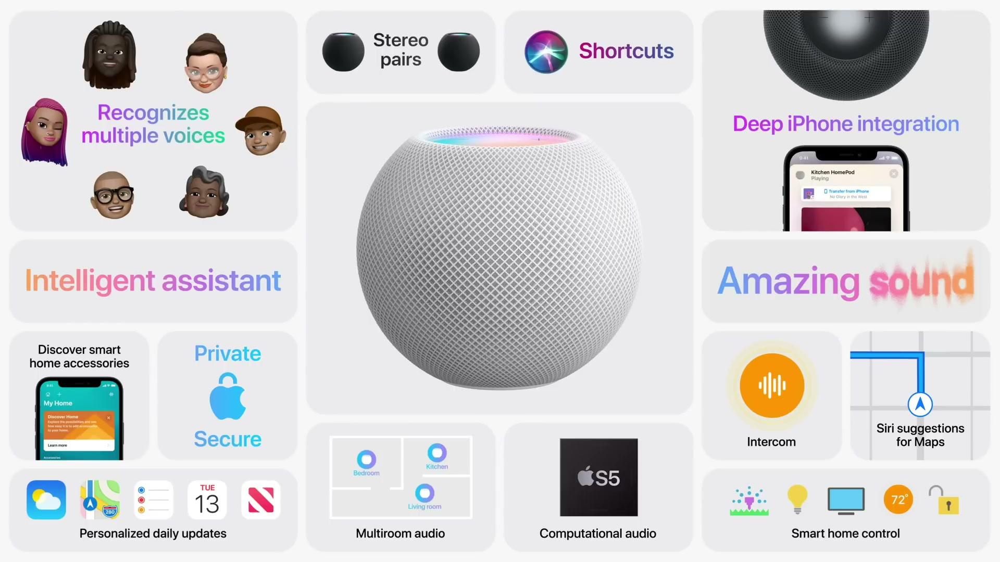
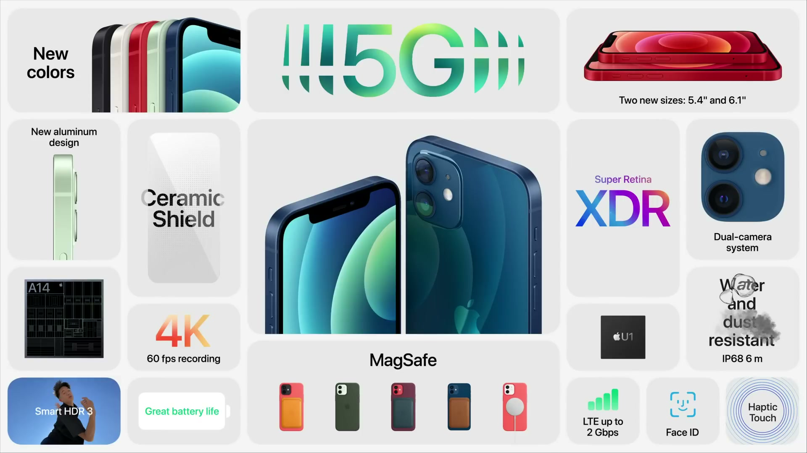
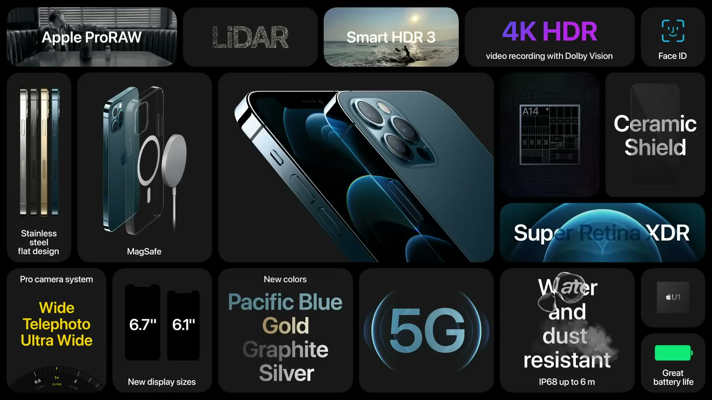

2020年10月13日（現地時間）、Apple Park でオンラインイベントが開催された。HomePod mini と、5G に対応した iPhone 12、iPhone 12 mini、iPhone 12 Pro、iPhone 12 Pro Max が発表された。

---

## HomePod mini

*出典：Apple*

**ハイライト**

- **新製品**：コンパクトなスマートスピーカー HomePod mini が登場。ホワイトとスペースグレイの2色
- **コンピュテーショナルオーディオ**：Apple S5 チップとソフトウェアが、楽曲の特性を解析して音量・ダイナミックレンジ・ドライバの動きを毎秒180回以上調整
- **360度サウンド**：フルレンジのダイナミックドライバと、2基のパッシブラジエーター、音響ウェーブガイドを搭載
- **複数台連携**：家中で同期再生でき、同じ部屋の2台は自動でステレオペアに
- **U1 による新 Handoff**：iPhone を近づけると、視覚・音・触覚の効果とともに再生が引き継がれる（年内提供）
- **Intercom 機能（新機能）**：HomePod 間のほか、iPhone、iPad、Apple Watch、CarPlay、AirPods とも連携
- **プライバシー**：「Hey Siri」またはタッチで起動するまで音声は家の外に送られない

### デザインと音響

メッシュファブリックで包まれたデザインで、この素材は音響性能のために作られている。上面にはバックライト付きのタッチ面があり、音量と再生・一時停止を操作でき、Siri 起動時には点灯する。

音響面では、高出力で歪みを抑えたフルレンジのダイナミックドライバ、低音を支える高ストロークで力を打ち消し合う1対のパッシブラジエーター、均一な360度の音を届ける音響ウェーブガイドを独自に設計している。Apple S5 チップと組み合わせた「コンピュテーショナルオーディオ」は、再生前から楽曲を解析し、チューニングモデルを適用して音量、ダイナミックレンジ、ドライバとパッシブラジエーターの動きをリアルタイムに最適化する。この処理は毎秒180回以上行われる。

### マルチルームと Handoff

- 複数の HomePod mini を家中で同期再生できる
- 同じ部屋に2台置くと、自動的にステレオペアになる
- U1 超広帯域チップにより、iPhone が近くにあることを高精度に検知する
- iPhone を近づけると、視覚・音・触覚の効果とともに音楽が iPhone と HomePod mini の間を移動する（年内に提供）

### 対応コンテンツと Siri

Apple Music に加え、Podcast、iHeartRadio・RADIO.COM・TuneIn のラジオ局を聴ける。今後数か月のうちに Pandora や Amazon などのサービスにも対応する。アーティスト、アルバム、曲の指定のほか、プレイリスト再生、歌詞による曲検索ができる。

Siri は10億台以上のデバイスで使え、月間250億件以上のリクエストを処理している。過去3年で音声認識の精度は2倍、知っている事実は20倍以上になった。HomePod mini では複数のタイマーとアラーム、天気、質問への回答など一般的なスマートスピーカーの機能に加え、iPhone との連携が特徴となる。

- iPhone のアプリを使い、メッセージ送信、予定の確認、通話、iPhone の探索ができる
- 「パーソナルアップデート」で天気、最初の予定、リマインダーを1回の依頼で確認できる
- 家族それぞれの声を認識し、個人ごとの内容を返す
- HomePod mini に尋ねた店の営業時間などが、CarPlay に Siri の提案として表示され、乗車時にルートが用意される

### スマートホームと Intercom

HomePod mini は Home アプリと自動で連携し、HomeKit アクセサリを音声で操作できる。温度、施錠、照明の調整や、複数のアクセサリをまとめて動かす「シーン」の実行に対応する。Home アプリには新しい「見つける」タブ（Discover）が加わり、照明、セキュリティ、快適性などのアクセサリを探しやすくなった。

Intercom は、ある HomePod から別の部屋、または複数の部屋の HomePod へメッセージを送る機能で、次の特徴がある。

- iPhone、iPad、Apple Watch、CarPlay からも利用できる
- メッセージは家中の HomePod で再生され、家族の個人デバイスに通知が届く
- AirPods でも再生される
- 返信も音声で行える

### プライバシーとセキュリティ

「Hey Siri」を言うかタッチで Siri を起動するまで、音声は家の外に送られない。リクエストは Apple ID に紐づけられず、音声録音を Apple が保存するかどうかは利用者が選べる。個人的なリクエストは iPhone が家にあるときだけ機能し、スマートホームアクセサリとの通信には強力な暗号化を使う。

---

## iPhone 12 と iPhone 12 mini

*出典：Apple*

**ハイライト**

- **5G 対応（新機能）**：iPhone 12 シリーズ全モデルが5Gに対応。米国では mmWave にも全モデルで対応
- **新デザイン**：フラットなエッジのアルミフレーム。iPhone 11 比で11%薄く、体積15%減、16%軽量
- **Super Retina XDR（OLED）**：解像度は iPhone 11 の2倍の画素数、460ppi、コントラスト比200万:1、HDR のピーク輝度1,200ニト
- **Ceramic Shield**：落下性能が4倍向上した新しいカバーガラス
- **A14 Bionic**：5nm プロセス初のスマートフォン用チップ。CPU・GPU とも最大50%高速化、Neural Engine は16コアに拡大
- **カメラの向上**：新しい Wide カメラは f/1.6 で、低照度性能が27%向上。Night mode が全カメラに対応
- **MagSafe（新機能）**：マグネットで装着するアクセサリのエコシステムと、最大15W のワイヤレス充電
- **iPhone 12 mini**：5.4インチのディスプレイで、iPhone 12 と同じ機能を備える最小・最薄・最軽量の5Gスマートフォン

### デザインとディスプレイ

アルミフレームとガラスが前後で面一になる、角のフラットなデザインになった。5G を前提に、アルミフレームの周囲に新しいアンテナを配置している。カラーは、ブラック、ホワイト、(PRODUCT)RED、グリーン、ブルーの5色。

ディスプレイは iPhone 11 と同じ6.1インチのまま、ベゼルを狭めて本体を小型化した。Apple カスタムの OLED を採用し、画素ごとに輝度を制御できる。

| 項目 | iPhone 12 |
|------|-----------|
| ディスプレイ | Super Retina XDR（OLED）6.1インチ |
| 画素密度 | 460ppi（iPhone 11 の2倍の画素数） |
| コントラスト比 | 200万:1 |
| ピーク輝度（HDR） | 1,200ニト |
| HDR 規格 | Dolby Vision、HDR10、HLG |
| 厚さ（iPhone 11 比） | 11%薄い |
| 体積（iPhone 11 比） | 15%小さい |
| 重さ（iPhone 11 比） | 16%軽い |

カバーガラスには Corning と共同開発した Ceramic Shield を採用する。高温の結晶化工程でガラスのマトリックス内にナノセラミック結晶を成長させ、結晶の種類と結晶化度を制御して、強度と透明度を両立した。落下性能は4倍向上し、iPhone 史上最大の信頼性向上となる。

### 5G

Apple は5G専用のアンテナと無線部品を設計し、1台に最も多くの5Gバンドを搭載している。ソフトウェア面では iOS のフレームワークを最適化し、消費電力を増やさずにアプリが5Gの恩恵を受けられるようにした。

- **Smart Data モード**：5G の速度が不要なときは自動で LTE を使ってバッテリーを節約し、必要になると5Gに切り替える
- **検証**：50の無響室などで検証し、100以上の通信事業者・30以上の地域で5Gテストを完了
- **速度**：理想的な条件で最大3.5Gbps。mmWave は理想条件で4Gbps 超、一般的な条件で最大1Gbps を計測
- **mmWave**：米国では全 iPhone 12 モデルが対応し、Verizon の 5G Ultra Wideband にも接続できる

Verizon は、5G Ultra Wideband のピークダウンロードを理想条件で4Gbps 超、アップロードを200Mbps 超とし、年末までに60都市へ拡大する。あわせて、1,800以上の都市・町で2億人以上をカバーする 5G Nationwide を開始した。

### A14 Bionic

A14 Bionic は、5nm プロセスで作られた世界初のスマートフォン用チップ。トランジスタ数は118億個で、A13 比で約40%増えた。

| 項目 | A14 Bionic |
|------|-----------|
| CPU | 6コア。最大50%高速化 |
| GPU | 4コア。最大50%高速な描画性能 |
| Neural Engine | 8コアから16コアへ。最大80%高速、毎秒11兆回の演算 |
| 機械学習アクセラレータ（CPU） | 70%高速化 |

ゲームでは、年内に『League of Legends: Wild Rift』が iPhone に登場する。

### カメラ

iPhone 12 は Ultra Wide と新しい Wide のデュアルカメラ構成。Wide カメラは Apple 初の7枚構成レンズと f/1.6 の絞り値を備え、低照度性能が27%向上した。

- **Smart HDR 3**：機械学習でシーンを理解し、被写体の領域ごとに調整する。空のセグメンテーションで色、コントラスト、ノイズも補正する
- **Night mode**：より明るい絞りで光を多く取り込む。初めて Ultra Wide と前面の TrueDepth カメラにも対応し、全カメラで使える
- **ビデオ**：絞りの拡大により、暗い場所での画質が向上する
- **Night mode タイムラプス**：三脚使用時に、より長い露光で明るいフレームを撮影できる

### MagSafe

MagSafe は、ワイヤレス充電の位置ずれによる充電の遅さや不具合を解消する新しい仕組み。独自のワイヤーコイルがマグネットを内蔵しつつ、既存の Qi 充電器との互換性を保つ。

- **充電**：マグネットで位置を合わせ、最大15W で充電できる。ナノ結晶シールドで磁束を抑える
- **センサー**：シングルターンコイルの NFC と磁力計を追加し、アクセサリを認識して反応できる
- **アクセサリ**：シリコーン、クリア、レザーのケース、MagSafe 充電器、MagSafe ウォレット、レザースリーブ（iPhone が入ると時計を表示）
- **MagSafe Duo Charger**：iPhone と Apple Watch を1台で充電でき、折りたためる
- **サードパーティ**：Belkin がカーマウントとマルチ充電ドックを開発中

### iPhone 12 mini と環境への取り組み

iPhone 12 mini は、iPhone 12 と同じ機能を備えたコンパクトなモデル。iPhone 8 などの4.7インチモデルより小さく軽いが、ディスプレイは大きい5.4インチ。5G対応の iPhone として世界最小、最薄、最軽量となる。

環境面では、すべてのマグネット（カメラ、ハプティクス、MagSafe）に100%リサイクルのレアアースを初めて使用した。また、iPhone の箱から電源アダプタと有線ヘッドフォンを取り除き、箱を小型・軽量化して、パレットに最大70%多く積載できるようにした。これらの変更で年間200万トン超の CO2 排出を削減し、乗用車45万台を道路から減らす効果に相当する。同梱の USB-C to Lightning ケーブルは全 iPhone に付属し、USB-C の電源アダプタやコンピュータのポートで高速充電ができる。Apple は2030年までに、製造サプライチェーンと製品ライフサイクル全体でカーボンニュートラルを目指す。

---

## iPhone 12 Pro と iPhone 12 Pro Max

*出典：Apple*

**ハイライト**

- **ステンレススチールの新デザイン**：医療用グレードのステンレスバンドと精密加工のバックガラス。シルバー、グラファイト、ゴールド、新色パシフィックブルーの4仕上げ
- **ディスプレイの拡大**：iPhone 12 Pro は5.8インチから6.1インチへ、Pro Max は6.5インチから6.7インチへ拡大。Pro Max は約350万画素で iPhone 史上最大のディスプレイ
- **LiDAR スキャナ（新機能）**：低照度のオートフォーカスが最大6倍高速化し、Night mode ポートレートにも対応
- **Dolby Vision HDR ビデオ（新機能）**：10bit HDR を最大4K・60fps で撮影。撮影・編集・再生・共有まで iPhone で完結
- **Apple ProRAW**：RAW の柔軟性と計算フォトグラフィを組み合わせる新形式。年内に提供予定
- **Pro Max のカメラ**：65mm の新望遠で光学5倍相当のズーム範囲、センサーが47%大きくなり低照度性能が87%向上、センサーシフト式の手ぶれ補正を搭載
- **耐水・耐塵**：IP68 等級で、水深6mに30分間の耐水性
- **iPhone 12 と共通**：A14 Bionic、Ceramic Shield、5G、MagSafe

### デザインと耐久性

ステンレススチールのバンドは PVD プロセスで仕上げ、ゴールドには高出力マグネトロンコーティングを使う。前面は Ceramic Shield で、IP68 等級により水深6mで30分間の浸水に耐える。MagSafe アクセサリにも対応する。

| 項目 | iPhone 12 Pro | iPhone 12 Pro Max |
|------|---------------|-------------------|
| ディスプレイ | 6.1インチ（従来は5.8インチ） | 6.7インチ（従来は6.5インチ） |
| 画素数 | — | 約350万画素 |
| 仕上げ | シルバー、グラファイト、ゴールド、パシフィックブルー | 同左 |

筐体の大きさはほぼ変えずにディスプレイを大きくした。5G で配信される高解像度の HDR 映画や番組も表示できる。

### カメラシステム

A14 Bionic の CPU、GPU、Neural Engine と ISP を組み合わせた計算フォトグラフィにより、Deep Fusion が前面の TrueDepth を含む4つのカメラすべてに対応した。ISP が複数フレームを処理し、CPU がフレームの位置合わせを計算し、GPU が前処理と後処理を行い、Neural Engine がピクセル単位で処理する。

| 項目 | iPhone 12 Pro | iPhone 12 Pro Max |
|------|---------------|-------------------|
| Ultra Wide | 視野角120度 | 同左（13mm） |
| Wide | f/1.6、7枚構成レンズ、光量27%増 | f/1.6、新センサー（47%大型、1.7ミクロン画素） |
| 望遠 | 52mm | 65mm（光学2.5倍） |
| 光学ズーム範囲 | 4倍 | 5倍 |
| 低照度性能 | — | 87%向上 |
| 手ぶれ補正 | Wide の OIS は毎秒5,000回の微調整（昨年の5倍） | センサーシフト式。露光は手持ちで最大2秒 |

Pro Max のセンサーシフト式 OIS は、重いレンズではなくセンサーを動かして X・Y 方向の動きを打ち消し、手の動きや車内の振動など低周波・高周波の揺れに対応する。ビデオの安定化にも効く。

### Apple ProRAW

Apple ProRAW は、RAW 撮影の自由度と、Deep Fusion や Smart HDR といった複数フレーム処理を組み合わせる新機能。CPU、GPU、ISP、Neural Engine の処理を新しいパイプラインにまとめ、シャッター遅延なしに撮影時に Deep Image ファイルを生成する。4つのカメラすべてで動作する。

- シャープネス、ホワイトバランス、トーンマッピングは画像に焼き込まれず、調整用の指示として保持される
- 色、ディテール、ダイナミックレンジを後から細かく編集できる
- 写真アプリやプロ向けの写真編集アプリで直接編集できる
- サードパーティアプリが ProRAW で撮影するための API も用意する
- iPhone 12 Pro と 12 Pro Max のカメラアプリに年内に追加される

### Dolby Vision ビデオ

iPhone に初めて HDR ビデオ撮影が加わり、10bit の HDR で7億色以上（従来の60倍）を記録できる。撮影中は Super Retina XDR ディスプレイでライブプレビューできる。

iPhone 12 Pro は、Dolby Vision HDR で記録する世界初のカメラ。10bit の全フレームを ISP に通してヒストグラムを生成し、撮影中にフレームごとの Dolby Vision グレーディングを4K・60fps で行う。Apple カスタムのセンサーと A14 の処理能力でリアルタイムに処理している。

編集も写真アプリ上で行え、フィルタを適用すると Dolby Vision のチューニングがその場で再生成される。これにより、Dolby Vision ビデオの撮影、編集、再生、共有が iPhone だけで完結する。

### LiDAR スキャナ

LiDAR（Light Detection and Ranging）は、光が物体に届いて反射するまでの時間を測る。iOS 14 の機械学習と深度のフレームワークにより、周囲の正確な深度マップを作る。

- **AR とスキャン**：物体や部屋のスキャン、写真・ビデオ効果、AR オブジェクトの正確な配置ができる
- **低照度オートフォーカス**：暗い場所でも被写体を識別して即座にピントを合わせ、ピント合わせの時間が最大6倍短縮される。写真とビデオの両方で動作する
- **Night mode ポートレート**：低照度での深度が向上し、Night mode でのポートレート撮影ができる

### 5G の展開

5G は世界100以上の通信事業者に展開され、Apple として最速の展開になる。

---

## 価格・発売日

| 製品 | 価格 | 税込換算 | 発売日 |
| ------ | ------ | ------ | -------- |
| HomePod mini | $99 | 約1万1,000円 | 11月6日に注文開始、11月16日の週に出荷開始 |
| iPhone 12 | $799 | 約9万3,000円 | 10月16日に予約開始、10月23日に発売 |
| iPhone 12 mini | $699 | 約8万1,000円 | 11月6日に予約開始、11月13日に発売 |
| iPhone 12 Pro | $999（128GBから） | 約11万6,000円 | 10月16日に予約開始、10月23日に発売 |
| iPhone 12 Pro Max | $1,099 | 約12万8,000円 | 11月6日に予約開始、11月13日に発売 |

※日本円は、米国の価格（税抜き）を発表日（2020年10月13日）の為替レート（1ドル＝105.52円、欧州中央銀行の参考レート）で換算し、消費税10%を加えた参考値。実際の日本での販売価格とは異なる。
