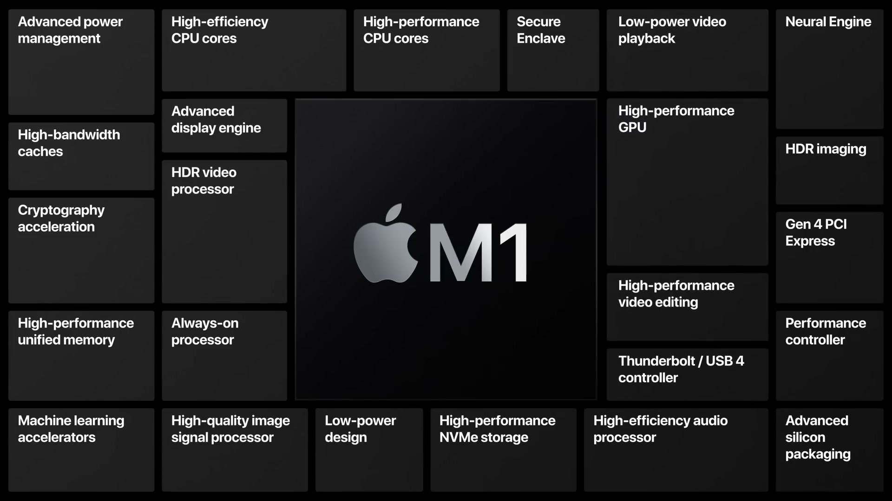
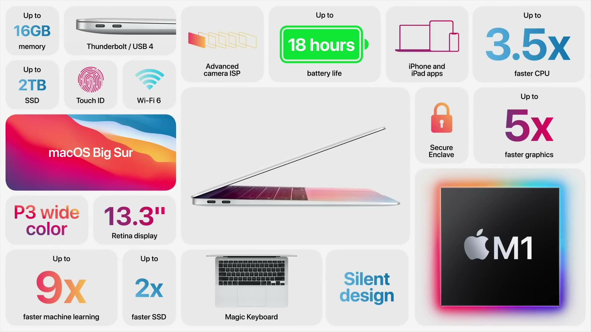
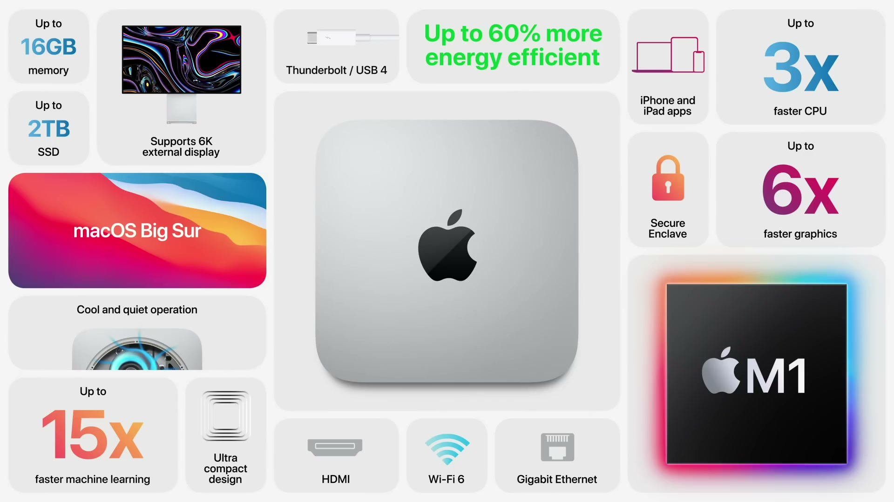
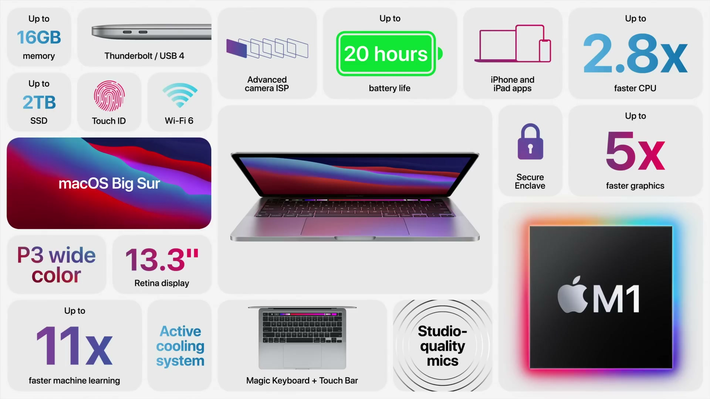

2020年11月10日（現地時間）に開催された Apple Event。この秋3回目のイベントで、Mac 初の Apple シリコン「M1」と、それを搭載した3つの Mac、そして macOS Big Sur が発表された。

---

## M1 チップ

*出典：Apple*

**ハイライト**

- **Mac 初の自社設計チップ**：Mac 向けに設計された最初の Apple シリコン。低消費電力が重要な小型システム向けに最適化され、今後数年かけて Mac 全体を Apple シリコンへ移行する
- **システムオンチップ**：プロセッサ、I/O、セキュリティ、メモリの機能を1つの SoC に統合
- **ユニファイドメモリ**：高帯域・低レイテンシのメモリを1つのプールにまとめ、SoC 内の各機能がコピーなしで同じデータにアクセス
- **5 nm プロセス**：パーソナルコンピュータ向けチップとして初めて 5 nm を採用。トランジスタ数は 160 億個
- **8 コア CPU**：高性能コア4つと高効率コア4つ。ワットあたりの CPU 性能は3倍に向上
- **最大 8 コア GPU**：約 25,000 スレッドを同時実行でき、統合グラフィックスとして最速と位置づけ
- **16 コア Neural Engine**：毎秒 11 兆回の演算に対応し、機械学習性能が向上
- **Thunderbolt と USB4、最新世代の Secure Enclave、最新の ISP** を搭載

### SoC とユニファイドメモリ

これまでの Mac はプロセッサ、I/O、セキュリティ、メモリごとに別々のチップが必要だった。M1 ではこれらを1つの SoC にまとめ、構成を簡素化しつつ効率と性能を高めている。

メモリは1つのプールとしてカスタムパッケージ内に置かれ、SoC 内のすべての技術が同じデータを複数のメモリ間でコピーせずに扱える。これにより性能と電力効率が大きく向上する。

### CPU

CPU は性能重視のコアと効率重視のコアの2種類で構成される。

| 種類 | コア数 | 特徴 |
|------|--------|------|
| 高性能コア | 4 | 低消費電力シリコンとして世界最速の CPU コアと位置づけ。マルチスレッド処理が大きく向上 |
| 高効率コア | 4 | 消費電力は高性能コアの約10分の1。軽い処理を担当し、高性能コアを重い処理に回せる |

- 高効率コア4つだけで、現行のデュアルコア MacBook Air と同程度の性能を、はるかに低い消費電力で発揮
- 最新のパフォーマンスコントローラがリアルタイムでコアの使い分けを決定
- MacBook Air の熱設計に相当する約 10 W の条件で、最新の PC 向けノート用チップの最大 2 倍の CPU 性能
- PC 向けチップのピーク性能を、4分の1の消費電力で出せる

### GPU

- 最大 8 コアの GPU で、約 25,000 スレッドを同時に実行
- 同じ PC ノート用チップに対し、どの電力レベルでも高いグラフィックス性能を発揮し、最大 2 倍
- PC 向けチップのピーク性能を、3分の1の消費電力で出せる
- 一般的な PC は統合グラフィックスだと性能が足りず、消費電力の大きいディスクリートチップを使う。M1 は統合グラフィックスで高性能と低消費電力を両立する

### Neural Engine とセキュリティ

- 16 コアの Neural Engine は毎秒 11 兆回の演算を実行でき、映像解析、音声認識、画像処理などの機械学習タスクが高速化
- 最新世代の Secure Enclave を搭載し、Mac のセキュリティを強化

### macOS Big Sur との統合

Mac 向けのソフトウェアワークロードを使って M1 のアーキテクチャを最適化しており、iOS と iPadOS が A シリーズチップ向けに作られているのと同様に、macOS Big Sur は M1 を最大限に活かすよう作られている。

---

## macOS Big Sur

**ハイライト**

- **M1 向けの最適化**：初めて自社シリコン向けに設計された macOS。アプリの起動はほぼ瞬時になり、スリープからも iPhone や iPad のように即座に復帰
- **Safari の向上**：JavaScript の実行が 1.5 倍に、応答性は約 2 倍に向上
- **Apple 製アプリの最適化**：Logic Pro は最大 3 倍の音源・エフェクトプラグインを実行でき、Final Cut Pro は複雑なタイムラインのレンダリングが最大 6 倍速
- **Universal アプリ**：Apple シリコン用と Intel 用のネイティブバイナリを1つにまとめ、すべての Mac で動く
- **Rosetta 2**：Intel Mac 向けアプリを M1 上でそのまま実行
- **iPhone / iPad アプリ**：Mac で直接実行できるようになった
- **セキュリティ強化**：ハードウェアで検証するセキュアブート、全ファイルの自動暗号化、コード実行アーキテクチャへの保護を追加

### 速度とメモリの使い方

M1 のユニファイドメモリ構造に合わせ、ビデオデコード、GPU、ディスプレイが同じデータ形式を使うようにした。高コストなコピーや変換が不要になる。

- アプリが使えるグラフィックスメモリが従来より増加
- 6K ビデオのカラーグレーディング、負荷の高いゲーム、リアルタイムの機械学習推論に効果
- Metal などの macOS の技術と M1 の速度で、3D アニメーションのレンダリングや RAW 動画の編集が快適になる
- 高度な電源管理が、M1 の高性能コアと高効率コアにタスクを自動で割り当て、静かな動作とバッテリー駆動時間の向上につながる

### セキュリティ

iOS で培ってきたセキュリティアーキテクチャを M1 で Mac に導入。

- ハードウェアによって検証されるセキュアブート
- すべてのファイルに対する高性能な自動暗号化
- コード実行アーキテクチャに組み込まれた新しい保護

### Apple 製アプリの最適化

すべての Apple 製アプリが M1 向けに最適化されている。

| アプリ | 向上内容 |
|--------|----------|
| Logic Pro | 実行できる音源とエフェクトプラグインが最大 3 倍 |
| Final Cut Pro | 複雑なタイムラインのレンダリングが最大 6 倍速 |

Pages、Numbers、Keynote、GarageBand、iMovie も M1 向けに最適化されている。

### Universal アプリと Rosetta 2

- **Universal アプリ**：Apple シリコン用と Intel 用のネイティブバイナリを含む1つのアプリ。App Store でもウェブでも配布でき、1つのアプリがすべての Mac で動く
- **対応予定**：Omni Group は Mac アプリの Universal 版を提供予定。Adobe は Lightroom を来月、Photoshop などを来年初めに Universal 化する予定
- **Rosetta 2**：Universal 化されていない既存アプリも、アプリの更新なしで M1 Mac 上でシームレスに動作。Metal と M1 により、一部のグラフィックス負荷の高いアプリは、統合グラフィックスの従来 Mac でネイティブ実行したときより Rosetta 下のほうが高速に動く

### iPhone・iPad アプリと開発者向け

- M1 は iPhone や iPad で使われているアーキテクチャを拡張したもので、開発者は同じ考え方でコードを最適化できる
- 初めて、iPhone と iPad のアプリを Mac で直接実行できる
- Mac 向けアプリに加え、より多くのゲーム、コンテンツ、アプリが Mac で使えるようになる

---

## MacBook Air

*出典：Apple*

**ハイライト**

- **CPU 性能の向上**：8 コア CPU で、従来世代の最大 3.5 倍高速
- **GPU 性能の向上**：最大 8 コアの統合 GPU で、グラフィックス性能は最大 5 倍。MacBook Air として過去最大の向上
- **機械学習の高速化**：16 コアの Neural Engine により、従来の Air より最大 9 倍高速
- **ストレージの高速化**：SSD が最大 2 倍高速
- **ファンレス設計**：ファンを廃止し、どのような処理でも無音
- **バッテリー駆動時間の拡大**：ワイヤレスのウェブ閲覧で最大 15 時間、ビデオ再生で最大 18 時間（従来より 6 時間長い）。ビデオ会議では従来の約 2 倍
- **カメラの画質向上**：M1 の最新 ISP により、ノイズ低減、ダイナミックレンジ、オートホワイトバランスが向上
- **Retina ディスプレイ**：13 インチ。P3 の広色域に対応

### 性能

| 項目 | 向上内容 |
|------|----------|
| CPU | 従来世代の最大 3.5 倍 |
| GPU | 従来世代の最大 5 倍 |
| Neural Engine（機械学習） | 従来の Air の最大 9 倍 |
| SSD | 最大 2 倍 |

- 同クラスで最も売れている Windows ノートと比べて最大 3 倍高速。過去1年に販売された PC ノートの 98% より高速
- 4K ProRes ビデオを複数ストリーム、フルクオリティで、コマ落ちなしで編集可能（初）
- ゲームでは、グラフィックス負荷の高いタイトルが大幅に高いフレームレートで動作
- Lightroom では大きな RAW ライブラリを扱え、iMovie の書き出しも高速
- Final Cut Pro の Smart Conform など、機械学習ベースの機能が大幅に短時間で完了

### ファンレスとバッテリー

M1 の電力効率と macOS Big Sur の電源管理により、ファンなしで上記の性能を実現。負荷の高い作業中も無音。

| 項目 | 駆動時間 |
|------|----------|
| ワイヤレスのウェブ閲覧 | 最大 15 時間 |
| ビデオ再生 | 最大 18 時間 |

ビデオ再生は従来より 6 時間長く、MacBook Air 史上最長のバッテリー駆動時間。

### カメラとディスプレイ

- M1 の最新 ISP が、ノイズ低減の向上、ダイナミックレンジの拡大、シャドウとハイライトのディテール向上、オートホワイトバランスの改善をもたらす
- 機械学習による顔検出を組み合わせ、FaceTime 通話で自然な映りに
- 13 インチ Retina ディスプレイは P3 の広色域に対応

### セキュリティ

- M1 の Secure Enclave と macOS Big Sur により、セキュリティを強化
- Touch ID による Mac のロック解除と、Apple Pay でのオンライン購入に対応

### デザイン

薄型で、先細りのくさび形デザインを維持。

---

## Mac mini

*出典：Apple*

**ハイライト**

- **CPU 性能の向上**：8 コア CPU で、従来の 4 コアモデルの最大 3 倍高速
- **GPU 性能の向上**：8 コア GPU で、グラフィックス性能は最大 6 倍
- **機械学習の高速化**：Neural Engine を初搭載し、従来世代より最大 15 倍高速
- **小型化と高性能**：同価格帯で最も売れている PC デスクトップと比べて、サイズは 10 分の 1、性能は最大 5 倍
- **放熱設計**：熱設計により M1 の性能を持続でき、動作は低温かつ静か
- **接続性**：Thunderbolt と USB4 の両方に対応した USB-C ポートを 2 つ搭載。Pro Display XDR を 6K 解像度で接続可能

### 性能

| 項目 | 従来の 4 コアモデルとの比較 |
|------|-----------------------------|
| CPU | 最大 3 倍 |
| GPU | 最大 6 倍 |
| 機械学習 | 最大 15 倍 |

- 開発者は Xcode での大規模なコンパイルや、Logic Pro での音楽制作が快適に
- Unity でのグラフィックス負荷の高いゲーム開発や、Baldur's Gate 3 など高グラフィックス設定でのゲームプレイが可能

### 機械学習

- Neural Engine により、Pixelmator Pro での写真の解像度向上（シャープさとディテールの向上）といった ML 機能が強化
- TensorFlow や Create ML といったディープラーニング技術が M1 で高速化され、開発者、科学者、エンジニアの用途に向く

### 熱設計と接続性

- 熱設計により、M1 が高い性能を維持しつつ、低温で静かに動作
- USB-C ポートを 2 つ備え、Thunderbolt と USB4 の両方に対応して幅広い周辺機器を接続
- Pro Display XDR を 6K の解像度でフルに駆動

---

## MacBook Pro（13 インチ）

*出典：Apple*

**ハイライト**

- **CPU 性能の向上**：8 コア CPU で、従来世代の最大 2.8 倍高速。Xcode でのビルドがほぼ 3 倍速
- **GPU 性能の向上**：8 コア GPU で、グラフィックス性能は最大 5 倍
- **機械学習の高速化**：Neural Engine により、従来世代の最大 11 倍高速
- **バッテリー駆動時間の拡大**：ワイヤレスのウェブ閲覧で最大 17 時間、ビデオ再生で最大 20 時間（従来より 10 時間長い）。Mac として最長
- **アクティブ冷却システム**：負荷の高い処理でも高い性能を持続
- **マイクとカメラの向上**：S/N 比を改善したスタジオ品質のマイク。M1 の ISP により、ビデオ通話の粒状感が減り、低照度でのコントラストとディテールが向上
- **接続性**：USB4 対応の Thunderbolt ポートを 2 つ搭載。Pro Display XDR を 6K 解像度で接続可能
- **筐体**：重さ約 3 ポンド（約 1.4 kg）の携帯性の高いデザインを維持

### 性能

| 項目 | 従来世代との比較 |
|------|------------------|
| CPU | 最大 2.8 倍 |
| GPU | 最大 5 倍 |
| 機械学習（Neural Engine） | 最大 11 倍 |

- 同クラスで最も売れている Windows ノートと比べて最大 3 倍高速
- Xcode で、アプリのビルドがほぼ 3 倍速に
- Photoshop で、高解像度写真へのフィルタやエフェクトの適用が高速化
- Shapr3D での製品設計、Cinema 4D での 3D 制作にも対応
- DaVinci Resolve で、8K ProRes 映像をフルクオリティでコマ落ちなく再生できる
- Neural Engine を使うオンデバイスの機械学習では、コンパクトなプロ向けノートとして最速

### 冷却とバッテリー

アクティブ冷却システムにより、ビデオのトランスコードや Compressor のような負荷の高い作業でも性能を維持する。M1 の効率と macOS Big Sur により、バッテリー駆動時間も大きく伸びた。

| 項目 | 駆動時間 |
|------|----------|
| ワイヤレスのウェブ閲覧 | 最大 17 時間 |
| ビデオ再生 | 最大 20 時間 |

- ビデオ再生は従来より 10 時間長い
- ソフトウェア開発者は、1回の充電でコンパイルできるコード量が 4 倍に

### マイク、カメラ、セキュリティ

- スタジオ品質のマイクで S/N 比が向上し、FaceTime 通話やボーカル録音の音声がクリーンに
- M1 のカメラ ISP により、ビデオ通話の映像は粒状感が少なく、低照度でもコントラストとディテールが向上
- Secure Enclave と macOS Big Sur により、紛失や盗難時に Mac を守るアクティベーションロックなどのセキュリティ機能に対応

### 接続性

USB4 に対応した Thunderbolt ポートを 2 つ備え、より多くの周辺機器に接続できる。Pro Display XDR は 6K の解像度でフルに利用できる。

### M1 搭載 Mac 全体

- MacBook Air、Mac mini、13 インチ MacBook Pro で、CPU は最大 3.5 倍、GPU は最大 6 倍の向上。Mac として過去最大の世代間向上
- 機械学習の高速化は最大 15 倍
- M1 の効率により、使用中の消費電力が最大 60% 低減し、ネットゼロカーボン目標への取り組みを支える
- MacBook Air、Mac mini、MacBook Pro は発表当日から注文でき、翌週に発売
- macOS Big Sur は今週木曜日に提供開始

---

## 価格・発売日

| 製品 | 価格 | 税込換算 | 発売日 |
| ------ | ------ | ------ | -------- |
| M1 チップ | 言及なし | — | 言及なし |
| macOS Big Sur | 言及なし | — | 今週木曜日（11月12日） |
| MacBook Air（M1） | $999（教育向け $899） | 約11万6,000円／約10万4,000円 | 11月10日から注文受付、翌週発売 |
| Mac mini（M1） | $699 | 約8万1,000円 | 11月10日から注文受付、翌週発売 |
| MacBook Pro 13 インチ（M1） | $1,299（教育向け $1,199） | 約15万円／約13万9,000円 | 11月10日から注文受付、翌週発売 |

※日本円は、米国の価格（税抜き）を発表日（2020年11月10日）の為替レート（1ドル＝105.32円、欧州中央銀行の参考レート）で換算し、消費税10%を加えた参考値。実際の日本での販売価格とは異なる。
