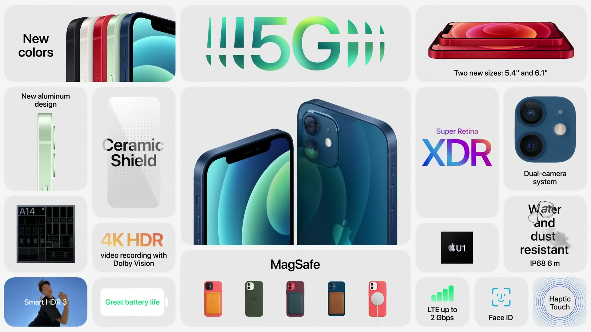
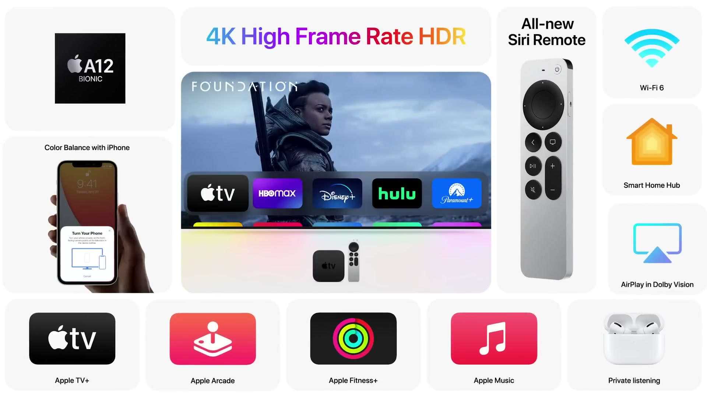
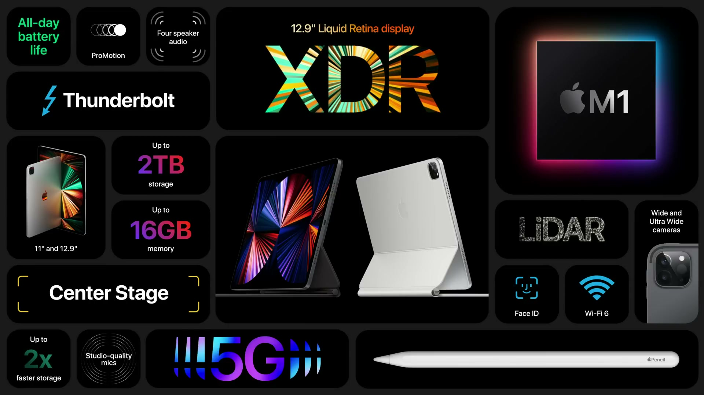

2021年4月20日（現地時間）、Apple Park から配信された、2021年最初のイベント。Apple Card Family と Apple Podcasts の刷新に続き、iPhone 12 の新色パープル、AirTag、Apple TV 4K、24インチ iMac、iPad Pro が発表された。

---

## iPhone 12

*出典：Apple*

**ハイライト**

- **新色パープル**：iPhone 12 のラインナップに新しいカラーとしてパープルが加わる
- **仕上げ**：精密加工されたバックガラスと、色を合わせたアルミニウムのエッジを採用
- **既存の特長を継承**：Ceramic Shield 搭載の Super Retina XDR ディスプレイ、カメラシステム、5G に対応

### 新色パープル

春向けの新しいカラーとして、パープルが iPhone 12 に追加された。バックガラスは精密加工で仕上げられ、側面のアルミニウムエッジはボディの色に合わせてある。

### iPhone 12 の特長

iPhone 12 は Super Retina XDR ディスプレイ（Ceramic Shield 採用）、カメラシステム、5G を備えたモデルで、世界で最も人気のあるスマートフォンと紹介された。今回の変更はカラーの追加で、これらの特長はそのまま引き継がれる。

### 予約と発売

パープルは金曜日に予約受付を開始し、4月30日に発売される。

---

## AirTag

**ハイライト**

- **新製品**：Find My ネットワークを使って、鍵やバッグなどの持ち物を探せる iPhone 用アクセサリ
- **Precision Finding（新機能）**：U1 チップ搭載の iPhone で、近くにある AirTag までの正確な距離と方向を画面上で案内
- **プライバシー設計**：位置情報を Apple を含め誰にも共有せずにネットワークへ参加できる
- **望まない追跡への対策**：不明なタグの検出、識別子のローテーション、不明なタグからの音による警告
- **カスタマイズ**：絵文字を使って AirTag を自分好みにでき、専用アクセサリで持ち物に取り付けられる
- **Hermès コレクション**：Hermès とのコラボで、AirTag 付きのバッグチャーム、ラゲッジタグ、キーリングを用意

### Find My ネットワークと AirTag

Find My には、10億台に迫る Apple デバイスによるエンドツーエンド暗号化・匿名のネットワークがある。オフラインの iPhone、Apple Watch、iPad、Mac の位置特定に使われており、サードパーティ製品にも開放されている。AirTag はこのネットワークを使い、iPhone から持ち物を追跡・検索できるようにする。Find My アプリで AirTag を管理する。

### Precision Finding

U1 チップを搭載した iPhone（iPhone 12 など）では、AirTag が近くにあるとき、オーバーレイで目的の物まで誘導する。U1 チップで AirTag までの正確な距離を測り、カメラ、加速度センサー、ジャイロスコープの入力と組み合わせて、視覚・触覚・音のフィードバックで案内する。

### プライバシーと安全性

Find My ネットワークは、位置情報を Apple を含む誰にも共有せずに参加できる設計になっている。AirTag は人ではなく物を追跡するためのもので、望まない追跡を防ぐ機能として次を備える。

- 不明なタグの検出（unwanted tag detection）
- 識別子のローテーション
- 不明なタグからの音による警告

これらの機能は業界初と説明された。

### カスタマイズとアクセサリ

AirTag は単体でも使え、絵文字で個性を付けられる。Apple が設計したアクセサリでバックパックやスーツケースなどに取り付けられる。Hermès との協業による手作りの革製コレクション（バッグチャーム、ラゲッジタグ、キーリング）では、Hermès のロゴが刻印された AirTag が付属する。

---

## Apple TV 4K

*出典：Apple*

**ハイライト**

- **A12 Bionic 搭載**：チップが新世代になり、性能が向上
- **ハイフレームレート HDR 対応（新機能）**：Dolby Vision などの HDR をハイフレームレートで再生でき、スポーツなど動きの速い映像が滑らかになる
- **AirPlay 強化**：AirPlay がハイフレームレート HDR に対応
- **カラーバランス（新機能）**：iPhone のセンサーで TV の色を測定し、Apple TV が出力を自動補正
- **Siri Remote を刷新**：一体型アルミニウム筐体、5方向ナビゲーション対応のタッチ式クリックパッド、ジョグ操作ができる外周リング
- **TV 操作ボタン**：電源とミュートのボタンを追加し、TV の操作もこれ1つで行える
- **環境への配慮**：リモコンの筐体は100％再生アルミニウム製

### チップと映像性能

新しい Apple TV 4K は A12 Bionic を搭載する。Dolby Vision などの HDR にはこれまでも対応していたが、A12 Bionic によりハイフレームレートの HDR を再生できるようになった。映像がより滑らかになり、スポーツのような動きの速いコンテンツに向く。世界各地の配信事業者と協力し、ハイフレームレート HDR のストリーミングへの対応が進められている。

iPhone 12 Pro は Dolby Vision・60fps での撮影に対応しており、AirPlay もハイフレームレート HDR に対応したため、撮影した映像を新しい Apple TV 4K で高画質のまま楽しめる。

### カラーバランス

TV ごとに設定が異なり、最適な画質かどうか判断しにくい問題に対応する新機能。

- iPhone のカメラと近接センサーで、画面上のターゲットまで誘導する
- 色の測定は自動で始まり、iPhone のライトセンサーで TV の色バランスを測る
- 撮影業界で使われる標準規格と比較する
- 測定結果をもとに、Apple TV が映像出力を自動で調整し、TV の設定の誤差を補正する

TV 側の設定を調整しなくても、より正確な色になり、色の自然さとコントラストが改善する。

### Siri Remote

Siri Remote が新しくなった。

| 項目 | 内容 |
|------|------|
| 筐体 | 一体型のアルミニウム。コントラストのあるボタンで押し分けやすい |
| クリックパッド | 5方向ナビゲーション。パッド全体がタッチ対応で、素早い方向スワイプも維持 |
| 外周リング | 円を描くジェスチャーでジョグ操作ができ、見たいシーンを探しやすい |
| 電源・ミュート | 電源ボタンで TV の電源を操作でき、ミュートボタンも備える |
| Siri ボタン | iPhone と同様に側面へ移動 |

### Apple TV の位置づけ

Apple TV は iPhone と同じ Apple シリコンを採用し、tvOS で動作する。Apple Fitness+ でのワークアウト、AirPlay での画面共有、Apple Arcade でのゲーム、AirPods での視聴などに使える。ストレージは32GBと、その倍の容量のモデルがあり、後者はアプリやゲームを多く入れたい場合に向く。

---

## iMac

**ハイライト**

- **全面刷新**：M1 を中心に設計された初の Mac。厚さ11.5mm、体積は従来より50％以上減少
- **24インチ 4.5K Retina ディスプレイ**：約1,130万画素、P3 広色域、500ニト、True Tone、低反射コーティング
- **7色展開**：前面は落ち着いた色、背面は鮮やかな色
- **カメラ**：1080p FaceTime HD カメラ（解像度が2倍）と M1 の ISP による映像処理
- **マイク・スピーカー**：3マイクアレイ、6スピーカー、Dolby Atmos 再生時の空間オーディオ対応
- **性能向上**：CPU は従来の21.5インチモデル比で最大85％高速、GPU は最大2倍、機械学習は最大3倍
- **Touch ID 付き Magic Keyboard（新機能）**：Mac デスクトップ向けとして初
- **接続性**：USB-C 最大4ポート（Thunderbolt 2ポート）、マグネット式電源コネクタ

### デザインと薄型化

前面は1枚のガラスで覆われ、淡い色と薄いグレーの縁でシンプルにまとめられている。背面は彩度の高い色で、色を見せる設計。M1 のシステムオンチップ構成により、CPU や GPU などが1つのチップに集約され、ロジックボードが小型化した。消費電力が低いため大きな冷却機構が不要になり、小型ファン2基だけで冷却する。通常使用時の動作音は10dB未満。

これにより全体の体積が50％以上減り、厚さは11.5mmになった。設置面積も小さくなっている。

### ディスプレイ

画面は24インチに拡大した。縁を狭めたことで、従来の21.5インチ iMac より少し大きいだけの筐体に収めている。

| 項目 | 内容 |
|------|------|
| 解像度 | 4.5K Retina、約1,130万画素 |
| 色 | P3 広色域、10億色以上 |
| 輝度 | 500ニト |
| 色温度 | True Tone で環境に合わせて自動調整 |
| コーティング | 業界最高水準の低反射 |

### カメラ・マイク・スピーカー

- **カメラ**：1080p の FaceTime HD カメラ。解像度が2倍になり、大型センサーで暗所性能も高い。M1 の ISP と Neural Engine により、1秒あたり1兆回超の演算で露出・ホワイトバランスの調整、ノイズ低減、トーンマッピングによるダイナミックレンジ拡大を行う。Mac 史上最高のカメラ
- **マイク**：スタジオ品質の3マイクアレイ。システム内部からのフィードバックを抑え、ビームフォーミングで周囲の雑音を抑えて声に集中する。Mac 史上最高のマイクシステム
- **スピーカー**：フォースキャンセリング・ウーファー2組とハイパフォーマンス・ツイーターによる6スピーカー構成。Dolby Atmos のビデオ再生時に空間オーディオに対応する。Mac 史上最高のサウンドシステム

### M1 と macOS Big Sur の性能

M1 と macOS Big Sur の組み合わせで、スリープ復帰やアプリ起動が速くなる。従来の21.5インチ iMac と比べた数値は次のとおり。

| 項目 | 向上幅 |
|------|--------|
| CPU（Xcode、Lightroom、iMovie など） | 最大85％高速 |
| GPU（Affinity Photo、Photoshop など） | 最大2倍。最速の21.5インチ iMac のディスクリート GPU と比べても最大50％高速 |
| 機械学習（16コア Neural Engine 利用アプリ） | 最大3倍 |

Final Cut Pro では、4K 映像を最大5ストリーム、または8K 映像を1ストリーム、フレーム落ちなしで編集できる。iPhone・iPad と同じチップアーキテクチャのため、iPhone・iPad アプリを Mac 上で動かせ、キーボードをゲームコントローラとして使うこともできる。iCloud と Continuity により、iPhone の通話やメッセージの受信、Handoff、ユニバーサルクリップボードも使える。

### 接続性とアクセサリ

- **ポート**：USB-C は最大4ポートで、うち2ポートが Thunderbolt。Pro Display XDR など最大6K ディスプレイに対応
- **電源**：マグネット式の新しい電源コネクタ。本体色に合わせた2mの織りケーブルで、小型アダプタは机の裏の床に置ける。Ethernet はアダプタに接続し、電源ケーブル経由で本体につながる
- **キーボード**：色を合わせたアルミニウム筐体の Magic Keyboard が3種類。絵文字・Spotlight・音声入力・おやすみモード・ロックの各キー付きモデル、Touch ID 付きモデル、Touch ID とテンキー付きモデル
- **Touch ID**：Mac デスクトップ向けとして初。キーボード内のセキュアプロセッサが M1 の Secure Enclave と暗号化経路でやり取りして指紋データを保護し、Apple Pay、ロック解除、Fast User Switching に使える
- **マウス・トラックパッド**：Magic Mouse は色を合わせたアルミニウム仕上げ。Magic Trackpad は新しいキーボードに合わせて形状を調整

### 環境への配慮

梱包に使われるバージン木質繊維の100％は適切に管理された森林由来。スピーカー、ファンモーター、電源コネクタのマグネットには100％再生レアアースを使う。

---

## iPad Pro

*出典：Apple*

**ハイライト**

- **M1 チップ搭載（新）**：8コア CPU は従来の iPad Pro 比で50％高速、初代 iPad 比では最大75倍
- **GPU 向上**：8コア GPU で最大40％高速、初代 iPad 比で1,500倍超
- **Liquid Retina XDR ディスプレイ（12.9インチのみ）**：ピーク輝度1,600ニト、全画面輝度1,000ニト、コントラスト比1,000,000:1
- **Thunderbolt／USB 4 対応**：転送帯域は4倍の最大40Gbps、Pro Display XDR を6K 解像度で利用可能
- **5G 対応**：セルラーモデルでダウンロード最大3.5Gbps、米国ではミリ波対応で最大4Gbps（いずれも理想条件）
- **ストレージ**：最大2倍高速化し、2TB 構成を新たに用意
- **超広角フロントカメラと Center Stage（新機能）**：12MP、画角122度で、人物をフレームの中央に保つ
- **Magic Keyboard に新色ホワイト**

### M1 による性能

iPad Pro は従来 A シリーズチップの強化版を使ってきたが、M1 で大きく性能が上がった。M1 は A シリーズと基本アーキテクチャが共通のため、iPadOS はその性能をそのまま活用できる。

| 項目 | 向上幅 |
|------|--------|
| CPU（8コア） | 従来の iPad Pro 比50％向上。初代 iPad 比で最大75倍 |
| GPU（8コア） | 最大40％高速。初代 iPad 比で1,500倍超 |
| ストレージ速度 | 最大2倍 |

16コアの Neural Engine、高度な ISP、ユニファイドな高帯域メモリアーキテクチャも備え、電力効率が高いので薄型軽量の筐体で1日使えるバッテリー駆動を保つ。ProMotion ディスプレイ、4スピーカーに加え、PlayStation や Xbox の最新ワイヤレスコントローラ（ハプティクス対応）も使える。

ストレージには新たに2TB 構成が加わり、ProRAW 写真なら最大6万枚、4K HDR 動画なら最大220時間を保存できる。

### Thunderbolt と 5G

USB-C ポートが Thunderbolt（USB 4 対応）になり、iPad 初、かつ同種のデバイスで最も多用途なポートとなる。有線接続の帯域は4倍の最大40Gbps。高速ストレージ、外部ディスプレイ、ケーブル、ドックなどのアクセサリが使え、Pro Display XDR をフル6K 解像度で接続できる。

セルラーモデルは5Gに対応する。

| 項目 | 速度（理想条件） |
|------|------------------|
| 5G ダウンロード | 最大3.5Gbps |
| ミリ波（米国のみ） | ピーク時最大4Gbps |

実際の5G 速度は通信事業者と地域によって変わる。

### カメラと Center Stage

- **Pro カメラ**：スタジオ品質の内蔵マイク、LiDAR スキャナを備える。LiDAR は CamTrackAR によるモーショントラッキング、Arki による現地での原寸大の可視化、新バージョンの Clips などで使われる
- **Smart HDR 3**：M1 の ISP が強化され、ISP と Neural Engine が写真の部分ごとに色、コントラスト、ノイズを調整する。暗所では ISP と LiDAR スキャナで素早く正確にピントを合わせる
- **TrueDepth カメラ**：Face ID とポートレート自撮りに対応。今回、iPad 専用設計の超広角カメラが加わった
- **Center Stage**：12MP センサー、画角122度の超広角カメラと機械学習で、動いても自動でパンして人物を中央に捉える。他の人が加わると認識し、全員が収まるようにズームアウトする

### Liquid Retina XDR ディスプレイ

11インチは約400万画素、12.9インチは約560万画素の Liquid Retina ディスプレイ。12.9インチモデルは Pro Display XDR の性能を取り入れた Liquid Retina XDR ディスプレイになった。

| 項目 | 12.9インチ Liquid Retina XDR |
|------|------------------------------|
| 全画面輝度 | 1,000ニト |
| ピーク輝度 | 1,600ニト |
| コントラスト比 | 1,000,000:1 |
| LED 数 | 10,000個超（従来は72個） |
| ローカルディミングゾーン | 2,500超 |

- 背面全体に Mini-LED を並べるバックライト方式。Mini-LED は従来の設計より体積が120分の1以下
- 薄い光学フィルムとディフューザーで光を整え、厚さ6.4mm、重さ1.5ポンドでも1日使えるバッテリーを維持
- HDR10、HLG、Dolby Vision の HDR 形式に対応し、サウンドシステムは Dolby Atmos 対応
- LumaFusion での HDR 動画編集、Lightroom での写真編集、Frame.io での HDR コンテンツ確認に対応

### アクセサリと環境への配慮

- **Apple Pencil**：Scribble は新たに5言語に対応し、あらゆるテキストフィールドに手書き入力できる
- **キーボード**：Smart Keyboard Folio と Magic Keyboard（バックライト付きキー、トラックパッド内蔵）に対応。Magic Keyboard には新色ホワイトが加わる
- **環境**：筐体全体に100％再生アルミニウム、スピーカーと筐体のマグネットに100％再生レアアースを使用

---

## 価格・発売日

| 製品 | 価格 | 税込換算 | 発売日 |
| ------ | ------ | ------ | -------- |
| iPhone 12（パープル） | 言及なし | — | 予約：4月23日（金）／発売：4月30日 |
| AirTag | $29（1個）、$99（4個パック） | 約3,000円／約1万2,000円 | 予約：4月23日（金）／発売：4月30日 |
| Apple TV 4K | $179（32GB）、$199（倍の容量） | 約2万1,000円／約2万4,000円 | 予約：4月30日／発売：5月後半 |
| iMac（4色） | $1,299 | 約15万5,000円 | 予約：4月30日／発売：5月後半 |
| iMac（7色、追加機能付き） | $1,499 | 約17万9,000円 | 予約：4月30日／発売：5月後半 |
| iPad Pro 11インチ | $799 | 約9万5,000円 | 予約：4月30日／発売：5月後半 |
| iPad Pro 12.9インチ | $1,099 | 約13万1,000円 | 予約：4月30日／発売：5月後半 |

※日本円は、米国の価格（税抜き）を発表日（2021年4月20日）の為替レート（1ドル＝108.41円、欧州中央銀行の参考レート）で換算し、消費税10%を加えた参考値。実際の日本での販売価格とは異なる。
