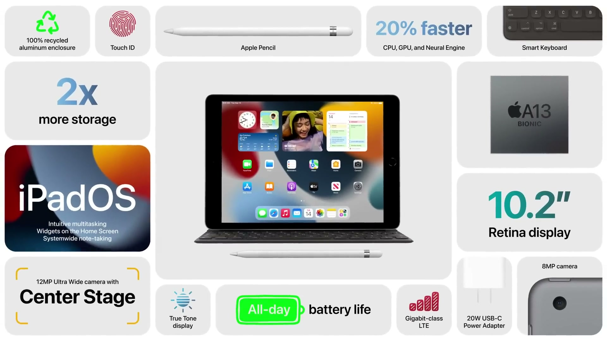
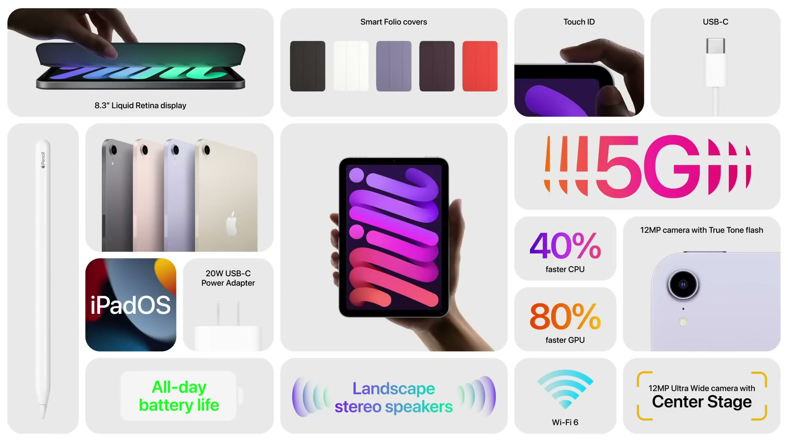
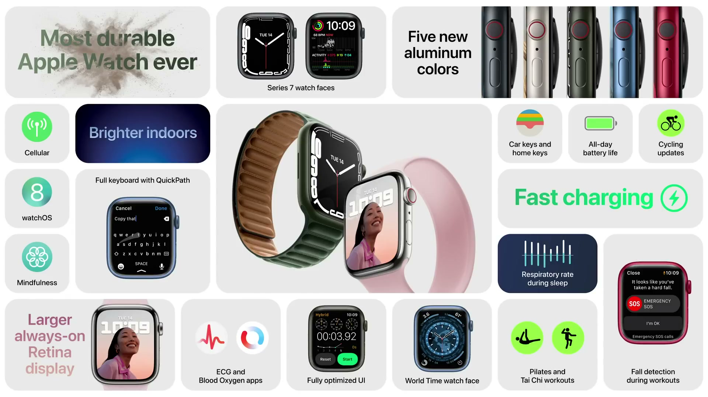
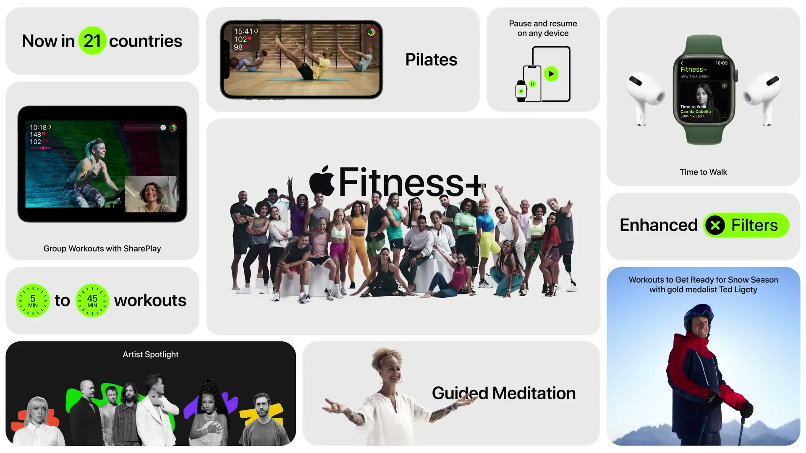
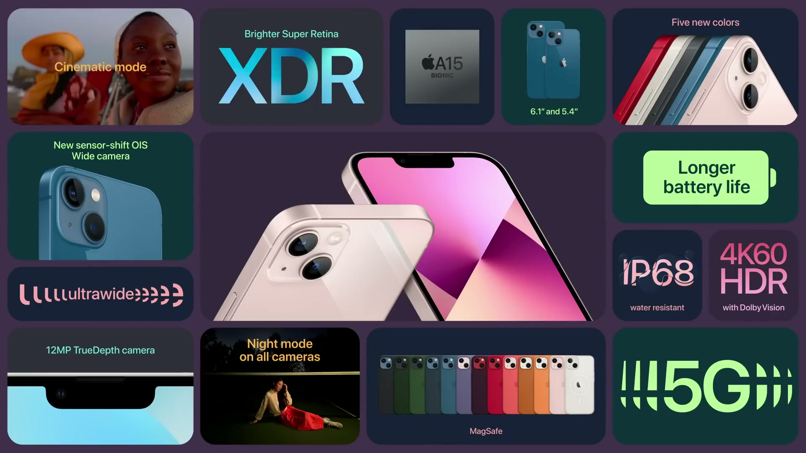
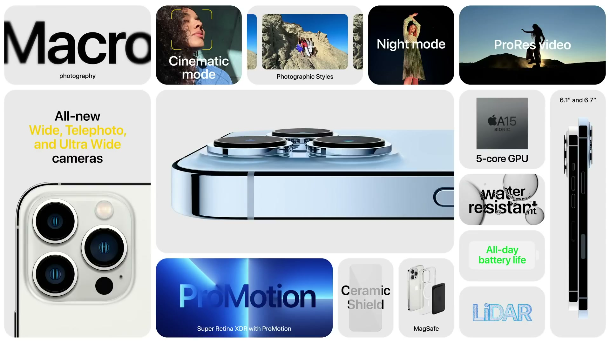

2021年9月14日（現地時間）に開催された Apple Event のまとめ。冒頭では、イベントのテーマとして Apple の拠点であるカリフォルニアが語られた。iPad、iPad mini、Apple Watch Series 7、Apple Fitness+ の新機能、iPhone 13 シリーズが発表された。

---

## iPad

*出典：Apple*

**ハイライト**

- **A13 Bionic**：A12 から CPU・GPU・Neural Engine のすべてで約 20% 高速化
- **性能比較**：ベストセラーの Chromebook より最大 3 倍、ベストセラーの Android タブレットより最大 6 倍高速
- **12MP 超広角フロントカメラ**：画質が向上し、iPad Pro と同じセンターフレームに対応
- **True Tone**：新たに搭載され、部屋の色温度にディスプレイを合わせる
- **ストレージ**：容量が 2 倍になり、64GB から
- **iPadOS 15**：ウィジェット、新しいマルチタスク操作、クイックメモを搭載して出荷

### チップとカメラの性能

A13 Bionic により、日常的な操作からゲーム、Adobe Fresco のような高度なアプリまで応答性が上がる。Neural Engine の強化で、iPadOS 15 のテキスト認識表示（Live Text）などの機械学習機能も高速になる。画像信号プロセッサも更新され、背面カメラは暗所でのオートフォーカスが改善し、フロントカメラの自撮りも向上する。

### センターフレーム

12MP の超広角フロントカメラと Neural Engine によって、人物を自動で検出し、動きや参加人数に応じてフレームを動的に調整する。横向き・縦向きのどちらでも使える。

- FaceTime のほか、Zoom、BlueJeans、Webex などのビデオ通話アプリで利用できる
- DoubleTake、Explain Everything、TikTok などで、録画・配信・投稿にも使える

### ディスプレイとアクセサリ

True Tone が加わり、周囲に合わせた色温度で表示する。デザインは従来を踏襲しているため、Smart Keyboard やサードパーティ製キーボード（Logitech の学校向けトラックパッド付きコンボなど）が使える。第1世代 Apple Pencil にも対応する。

### iPadOS 15 と接続性

iPadOS 15 では、ホーム画面のアプリの間にウィジェットを置け、新しいマルチタスク操作で複数のアプリを起動・利用しやすくなり、クイックメモでどこからでもメモを取れる。Gigabit クラスの LTE に対応したセルラーモデルも用意される。

### カラーとモデル

| 項目 | 内容 |
|------|------|
| カラー | スペースグレイ、シルバー |
| モデル | Wi-Fi、セルラー |
| ストレージ | 64GB から（従来の 2 倍） |
| 教育機関向け | 価格を下げた設定あり |
| 筐体 | 100% 再生アルミニウム |

---

## iPad mini

*出典：Apple*

**ハイライト**

- **デザイン**：全面ディスプレイの新デザインに刷新し、細いベゼルと丸みのある角を採用
- **カラー**：パープル、ピンク、スターライト、スペースグレイの 4 色
- **Liquid Retina ディスプレイ**：筐体サイズを保ったまま 8.3 インチに拡大。輝度 500 ニト
- **性能向上**：前世代比で CPU が 40%、GPU が 80% 向上。Neural Engine は最大 2 倍
- **USB-C**：搭載し、データ転送は前世代の最大 10 倍高速
- **5G 対応**：ダウンロード速度は最大 3.5Gbps
- **カメラ強化**：背面は 12MP で 4K 録画に対応。前面は 12MP 超広角でセンターフレームに対応
- **Apple Pencil（第2世代）対応**：本体側面にマグネットで取り付けられる

### デザインとディスプレイ

画面サイズは 8.3 インチへ広がったが、コンパクトな筐体は維持される。ワイドカラー、True Tone、輝度 500 ニト、業界で最も低い反射率に対応する。ホームボタンを廃したため、Touch ID は iPad Air と同様にトップボタンへ移った。Apple Pay にも使える。

### チップと機械学習

A15 Bionic を搭載する。

CPU は前世代から 40%、GPU は 80% 向上した。ForeFlight（飛行計画に風速表示を重ねる）や「Star Wars: Hunters」のようなグラフィックの重いゲームも快適に動く。Neural Engine は最大 2 倍に高速化し、iPadOS 15 の翻訳アプリによる会話のリアルタイム翻訳などを支える。

### 接続性

| 項目 | 内容 |
|------|------|
| USB-C | iPad Air と同等の機能。前世代の最大 10 倍の速度で、カメラや Butterfly の超音波機器などの周辺機器をつなげる |
| 5G | ダウンロード速度は最大 3.5Gbps。Splunk AR での現場データ参照や、SharePlay を使った MasterClass の視聴に利用できる |

### カメラとオーディオ

- **背面カメラ**：12MP センサー（Focus Pixels）と大きな絞り。True Tone フラッシュを新たに搭載し、新しい ISP で Smart HDR により暗部と明部のディテールを復元する。4K 録画に対応する
- **前面カメラ**：12MP 超広角で、センターフレームに対応する
- **スピーカー**：横向きでステレオになる新しいスピーカーシステム

### アクセサリと環境への取り組み

第2世代 Apple Pencil に対応し、本体側面へ磁力で取り付けると、接続と充電が同時に行われる。本体色に合わせた薄型の Smart Folio カバーも用意される。モデルは Wi-Fi とセルラーの 2 種類。筐体は 100% 再生アルミニウムで、iPad と iPad mini の採用により、iPad のラインナップすべてが再生アルミニウム筐体になった。

---

## Apple Watch Series 7

*出典：Apple*

**ハイライト**

- **ディスプレイ**：Series 6 より画面面積が約 20% 拡大（Series 3 比で 50% 以上）。ベゼルは 1.7mm で、Series 6 より 40% 薄い
- **明るさ**：手首を下ろした状態の屋内で最大 70% 明るい
- **UI**：ボタンを拡大して再設計し、Series 6 より約 50% 多くの文字を表示できる
- **入力**：フルキーボードと QuickPath（スライド入力）を新たに搭載
- **耐久性**：Apple Watch で最も割れにくい前面ガラス。Apple Watch で初めて IP6X（防塵）に対応し、WR50 の耐水も維持
- **充電**：Series 6 より最大 33% 高速。0 から 80% まで 45 分
- **新カラー**：アルミニウムに 5 色（ミッドナイト、スターライト、グリーン、ブルー、PRODUCT(RED)）
- **watchOS 8**：サイクリング向けの機能（自動検出、自動一時停止、転倒検出、e バイク対応）

### 新しいディスプレイ

ベゼルを 1.7mm まで縮めたことで、本体寸法をほとんど変えずに画面面積を広げた。ケースとディスプレイの角は丸みが増し、ディスプレイは縁で光を屈折させて、ケースの曲面となじむ。

| 項目 | Series 7 |
|------|----------|
| 画面面積 | Series 6 比で約 20% 増、Series 3 比で 50% 以上増 |
| ベゼル | 1.7mm（Series 6 比で 40% 薄い） |
| 屋内での明るさ（手首を下ろした状態） | 最大 70% 向上 |

### ユーザーインターフェースと文字盤

ストップウォッチ、アクティビティ、アラームなどのボタンを大きく作り直し、タップしやすくした。表示できる文字量は Series 6 より約 50% 増え、メッセージやメールのスクロールが減る。キーボードはタップ入力のほか、文字から文字へなぞる QuickPath に対応し、機械学習で入力中の単語を予測する。Series 7 専用の文字盤として、手首を上げるとダイヤルが縁まで広がる Contour と、中央に大型のコンプリケーションを 2 つ置ける Modular が加わった。

### 耐久性とバッテリー

前面クリスタルは形状を見直して強度を上げた。IP6X 認証で粉塵のある環境でも使え、WR50 の耐水性能で水泳にも対応する。バッテリーは従来と同じ 18 時間。

- 新しい充電アーキテクチャと高速充電対応の USB-C ケーブルで、Series 6 より最大 33% 速く充電できる
- 0 から 80% まで 45 分
- 8 分の充電で 8 時間分の睡眠トラッキングが可能

### watchOS 8 のサイクリング機能

- 自転車の走行開始を検出し、ワークアウトの開始を促す
- 一時的に止まると自動で一時停止し、再開する
- 走行中の転倒に特有の動きと衝撃を検知する転倒検出に対応する
- e バイク向けにワークアウトのアルゴリズムを改善し、消費カロリーをより正確に計算する

watchOS 8 にはほかにも、マインドフルネスアプリや写真の「メモリー」がある。

### ケース素材・バンド・環境への取り組み

アルミニウムに加え、ステンレススチール（シルバー、グラファイト、ゴールド）とチタニウム（ナチュラル、スペースブラック）のケースが用意される。Apple Watch Nike にはグラフィックの Sport Loop と Nike Bounce 文字盤が加わり、Apple Watch Hermès には Circuit H のレザーバンドと対応する文字盤、Double Tour バンドが加わる。人気のバンドには新色が追加され、既存のバンドはすべて Series 7 で使える。アルミニウムケースは 100% 再生金属、磁石は 100% 再生レアアースを使用している。

### 2021年のラインナップ

Apple Watch Series 3 は引き続きエントリーモデルとして販売され、Apple Watch SE、Apple Watch Series 7 と並ぶ 3 モデルの構成になる。

---

## Apple Fitness+

*出典：Apple*

**ハイライト**

- **ピラティス**：新たに追加。初心者向けの修正版と上級者向けの選択肢を備え、毎週新しいワークアウトが配信される
- **ガイド付きメディテーション**：新機能。落ち着き、感謝、思いやりなどのテーマから選べ、毎週追加される
- **グループワークアウト**：SharePlay を使った新機能で、最大 32 人が同時に参加できる
- **提供国の拡大**：現在の 6 か国から、今秋 15 か国を追加。ワークアウトは英語で、6 言語の字幕に対応
- **雪の季節に備えるワークアウト**：スキーとスノーボード向けの新プログラム
- **提供時期**：ピラティス、メディテーション、新プログラムは今月中、グループワークアウトと新 15 か国は今秋

### 現在の Fitness+

Apple Watch を中心に設計されたフィットネスサービス。HIIT からヨガまで 10 種類のワークアウトがあり、長さは 5 分から 45 分。各ワークアウトに強度の修正版が用意され、4K の高解像度で 1,200 以上のワークアウトがあり、毎週新しいコンテンツが追加される。Apple Watch とリアルタイムに連携し、心拍数と消費カロリーの表示、きつい区間のタイマー、アクティビティリング完成時の演出が画面に出る。散歩しながら音声コンテンツを聴く Time to Walk もある。

### ピラティス

低負荷で体幹を鍛え、筋力と柔軟性の向上に向く。筋力トレーニング、体幹、ヨガと並ぶボディコンディショニング系ワークアウトとして加わる。

### ガイド付きメディテーション

動画では好みのトレーナーと一緒に瞑想する没入型の体験になる。Apple Watch の新しいマインドフルネスアプリには、同じ内容の音声版が毎週追加される。

### 雪の季節に備えるワークアウト

スキーとスノーボードの運動に着想を得た新プログラムで、筋力をつけ、ゲレンデで長く滑れる体づくりを目指す。オリンピック金メダリストの Ted Ligety 氏と共同で設計された。

### グループワークアウト

グループメッセージのスレッドや FaceTime 通話から Fitness アプリに移って開始する。自分の指標は画面に表示されたまま、友人が Burn Bar で先行する様子やアクティビティリングを閉じる様子が見える。

- 対応デバイス：iPhone、iPad、AirPlay 経由の Apple TV
- 最大 32 人が同時に参加できる

### 無料トライアルとバンドル

新規の Fitness+ 加入者には 1 か月の無料トライアルがあり、新しい Apple Watch の購入では 3 か月無料になる。Apple One プレミアのサブスクリプションにも含まれる。

---

## iPhone 13 / iPhone 13 mini

*出典：Apple*

**ハイライト**

- **A15 Bionic**：5nm、約 150 億トランジスタ。6 コア CPU（高性能 2＋高効率 4）、4 コア GPU、16 コア Neural Engine（毎秒 15.8 兆回）
- **ディスプレイ**：Super Retina XDR の輝度が 28% 向上して最大 800 ニト、HDR のピークは 1200 ニト
- **Wide カメラ**：1.7 ミクロンの画素と f/1.6 で、光の取り込みが 47% 増。センサーシフト光学式手ぶれ補正を搭載
- **新しい Ultra Wide カメラ**：暗部のノイズを抑えて描写を改善
- **シネマティックモード**：新機能。被写体にピントを保ち、自動でピント位置を移す。Dolby Vision HDR で撮影
- **5G の拡充**：バンドを追加し、年末までに 60 の国と地域で 200 以上のキャリアに対応
- **バッテリー**：iPhone 12 mini より約 1.5 時間、iPhone 12 より約 2.5 時間長持ち
- **ストレージ**：最小容量が 128GB に倍増し、512GB を新たに追加

### 2つのモデルとデザイン

iPhone 13 と iPhone 13 mini は同じデザインで、サイズだけが異なる。フラットエッジのデザイン、Ceramic Shield の前面、IP68 の耐水性能を備える。デュアルカメラのレンズは斜めに配置された。航空宇宙グレードのアルミニウムフレームで、ピンク（新色）、ブルー、ミッドナイト、スターライト、(PRODUCT)RED の 5 色が用意される。

- TrueDepth カメラシステムを作り直し、Face ID を含む部品の占有スペースを 20% 縮小して、表示領域を広げた
- 内部の構成を一新し、より大きなバッテリーを搭載した
- アンテナラインにペットボトル由来の再生プラスチックを使用（業界初）

### Super Retina XDR ディスプレイ

通常輝度は 28% 向上して最大 800 ニト、写真や動画などの HDR コンテンツではピーク輝度 1200 ニトになる。省電力性も上がり、高輝度を長く維持できる。OLED により、ゲームや写真、動画で黒を深く表示する。Dolby Vision、HDR10、HLG に対応する。

### A15 Bionic

| 項目 | 内容 |
|------|------|
| プロセス | 5nm、約 150 億トランジスタ |
| CPU | 6 コア（高性能 2、高効率 4）。他社の主要製品より最大 50% 高速 |
| GPU | 4 コア。他社の主要製品より最大 30% 高速 |
| Neural Engine | 16 コア、毎秒 15.8 兆回の演算 |
| その他 | 新しいディスプレイエンジン、新しいビデオエンコーダ／デコーダ、システムキャッシュ 2 倍 |

CPU の機械学習アクセラレータも強化され、Siri の高度な音声合成や、マップの経路案内のオンデバイス処理に使われる。Neural Engine はカメラのハードウェア・ソフトウェアと合わせて設計され、iOS 15 のテキスト認識表示（Live Text）が高速になる。デベロッパ向けには、SwingVision（ショットの追跡や動画解析）、PeakVisor（山の識別と 3D マップ）、Seek（2,000 万枚以上の写真で学習したモデルによる動植物の識別。処理はすべてオンデバイス）のように、Core ML と AR のモデルを動かす活用例が示された。

### カメラシステムとシネマティックモード

- **Wide カメラ**：1.7 ミクロンの画素と f/1.6 の絞りで、光の取り込みが 47% 増える。デュアルカメラシステムで最大のセンサー
- **センサーシフト光学式手ぶれ補正**：iPhone 12 Pro Max で導入された技術が iPhone 13 と 13 mini にも載る。暗所撮影の画質が上がり、ナイトモードは撮影時間も短くなる
- **Ultra Wide カメラ**：新たにカスタム設計され、暗部のノイズを抑える

シネマティックモードは、映画のラックフォーカス（ピント送り）をシンプルな操作で再現する。録画を始めると被写体にピントを保ち、被写体間のピント移動を自動かつリアルタイムで行う。フレームに入ろうとする被写体を先読みしてピントを送り、被写体が視線を外すとピントも切り替わる。タップでいつでもピント位置を変更でき、もう一度タップするとピントを固定して追従する。Apple 独自のセンサーと A15 Bionic が Dolby Vision HDR のグレーディングを録画中にリアルタイムで行う。前面の TrueDepth カメラでも使える。

### 5G とバッテリー

5G 用のアンテナと無線部品を独自設計し、対応バンドを増やして、より多くの場所で最新の速度を使えるようにした。キャリアとの協力で、年末までに 5G 対応を 200 以上のキャリア、60 の国と地域へ倍増させる。

バッテリーは、A15 Bionic、省電力な部品、大型化したバッテリーに加え、ハードウェアとソフトウェアの最適化で長持ちになる。その一つのスマートデータモードは、5G の速度が不要なときに自動で LTE に切り替えて電力を節約する。

| モデル | 駆動時間の変化 |
|--------|----------------|
| iPhone 13 mini | iPhone 12 mini より約 1.5 時間長い |
| iPhone 13 | iPhone 12 より約 2.5 時間長い |

### プライバシーと MagSafe

iOS 15 では、Siri がオンデバイスで音声認識するため、音声リクエストは既定で iPhone の外に出ない。「インテリジェントなトラッキング防止」は IP アドレスによるプロファイリングを防ぎ、「メールのプライバシー保護」は IP アドレスを隠して送信者がメールの開封状況を把握できないようにする。

MagSafe 対応のレザー、シリコン、クリアケースに新色が加わり、「探す」に対応した新しい MagSafe レザーウォレットも登場した。ウォレットが iPhone から離れた最後の位置が通知される。

### ストレージ

最小容量が 128GB になって従来の 2 倍になり、512GB が新たに選べる。

---

## iPhone 13 Pro / iPhone 13 Pro Max

*出典：Apple*

**ハイライト**

- **ProMotion**：iPhone で初めて搭載。リフレッシュレートは 10Hz から 120Hz まで可変
- **ディスプレイ**：新しい OLED パネルで屋外のピーク輝度が最大 1000 ニト（前年比 25% 向上）。サイズは 6.1 インチと 6.7 インチ
- **A15 Bionic（5 コア GPU）**：他社の主要製品より最大 50% 高速なグラフィックス
- **3 つの新カメラ**：77mm の望遠（3 倍光学ズーム）、オートフォーカス付き Ultra Wide（f/1.8、低照度で 92% 向上）、f/1.5・1.9 ミクロンの Wide（低照度で最大 2.2 倍）
- **マクロ撮影**：新機能。最短 2cm まで近づける
- **写真のスタイル**：新機能。好みの仕上がりを撮影時にリアルタイムで適用
- **ProRes ビデオ**：年内に提供。4K・30fps まで本体で撮影可能
- **バッテリー**：iPhone 12 Pro より 1.5 時間以上、Pro Max は 12 Pro Max より 2.5 時間以上長持ち。Pro Max は iPhone で最長
- **ストレージ**：1TB を新たに追加

### 外装デザイン

外装には医療用グレードのステンレススチールを使い、物理蒸着（PVD）処理で耐摩耗性と耐腐食性の高い仕上げにしている。カラーはグラファイト、ゴールド、シルバー、シエラブルー（新色）の 4 種類。シエラブルーはナノメートル級の金属セラミックスを何層も重ねる新しい工程で仕上げる。

- 背面は、ステンレススチールの縁取りがサファイアクリスタルのレンズを囲み、質感のあるマットガラスで仕上げる
- 前面は TrueDepth カメラシステムが 20% 小型化し、Ceramic Shield を採用する
- IP68 の耐水性能と MagSafe に対応する
- 内部を再設計し、新カメラシステムとディスプレイ、より大きなバッテリーを収める

### A15 Bionic と ProMotion ディスプレイ

CPU は高性能コア 2 つと高効率コア 4 つで、Neural Engine と新しい ISP（ノイズ低減とトーンマッピングが向上）も改良された。Pro モデルは 5 コア GPU を備え、他社の主要製品より最大 50% 高速なグラフィックスになる。Apple ProRAW や 4K Dolby Vision ビデオなどのカメラ機能にも生かされる。

| 項目 | 内容 |
|------|------|
| パネル | 効率の高い新しい OLED。屋外のピーク輝度は最大 1000 ニト（前年比 25% 向上） |
| ProMotion | 10Hz から 120Hz まで、コンテンツに合わせて動的に変化 |
| サイズ | 6.1 インチと 6.7 インチ |

ProMotion は高いフレームレートが必要なときだけ使い、不要なときは電力を節約する。iOS も最適化され、アプリの切り替えやスクロールでは、指の速度に合わせてフレームレートが変わる。入力の応答性、描画の滑らかさ、ゲームの操作精度が向上する。Marvel: Future Revolution、Adobe Fresco、Catalyst Black などが対応の例として紹介された。

### カメラシステム

| カメラ | 仕様 |
|--------|------|
| 望遠 | 77mm、3 倍光学ズーム（広角側と合わせて 6 倍の光学ズーム範囲） |
| Ultra Wide | オートフォーカス付き、f/1.8、低照度で 92% 向上 |
| Wide | f/1.5、1.9 ミクロンの画素で最大のセンサー。低照度で最大 2.2 倍 |

- Wide の大きなセンサーで、ノイズが減り、シャッタースピードが速くなり、三脚を使うナイトモードでは長い露光ブラケットが使える
- 77mm の望遠は、ポートレートに向く焦点距離を提供する
- Ultra Wide の新しいレンズ設計とオートフォーカスでマクロ撮影が可能になり、最短 2cm まで被写体に寄れる。マクロのスローモーションビデオにも使える
- 望遠を含むすべてのカメラがナイトモードに対応するのは初めて

### Smart HDR 4 と写真のスタイル

Smart HDR 4 は、集合写真で被写体ごとに色、コントラスト、ライティングを自動で改善する。肌のトーンの処理も改善された。

写真のスタイルは、好みの仕上がりを画像パイプラインに組み込み、撮影時にリアルタイムで部分的な編集を適用する。単純なフィルタとは異なり、マルチフレーム処理の利点を保ったまま調整できる。

- 4 種類の既定スタイルから撮影前に選べる（例：コントラストを強めるリッチなコントラスト、鮮やかなビビッド）
- 肌のトーンを保ちながら、写真の部分ごとに適切な量の調整を行う
- トーンと暖かみでさらにカスタマイズでき、一度設定すれば撮影のたびに設定し直す必要がない
- iPhone 13 にも提供される

### ビデオ撮影：シネマティックモードと ProRes

シネマティックモードでは、機械学習と視差から深度マップを作って動画に埋め込むため、撮影後にもボケの強さとピントを合わせる位置を変えられる。この撮影後の編集ができるスマートフォンは iPhone 13 と iPhone 13 Pro だけ。

ProRes ビデオは年内に提供される。色の再現性が高く、Final Cut Pro のようなプロ向け編集アプリで効率よく扱える。A15 Bionic に ProRes のハードウェアアクセラレーションが加わり、ビデオエンコーダ／デコーダ、高速なファイルシステムとフラッシュストレージの経路によって、カメラアプリで 4K・30fps までの ProRes 撮影ができる。ProRes と Dolby Vision で撮影から編集まで完結するワークフローを備えたスマートフォンは iPhone 13 Pro だけ。

### バッテリーと環境への取り組み

| モデル | 駆動時間の変化 |
|--------|----------------|
| iPhone 13 Pro | iPhone 12 Pro より 1.5 時間以上長い |
| iPhone 13 Pro Max | iPhone 12 Pro Max より 2.5 時間以上長い（iPhone で最長） |

パッケージの外側のプラスチックフィルムを廃止し、プラスチックを 600 トン削減した。磁石には 100% 再生レアアース、メインロジックボードのはんだには 100% 再生スズを使う。ストレージは 128GB、256GB、512GB に 1TB が加わる。

---

## 価格・発売日

| 製品 | 価格 | 税込換算 | 発売日 |
| ------ | ------ | ------ | -------- |
| iPad | $329〜（教育機関向け $299） | 約4万円〜／約3万6,000円 | 来週発売（発表日から注文可能） |
| iPad mini | $499〜 | 約6万円〜 | 来週発売（発表日から注文可能） |
| Apple Watch Series 3 | $199 | 約2万4,000円 | 言及なし |
| Apple Watch SE | $279〜 | 約3万4,000円〜 | 言及なし |
| Apple Watch Series 7 | $399〜 | 約4万8,000円〜 | 年内発売 |
| Apple Fitness+ | 言及なし（新規加入者は 1 か月無料） | — | ピラティス、ガイド付きメディテーション、雪の季節向けプログラムは今月中、グループワークアウトと新 15 か国は今秋 |
| iPhone 13 | $699〜 | 約8万5,000円〜 | 予約：9月17日、発売：9月24日 |
| iPhone 13 mini | 言及なし | — | 予約：9月17日、発売：9月24日 |
| iPhone 13 Pro | $999〜 | 約12万1,000円〜 | 予約：9月17日、発売：9月24日 |
| iPhone 13 Pro Max | $1,099〜 | 約13万3,000円〜 | 予約：9月17日、発売：9月24日 |

※日本円は、米国の価格（税抜き）を発表日（2021年9月14日）の為替レート（1ドル＝110.11円、欧州中央銀行の参考レート）で換算し、消費税10%を加えた参考値。実際の日本での販売価格とは異なる。
