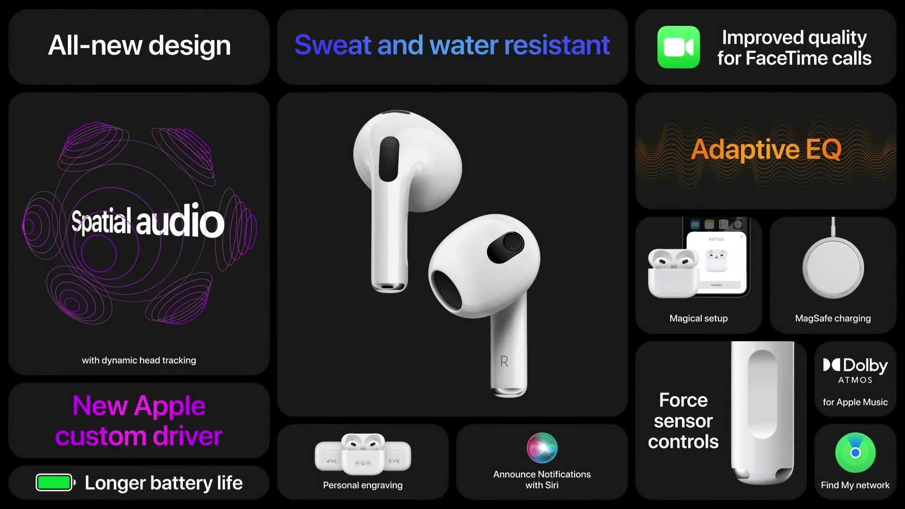
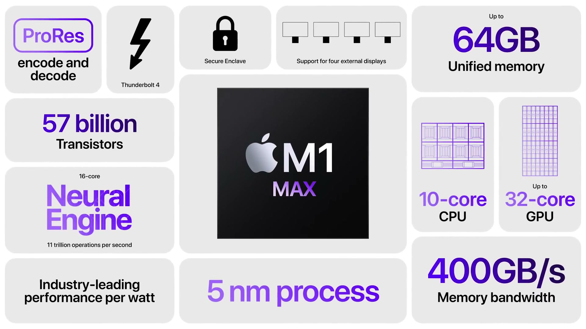
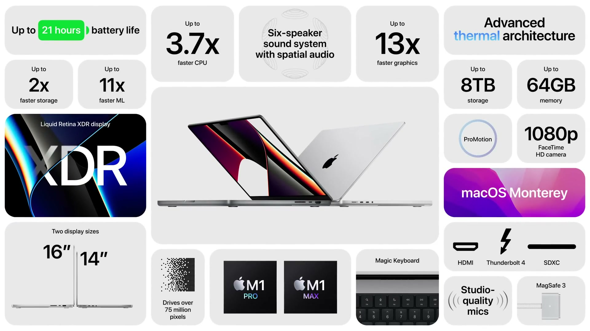

2021年10月18日（現地時間）、Apple Park で開催されたイベントの内容をまとめる。テーマは「音楽」と「Mac」で、Apple Music の新プランや AirPods、HomePod mini の新色に続き、Apple シリコンの新チップ M1 Pro・M1 Max と全面刷新された MacBook Pro が発表された。

---

## Apple Music

**ハイライト**

- **Siri 向けの新プレイリスト**：音楽の専門家が、気分やアクティビティに合わせたプレイリストを数百種類用意し、Siri から呼び出せる
- **ボイスプラン（新プランの追加）**：Siri だけで Apple Music の全曲・全プレイリスト・全ステーションを利用できる新しい購読プラン
- **ボイスプランの提供範囲**：すべての Apple デバイスで利用でき、17の国と地域で今秋以降に開始
- **既存プランとの関係**：個人プラン、ファミリープランに加えて、3つ目の選択肢になる

### Siri と新プレイリスト

Siri に曲名、アルバム、アーティストを頼む使い方はすでにある。今回はそこに、「ディナーパーティー向け」「寝る前にリラックスしたい」「ハイキングの後押しがほしい」といった場面や気分を伝えると、専門家が作ったプレイリストを再生してくれる仕組みが加わる。

- 対象は気分やアクティビティ別の数百種類のプレイリスト
- すべての購読者が利用できる

### ボイスプラン

声と Siri だけでカタログ全体を使うための新プラン。Apple Music は9,000万曲以上、3万以上の厳選プレイリストを擁するカタログを持つ。

| 項目 | 内容 |
|------|------|
| 操作方法 | 声と Siri |
| 利用できる範囲 | 全曲・全プレイリスト・全ステーション |
| 対応デバイス | すべての Apple デバイス |
| 提供開始 | 今秋以降、17の国と地域から |

### 3つのプラン

| プラン | 特徴 |
|--------|------|
| 個人プラン | 従来のプラン |
| ファミリープラン | 従来のプラン |
| ボイスプラン | Siri で Apple Music のカタログ全体にアクセスする |

---

## HomePod mini

**ハイライト**

- **新色の追加**：イエロー、オレンジ、ブルーの3色が登場し、既存のホワイト、スペースグレイと合わせて5色になる
- **全体にカラーを反映**：メッシュ生地、色付きのタッチ面、音量アイコン、編み込みケーブルまで色をそろえた仕上げ
- **マルチルームオーディオ**：複数の部屋で同期して音楽を再生できる
- **Siri の機能**：リマインダーの作成、インターコムでの家族への呼びかけに対応

### 新カラー

イエロー、オレンジ、ブルーの3色が新たに加わる。メッシュ生地やタッチ面の色合い、音量アイコン、編み込みケーブルといった各部を同じ色味でそろえている。部屋ごとに色を選んで置ける。

### 部屋をまたぐ音楽再生

マルチルームオーディオで、家じゅうの HomePod mini から同じ音楽を同期して流せる。「Hey Siri、play something new everywhere」のように、全部屋での再生も声で指示できる。

### Siri によるリマインダーとインターコム

- リマインダー：声で依頼を伝えると、リマインダーに項目を追加できる
- インターコム：声で呼びかけると、家の中の他のデバイスへメッセージを届けられる

### 基本的な位置づけ

コンパクトなスマートスピーカーで、サウンド、Siri、スマートホームの基盤としての役割を持ち、プライバシーとセキュリティを保護する設計になっている。Apple Music を楽しむ手段としても位置づけられている。

---

## AirPods（第3世代）

*出典：Apple*

**ハイライト**

- **空間オーディオに対応**：ダイナミックヘッドトラッキング付きの空間オーディオを搭載した第3世代が登場
- **デザイン刷新**：外観・内部ともに新設計で、フォースセンサーによる音楽と通話の操作が加わる
- **新開発ドライバ**：低歪みの専用ドライバで、力強い低音と明瞭な高音域を実現
- **アダプティブ EQ**：AirPods Pro で先行していた機能で、聴こえ方に合わせて周波数をリアルタイムに調整する
- **防汗・耐水**：汗と水に強い仕様
- **バッテリー向上**：1回の充電で最大6時間、5分の充電で約1時間使える。ケース込みで最大30時間
- **MagSafe 対応**：ケースが MagSafe とワイヤレス充電に対応

### 空間オーディオ

左右だけのステレオを超え、立体的に包み込む音の聴き方。Apple Music では Dolby Atmos を使った特別なオーディオとして提供され、対応楽曲は増え続けている。テレビ番組や映画でも、映画館のような没入感が得られる。ダイナミックヘッドトラッキング付きの空間オーディオは、従来 AirPods Pro と AirPods Max で iPhone、iPad、Apple TV、Mac のすべてのデバイスから使えたが、今回の第3世代でも使える。

### デザインとサウンド

- 内外を一新したデザインに、フォースセンサーを搭載し、音楽や通話を操作できる
- 低歪みの専用ドライバを新たに設計
- 耳に向けて音を直接届ける新しいコンツアー形状
- アダプティブ EQ により、耳の形の違いによる聴こえ方の差を補正し、本来意図された音に近づける

### バッテリーと充電

| 項目 | 内容 |
|------|------|
| 連続リスニング | 最大6時間 |
| 5分の充電 | 約1時間の使用 |
| ケースでの追加充電 | フル充電4回分 |
| 総リスニング時間 | 最大30時間 |
| 充電方式（ケース） | MagSafe とワイヤレス充電に対応 |

### 使い勝手

ケースを開くだけで、すべての Apple デバイスに自動でペアリングされるワンタッチセットアップに対応する。

### AirPods のラインアップ

第3世代が加わり、ラインアップは $129 から選べる構成になった。

---

## M1 Pro と M1 Max

*出典：Apple*

**ハイライト**

- **Mac 初の Pro 向けチップ**：M1 ファミリーに M1 Pro と M1 Max の2つが加わる。M1 のアーキテクチャを拡大し、システムオンチップ設計を Pro 向けシステムに初めて適用
- **メモリ帯域の拡大**：M1 Pro は最大200GB/s（M1 の約3倍）、M1 Max は最大400GB/s（M1 の6倍）
- **ユニファイドメモリ**：M1 Pro は最大32GB、M1 Max は最大64GB
- **CPU 性能の向上**：どちらも10コア（高性能8、高効率2）で、M1 比で最大70%高速
- **GPU 性能の向上**：M1 Pro は16コアで M1 比最大2倍、M1 Max は32コアで M1 比最大4倍
- **メディアエンジンの強化**：ProRes のアクセラレーションに対応。M1 Max は動画エンコードが最大2倍高速で、ProRes アクセラレータを2基搭載
- **電力効率**：PC 向けチップと同等の性能を、はるかに少ない消費電力で実現

### M1 Pro

M1 の設計を拡大したチップ。従来のノートは CPU と GPU を別チップにしており、消費電力と冷却の要求が大きく、メモリが別々でデータのコピーも遅いインターフェイス越しになる、という課題があった。M1 Pro は、チップ内のファブリックを作り直し、メモリインターフェイスの幅を2倍にして高速なメモリを使うことで、これを解決している。

- 5nm プロセス、トランジスタ数は337億（M1 の2倍超）
- 10コア CPU：高性能コア8、高効率コア2
- 16コア GPU（M1 より8コア多い）
- ProRes 対応のメディアエンジンで、4K・8K の ProRes ビデオを複数ストリーム再生でき、消費電力はごくわずか
- 複数ディスプレイを駆動するエンジンと、追加の Thunderbolt コントローラによる IO 帯域の拡大

### M1 Max

M1 Pro をさらに拡大したチップ。オンチップのファブリックの帯域を高め、メモリインターフェイスを再び2倍にしている。Apple がこれまでに作った最大のチップで、Pro 向けノートで世界最強のチップとされている。

- トランジスタ数は570億（M1 Pro の1.7倍、M1 の3.5倍）
- CPU は M1 Pro と同じ10コア
- GPU は32コアで、M1 Pro の2倍
- メディアエンジンはさらに強化され、動画エンコードが最大2倍高速。ProRes アクセラレータは2基

### スペック比較

| 項目 | M1 | M1 Pro | M1 Max |
|------|----|--------|--------|
| メモリ帯域 | 基準 | 最大200GB/s（約3倍） | 最大400GB/s（6倍） |
| ユニファイドメモリ | — | 最大32GB | 最大64GB |
| トランジスタ数 | 基準 | 337億（2倍超） | 570億（3.5倍） |
| CPU | 基準 | 10コア、最大70%高速 | 10コア、最大70%高速 |
| GPU | 8コア | 16コア、最大2倍 | 32コア、最大4倍 |

### 電力あたりの性能

- CPU：最新の8コア PC 向けノートチップと比べ、同じ電力枠で最大1.7倍の性能。PC チップのピーク性能と同じ性能なら、消費電力は70%少ない
- GPU（M1 Pro）：8コア PC 向けノートチップの統合グラフィックスに対し、ピークで7倍超の速さ。ディスクリート GPU 搭載の PC ノートより高い性能を出しつつ、消費電力は70%少ない
- GPU（M1 Max）：コンパクトなプロ向けノートの高性能 GPU と同等の性能を、消費電力40%減で実現。最速クラスの大型ハイエンドノートに対しても、同程度の性能を約100W少ない消費電力で出す
- バッテリー駆動時：コンパクトなプロ向けノートに対して最大2.5倍、ハイエンドノートに対して3倍超の GPU 性能。電源につないでいても、バッテリーでも性能が出る

---

## macOS

**ハイライト**

- **Pro チップ向けの最適化**：Pro アプリのワークロードデータをもとに、マルチスレッドのタスクを CPU コアへ割り当てる方法を改善
- **電力管理の向上**：高性能コアと高効率コアへのタスク配分を賢く行い、性能とバッテリー持ちを両立
- **ゼロコピー**：ユニファイドメモリを活かし、大きな画像や動画ストリームを CPU と GPU の間でコピーなしに受け渡せる
- **Core ML の高速化**：機械学習モデルは Core i9 搭載 MacBook Pro 比で平均3倍超、一部のモデルは20倍超
- **セキュリティ**：ハードウェア検証付きセキュアブート、実行時のエクスプロイト対策、ファイルの高速なインライン暗号化
- **Pro アプリの更新**：Logic Pro、Final Cut Pro、Compressor が M1 Pro と M1 Max 向けにアップデート

### システム全体の最適化

自社製チップ向けに macOS を設計しており、アプリの起動が高速で、スリープからの復帰も即座に行える。M1 Pro と M1 Max 向けには、Pro アプリのワークロードデータを使ってマルチスレッド処理のコア割り当てを最適化した。高度な電力管理により、1回の充電でコンパイルや動画編集をより多くこなせる。

- Metal などの技術で、アプリはチップの性能に合わせて自動的にスケールする
- Core ML の最適化により、機械学習モデルは最速の Core i9 搭載 MacBook Pro 比で平均3倍超速く動く

### セキュリティ

M1、M1 Pro、M1 Max は、次の保護機能を備える。

- ハードウェアで検証するセキュアブート
- 実行時のエクスプロイト対策技術
- すべてのファイルに対する高速なインライン暗号化

### アプリの互換性

| 種類 | 状況 |
|------|------|
| Apple 製アプリ | すべて Apple シリコンに最適化され、ネイティブで動作 |
| Intel ベースのアプリ | Rosetta 2 で動作。プラグインを使う Pro アプリも対象 |
| Rosetta 上のアプリ | Metal など macOS の技術を呼び出す場合は、Apple シリコン向けの最適化で高速化 |
| iPhone・iPad アプリ | Mac 上で実行できる |

アプリを Universal として再コンパイルすると、チップの性能をフルに引き出せる。Apple の Pro アプリはすべて Universal で、Lightroom Classic、Cinema 4D、Capture One、Sketch などのサードパーティ製の Universal アプリやプラグインも提供されている。

### Pro アプリのアップデート

- Logic Pro：ノートブックで大規模な空間オーディオのミックスを作成できるようになる（初）
- Final Cut Pro：新機能のオブジェクトトラッキングの映像解析が最大5倍高速
- Compressor：ProRes のビデオトランスコードが10倍高速

サードパーティの開発者も、M1 Pro と M1 Max による処理の高速化を確認している。64GB のユニファイドメモリにより、ノートブックで巨大な3Dデータをメモリへ読み込める点も挙げられた。

---

## MacBook Pro

*出典：Apple*

**ハイライト**

- **デザインを全面刷新**：16インチに加え、初の14インチモデルが登場。アルミ筐体と新しい冷却システムで、持続的な性能を静かに発揮
- **ディスプレイ**：Liquid Retina XDR（mini LED）と ProMotion（最大120Hz）を搭載。16インチは約770万画素、14インチは約590万画素
- **キーボード**：Touch Bar を廃止し、フルハイトのファンクションキー列を物理キーで採用
- **ポートの拡充**：HDMI、SD カードスロット、Thunderbolt 4 ×3、MagSafe 3、高インピーダンスヘッドフォン対応のヘッドフォンジャックを搭載
- **カメラとオーディオ**：カメラは 1080p で低照度性能が2倍。スピーカーは6スピーカー構成で空間オーディオに対応
- **性能**：M1 Pro と M1 Max を搭載。16インチは従来比で CPU 最大2倍、GPU は M1 Max で最大4倍
- **バッテリー**：ビデオ再生は14インチで最大17時間、16インチで最大21時間。Mac 初の急速充電に対応

### デザインと冷却

アルミ製の筐体が内部スペースを広げ、高度な冷却システムの周りに精密に加工されている。ファン回転数が低くても空気を50%多く動かせるため、静かさを保ちながら高い持続性能を出せる。日常的な作業では、Apple シリコンの効率の高さからファンが回らないことも多い。

| 項目 | 14インチ | 16インチ |
|------|----------|----------|
| 厚さ | 15.5mm | 16.8mm |
| 重さ | 3.5ポンド | 4.7ポンド |

### キーボードとポート

Touch Bar に代わり、単体の Magic Keyboard と同じフルハイトのファンクションキー列を採用した。キーボードはダブルアノダイズのブラックの枠に収められ、バックライト付きの刻印が映える。トラックパッドは大型の Force Touch トラックパッドになる。

- 片側：HDMI ポート、Thunderbolt 4 ポート、SD カードスロット
- 反対側：ヘッドフォンジャック（高インピーダンスのヘッドフォンに対応）、Thunderbolt 4 ポート2つ（合計3つ）
- MagSafe 3：新しい設計で、より大きな電力を供給できる。Thunderbolt ポートからの充電も引き続き可能
- 外部ディスプレイ：M1 Pro は Pro Display XDR を最大2台、M1 Max は Pro Display XDR を最大3台と 4K テレビ1台を同時に接続でき、画素数は合計7,500万超。アダプタは不要

### ディスプレイ

- 狭額縁：側面の枠が24%細くなり、カメラ周りまで表示領域を広げたことで上側の枠は60%細くなった。macOS はメニューバーを持ち上げてカメラの周囲に回し込み、コンテンツの表示領域を広げる
- 画面サイズ：16インチモデルは16.2インチ、14インチモデルは14.2インチの表示領域
- 画素数：16インチは従来比で180万画素増の770万画素（Mac ノートで最多）、14インチは590万画素で、従来の16インチモデルより多い
- ProMotion：最大120Hz。コンテンツの動きに応じてリフレッシュレートが自動で上下し、静止画面では下げてバッテリーを節約する。動画編集者は標準のリフレッシュレートに固定することもできる
- 10億色に対応し、グラデーションがなめらか
- Liquid Retina XDR：mini LED を細かい調光ゾーンに分けて制御する。持続的なフルスクリーン輝度は最大1000ニト、ピーク輝度は1600ニト、コントラスト比は100万:1。HDR コンテンツの作成・編集・確認に使える

### カメラとオーディオ

- カメラ：解像度が 1080p に倍増。より明るいレンズと大きなセンサーで低照度性能が2倍になり、ISP と Neural Engine による演算処理で映像の画質を高める
- マイク：スタジオ品質のマイクのノイズフロアが最大60%低下
- スピーカー：6スピーカー構成で、ツイーター2基とフォースキャンセリングウーファー4基。ツイーターは約2倍大きく、ウーファーは空気の押し出し量が2倍になり、低音が80%増え、半オクターブ深い音域を再生できる。14インチにも同じ構成を採用
- 空間オーディオと Dolby Atmos に対応

### 性能

| 比較 | CPU | GPU | 機械学習 |
|------|-----|-----|----------|
| 16インチ（M1 Pro / M1 Max）と従来の16インチ（Core i9） | 最大2倍 | M1 Pro で最大2.5倍、M1 Max で最大4倍 | 最大5倍 |
| 14インチと従来の13インチ（Core i7） | 最大3.7倍 | M1 Pro で最大9倍、M1 Max で最大13倍 | 最大11倍 |

- ユニファイドメモリは最大64GB。最新の Pro 向け PC ノートのビデオメモリは最大16GB
- M1 Max のメディアエンジン：Final Cut Pro で 4K ProRes を最大30ストリーム、8K ProRes を最大7ストリーム編集でき、Afterburner 付き28コア Mac Pro より多い。バッテリー駆動でも8K ProRes の HDR カラーグレーディングが可能
- SSD：読み出し速度が最大7.4GB/s で、従来の SSD の2倍超

### バッテリーと環境

- ビデオ再生：14インチは最大17時間（7時間増）、16インチは最大21時間（10時間増）で、Mac ノートで最長
- 作業時間：Lightroom Classic で写真を編集するときのバッテリー持ちが最大2倍、Xcode では同じ充電で4倍のコードをコンパイルできる
- 急速充電：Mac で初。30分で最大50%まで充電
- 筐体は100%再生アルミニウム製

### モデルとカラー

14インチは従来のハイエンド13インチモデルより、最大7時間長いバッテリー持ち、大型の XDR ディスプレイ、高度なカメラ、高音質オーディオ、多くのポートを備える。M1 Pro と M1 Max の両方を選べ、どちらのサイズもシルバーとスペースグレイがある。13インチの M1 モデルも引き続きラインアップに残る。

---

## 価格・発売日

| 製品 | 価格 | 税込換算 | 発売日 |
| ------ | ------ | ------ | -------- |
| Apple Music ボイスプラン | $4.99／月 | 約1,000円 | 今秋以降（17の国と地域から） |
| HomePod mini（新3色） | $99 | 約1万2,000円 | 11月から |
| AirPods（第3世代） | $179 | 約2万2,000円 | 本日から注文受付、翌週発売 |
| AirPods ラインアップ | $129 から | 約1万6,000円〜 | 言及なし |
| M1 Pro / M1 Max | 言及なし（MacBook Pro に搭載） | — | 言及なし |
| macOS | 言及なし | — | 言及なし |
| MacBook Pro 14インチ | $1,999 | 約25万1,000円 | 本日から注文可能、翌週発売 |
| MacBook Pro 16インチ | $2,499 | 約31万4,000円 | 本日から注文可能、翌週発売 |

※日本円は、米国の価格（税抜き）を発表日（2021年10月18日）の為替レート（1ドル＝114.15円、欧州中央銀行の参考レート）で換算し、消費税10%を加えた参考値。実際の日本での販売価格とは異なる。
