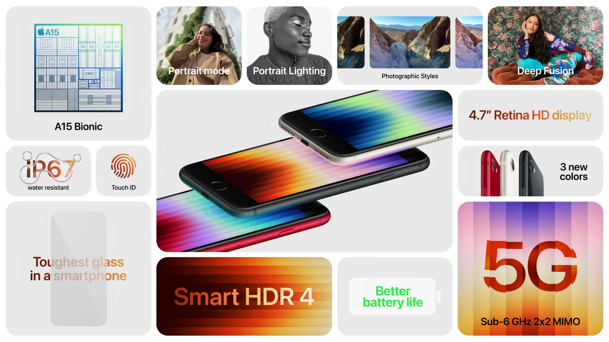
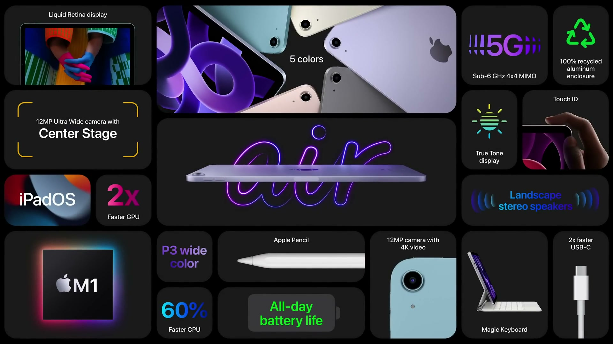
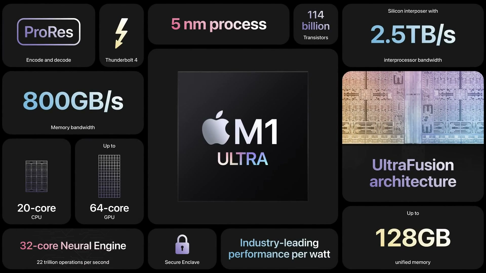
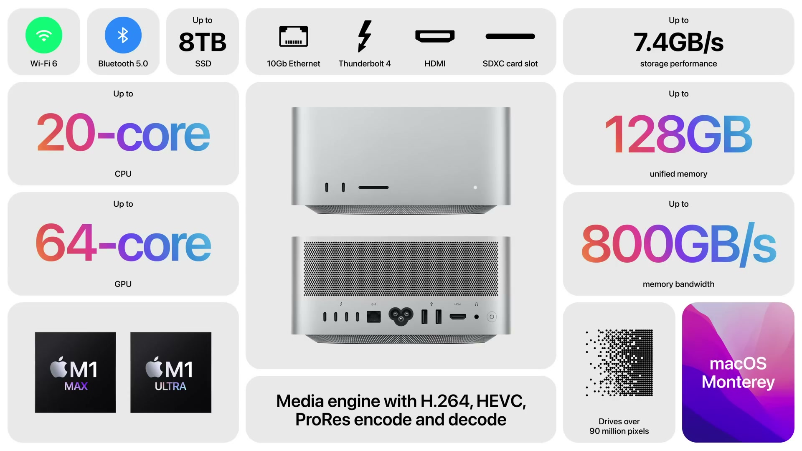
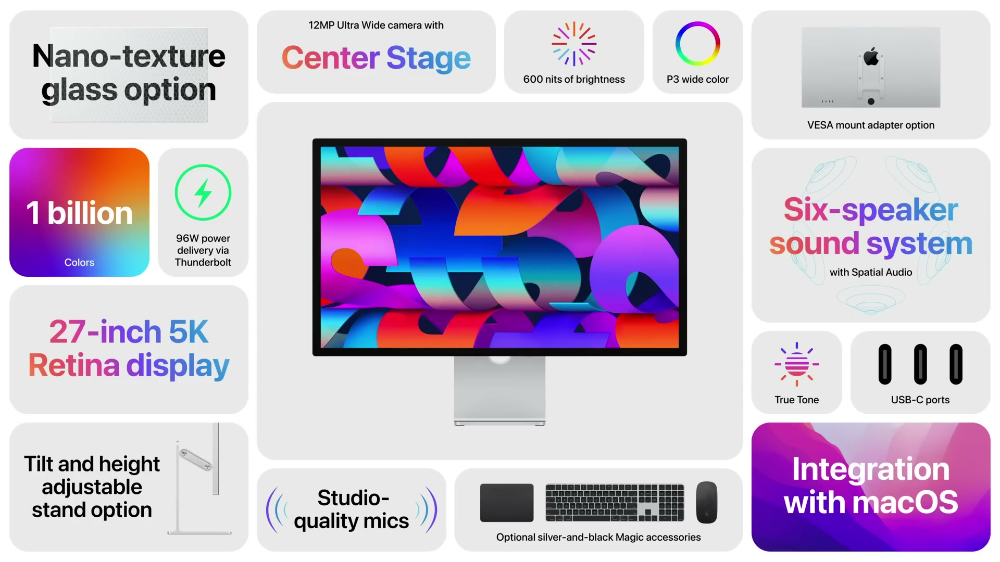

2022年3月8日（現地時間）にオンラインで開催された、2022年最初の Apple Event。Apple シリコンを軸に、M1 ファミリー最後のチップ M1 Ultra と、それを搭載する Mac Studio、新しい Studio Display が発表された。iPhone 13 の新色、A15 Bionic を搭載した iPhone SE、M1 を搭載した iPad Air も登場した。

---

## iPhone 13 / iPhone 13 Pro の新色

**ハイライト**

- **iPhone 13 の新色**：グリーンを追加。精密に削り出した背面ガラスと、同色のアルミニウムエッジを採用
- **iPhone 13 Pro の新色**：アルパイングリーンを追加
- **予約と発売**：どちらも金曜日に予約開始、3月18日に発売

### 新色の仕上げ

| モデル | 新色 | 特徴 |
|--------|------|------|
| iPhone 13 | グリーン | 精密に削り出した背面ガラス、同色のアルミニウムエッジ |
| iPhone 13 Pro | アルパイングリーン | Pro ラインナップへの新色追加 |

### 搭載機能

- iPhone 13 は A15 Bionic と iOS 15 を搭載し、シネマティックモードや ProRes ビデオに対応する
- Super Retina XDR ディスプレイとバッテリー駆動時間の長さも特徴として挙げられた

---

## iPhone SE

*出典：Apple*

**ハイライト**

- **A15 Bionic 搭載**：iPhone 13 と同じチップを、最も手頃な iPhone に搭載
- **CPU / GPU / Neural Engine**：6コア CPU は iPhone 8 比で最大1.8倍高速。4コア GPU、16コア Neural Engine（毎秒15.8兆回の演算、iPhone 8 比26倍）
- **5G 対応**：最も手頃な iPhone に 5G を搭載
- **耐久性の向上**：前面と背面に、スマートフォンで最も丈夫なガラスを採用。IP67 の防水・防塵
- **バッテリー駆動時間の向上**：A15 Bionic の効率、iOS との統合、新しいバッテリー化学、内部設計の更新による
- **カメラの進化**：12MP カメラと A15 Bionic の組み合わせで、Deep Fusion、スマート HDR 4、フォトグラフスタイルに対応
- **デザイン**：ホームボタンと Touch ID、4.7インチ Retina HD ディスプレイ。カラーはミッドナイト、スターライト、(PRODUCT)RED

### A15 Bionic

- 6コア CPU は iPhone 8 比で最大1.8倍高速
- 4コア GPU により、グラフィックスを多用する用途の性能が向上
- 16コア Neural Engine は毎秒15.8兆回の演算が可能で、iPhone 8 比26倍
- Neural Engine を持たない機種からの乗り換えでは、ライブテキストなどが使えるようになる
- ライブテキストでは、カメラで捉えた文字をコピー、翻訳したり、電話やメールに利用できる

### デザインと耐久性

- ガラスとアルミニウムのデザインで、ミッドナイト、スターライト、(PRODUCT)RED の3色
- 4.7インチ Retina HD ディスプレイ
- 前面と背面に、iPhone 13 / 13 Pro の背面と同じガラスを採用
- IP67 の防水・防塵性能
- Touch ID 搭載のホームボタンで、ロック解除、パスコードの入力、Apple Pay での支払いに対応

### 5G とバッテリー

- 5G により、ダウンロード・アップロードの高速化、低遅延化に対応
- Wi-Fi 接続でなくても、高画質の HD FaceTime 通話が可能
- SharePlay での映画視聴やオンラインのマルチプレイヤーゲームにも活用できる
- バッテリー駆動時間は、A15 Bionic の効率、iOS との統合、最新のバッテリー化学、内部設計の更新により向上

### カメラ

| 機能 | 内容 |
|------|------|
| カメラ | 12MP |
| Deep Fusion | 写真のあらゆる部分でテクスチャとディテールを最適化 |
| スマート HDR 4 | 被写体と背景に、色・コントラスト・ノイズの調整を個別に適用 |
| フォトグラフスタイル | 好みのスタイルを撮影時に反映しつつ、肌のトーンを維持 |
| ISP | 肌の色の再現性を高め、特に暗所でノイズを低減 |

### iOS 15 とサステナビリティ

- iOS 15 の「集中モード」と新しい「マップ」に対応
- オンデバイスの Siri とオンデバイスの音声入力が利用できる
- 今後数年にわたり iOS のアップデートを受けられる
- 外側のプラスチックフィルムを廃止したパッケージ
- Taptic Engine に100%再生希土類元素と100%再生タングステンを使用

---

## iPad Air

*出典：Apple*

**ハイライト**

- **M1 チップ搭載**：8コア CPU は A14 搭載の前モデル比で最大60%高速、8コア GPU は最大2倍高速
- **Neural Engine**：16コアで機械学習の処理を強化
- **センターフレーム対応**：前面カメラが12MP の超広角になり、これで iPad の全モデルがセンターフレームに対応
- **5G 対応**：高速なモバイル通信に対応
- **USB-C の高速化**：USB-C ポートが2倍高速に
- **新色**：新しいブルーを追加。スペースグレイ、スターライト、ピンク、パープルと合わせて5色
- **ストレージと通信**：64GB と256GB、Wi-Fi モデルとセルラーモデル

### M1 チップによる性能向上

- 8コア CPU は A14 搭載の前モデル比で最大60%高速
- 8コア GPU はグラフィックス性能が最大2倍
- 競合する最速のタブレットより高速
- 同価格帯で最も売れている Windows ノートPC（3倍厚く、4倍重い）の最大2倍高速
- 16コア Neural Engine により、Adobe Lightroom で空と前景をタップだけで選択するといった機械学習ワークフローを強化
- Procreate や SketchUp などのアプリ、モバイルゲームでの活用が想定されている

### ディスプレイ・カメラ・通信

| 項目 | 内容 |
|------|------|
| ディスプレイ | Liquid Retina、P3 広色域、True Tone、輝度500ニト、反射防止コーティング |
| 前面カメラ | 12MP 超広角、センターフレーム対応 |
| 通信 | 5G 対応。SharePlay での映画視聴などに活用 |
| USB-C | ドライブ、ドック、カメラとの接続が従来の2倍の速度 |

### アクセサリとソフトウェア

- Smart Keyboard Folio と Magic Keyboard に対応
- Apple Pencil（第2世代）に対応
- iPadOS 15 では、マルチタスクの強化、クイックメモ、SharePlay が利用できる
- Swift Playgrounds の新バージョンで、iPad 上でアプリを作成し App Store に提出できる
- iMovie の新バージョンは来月提供。ストーリーボード機能で、撮影リスト、トランジション、音楽を使って動画を仕上げられる

### 色とサステナビリティ

- カラーはスペースグレイ、スターライト、ピンク、パープル、新色のブルー
- エンクロージャのアルミニウム、メインロジックボードのはんだに使うスズ、エンクロージャとオーディオ用マグネットの希土類元素に、100%再生素材を使用

---

## M1 Ultra

*出典：Apple*

**ハイライト**

- **新チップ**：M1 ファミリーの最後のチップとして M1 Ultra を発表。M1 Max 2基を接続した構成
- **UltraFusion**：シリコンインターポーザで2つのダイを接続。1万本超の信号、2.5TB/s の帯域
- **トランジスタ数**：1,140億個。M1 の7倍で、パーソナルコンピュータ用チップで最多
- **ユニファイドメモリ**：帯域800GB/s、最大128GB
- **CPU / GPU**：20コア CPU（高性能16、高効率4）、64コア GPU（M1 の約8倍）
- **Neural Engine / Media Engine**：32コアで毎秒22兆回の演算。Media Engine は M1 Max の2倍の能力
- **電力効率**：同じ電力枠で、16コアの PC 向けデスクトップチップ比90%高い性能
- **ソフトウェア**：ソフトウェアからは1つのチップに見え、アプリは追加作業なしで性能を活かせる

### UltraFusion アーキテクチャ

- 従来の主流は、2つのチップをマザーボード経由で接続する方式。遅延の増加、帯域の低下、消費電力の大幅な増加があり、開発者もコードの変更を迫られる
- M1 Max には、ダイ間を接続する技術が組み込まれていた。M1 Ultra は M1 Max 2基で構成し、性能が2倍になる
- シリコンインターポーザは、既存のどの技術の2倍の接続密度を持つ
- 1万本を超える信号を接続し、ダイ間に低遅延で2.5TB/s の帯域を確保する。最先端のマルチチップ接続技術の4倍超
- ソフトウェアからは1つのチップとして動き、ユニファイドメモリの利点も維持される

### 仕様

| 項目 | M1 Ultra |
|------|----------|
| トランジスタ数 | 1,140億個（M1 の7倍） |
| CPU | 20コア（高性能16 + 高効率4） |
| GPU | 64コア（M1 の約8倍） |
| Neural Engine | 32コア、毎秒22兆回の演算 |
| Media Engine | M1 Max の2倍の能力。ProRes のエンコード・デコードのスループットが向上 |
| メモリ帯域 | 800GB/s（最新の PC デスクトップ向けチップの10倍超） |
| ユニファイドメモリ | 最大128GB |

### 電力効率

- M1 Max は、最新の10コア PC デスクトップチップとほぼ同等のマルチスレッド CPU 性能を、消費電力65%減で実現する
- M1 Ultra は、最速の16コア PC デスクトップチップと同じ電力枠で90%高い性能。同チップのピーク性能を、消費電力100W減で出せる
- GPU では、M1 Max が人気の GPU とほぼ同等の性能を、消費電力3分の1で実現する
- M1 Ultra は、最高性能の GPU より高速で、消費電力は200W少ない

### macOS とアプリ

- macOS が M1 Ultra に合わせて自動的にスケールし、性能向上の恩恵を受けられる
- Apple シリコンへの移行で、iPhone / iPad アプリの Mac 実行や、M1 ファミリーの性能を引き出す Universal アプリなど、Mac 向けアプリが過去最多になった
- 1つのチップに見えるため、アプリは追加の作業なしで性能向上の恩恵を受ける
- デベロッパの評価として、Maxon での シーンレンダリングが最大4倍高速になったほか、Adobe、Vectorworks、Ableton、Sapphire などで、プレビューや3Dナビゲーションの高速化、レイヤー数や音源数の増加が挙げられた

---

## Mac Studio

*出典：Apple*

**ハイライト**

- **新しい Mac**：M1 Max または M1 Ultra を搭載するデスクトップ。M1 Ultra は Mac Studio で提供
- **コンパクトな筐体**：1枚のアルミニウム押し出し材から削り出し。底面は一辺7.7インチ、高さ3.7インチ
- **冷却**：両面ブロワーによる冷却機構で、ほとんどの作業でほぼ無音
- **背面の接続**：Thunderbolt 4 x4、10Gb Ethernet、USB-A x2、HDMI、プロ向けオーディオジャック
- **前面の接続**：M1 Max は USB-C x2（10Gb/s）、M1 Ultra は Thunderbolt 4 x2（最大40Gb/s）。SD カードスロットも搭載
- **ディスプレイ**：Pro Display XDR 最大4台と4K テレビを接続可能（約9,000万ピクセル）
- **性能**：M1 Ultra 搭載モデルの CPU は、27インチ iMac の最大3.8倍、グラフィックスは最大4.5倍
- **メモリとストレージ**：ユニファイドメモリは最大128GB、SSD は最大8TB（最大7.4GB/s）

### デザインと冷却

- 外装は1枚のアルミニウム押し出し材から削り出されている
- 底面は一辺7.7インチ、高さ3.7インチで、ほとんどのディスプレイの下に収まる
- 両面ブロワーが、穴の開いたアルミニウム製の底面の全周から空気を取り込む
- 空気は円形の電源ユニットを通り、チップのサーマルモジュールへ導かれる
- 背面の低抵抗な排気口には、精密に加工された2,000個超の穴がある
- M1 Max と M1 Ultra の効率により、ほとんどの作業で動作音はごくわずか

### 接続

| 位置 | 内容 |
|------|------|
| 背面 | Thunderbolt 4 x4、10Gb Ethernet x1、USB-A x2、HDMI x1、プロ向けオーディオジャック（ハイインピーダンスのヘッドフォン、外部アンプ内蔵スピーカー対応） |
| 前面（M1 Max） | USB-C x2（USB 3、10Gb/s） |
| 前面（M1 Ultra） | Thunderbolt 4 x2（最大40Gb/s） |
| 前面（共通） | SD カードスロット |
| 無線 | Wi-Fi 6、Bluetooth 5 |

### 性能比較

| 比較対象 | M1 Max 搭載 | M1 Ultra 搭載 |
|----------|-------------|---------------|
| 最速の27インチ iMac（CPU） | 最大2.5倍 | 最大3.8倍 |
| 16コア Xeon の Mac Pro（CPU） | 50%高速 | 最大90%高速 |
| 28コアの Mac Pro（CPU） | — | 最大60%高速 |
| 最速の27インチ iMac（グラフィックス） | 最大3.4倍 | 最大4.5倍 |
| 最も一般的なグラフィックスカード搭載の Mac Pro | 3倍超 | — |
| 最速のグラフィックスカード搭載の Mac Pro | — | 最大80%高速 |

### メモリ・ストレージ・ProRes

- 現在最も強力なワークステーション向けグラフィックスカードのビデオメモリは48GB。Mac Studio は M1 Max で最大64GB、M1 Ultra で最大128GB のユニファイドメモリを使える
- SSD は最大7.4GB/s、最大8TB
- M1 Ultra の Media Engine により、8K ProRes 422 ビデオを18ストリーム再生できる

### 想定される用途と環境への配慮

- 音楽制作：数百のトラック、プラグイン、仮想音源をリアルタイムで再生
- 3D：より複雑なジオメトリの操作、パーティクルシミュレーションの短縮、これまでレンダリングできなかった大規模な環境
- ソフトウェア開発：ビルドの高速化、自動統合テストの拡充
- 写真：ギガピクセル級の画像、数百のレイヤー合成、書き出しの高速化
- 動画：カラー補正の追加、マルチカムでの8K ストリーム再生数の増加、エンコードの高速化
- 年間の消費電力は、ハイエンドの PC デスクトップより最大1,000キロワット時少ない
- 磁石に100%再生希土類元素、メインロジックボードのはんだに再生スズを使用

---

## Studio Display

*出典：Apple*

**ハイライト**

- **5K Retina ディスプレイ**：27インチ、1,470万ピクセル、218ppi。輝度600ニト、P3 広色域、10億色超に対応
- **A13 Bionic 内蔵**：高度なカメラとオーディオシステムを実現
- **カメラ**：12MP 超広角カメラ。Mac として初めてセンターフレームに対応
- **サウンド**：6スピーカーシステムが空間オーディオ（Dolby Atmos）に対応。スタジオ品質のマイクアレイも搭載
- **接続**：USB-C x3（最大10Gb/s）と Thunderbolt ポート。1本のケーブルで96W 給電
- **スタンド・ガラス**：最大30度のチルト調整スタンドが標準。チルト・高さ調整スタンドと VESA アダプタ、ナノテクスチャガラスも選べる
- **新色の周辺機器**：Magic Keyboard（Touch ID 搭載）、Magic Trackpad、Magic Mouse にシルバーとブラックの組み合わせを追加

### デザインとスタンド

- 狭いベゼルのオールスクリーンデザインで、筐体はすべてアルミニウム
- 標準のスタンドは最大30度のチルトに対応
- 選べるオプション：チルト・高さ調整スタンド（カウンターバランスアーム付き）、縦横どちらにも取り付けられる VESA アダプタ

### ディスプレイ

| 項目 | 内容 |
|------|------|
| サイズ・解像度 | 27インチ、5K Retina（1,470万ピクセル、218ppi） |
| 輝度 | 600ニト |
| 色 | P3 広色域、10億色超 |
| その他 | True Tone、反射防止コーティング |
| オプション | ナノテクスチャガラス（光を散乱させて映り込みをさらに抑える） |

### カメラとオーディオ

- A13 Bionic を内蔵し、カメラとオーディオ機能を処理する
- 12MP 超広角カメラはセンターフレームに対応し、Mac では初めて
- ノイズフロアの低いスタジオ品質のマイクアレイを搭載
- 6スピーカー構成：歪みを抑えるフォースキャンセリングウーファー x4、高性能ツイーター x2
- Apple シリコンによるマルチチャンネルサラウンド処理で、Dolby Atmos の音楽・ビデオの空間オーディオに対応

### 接続と給電

- USB-C x3（最大10Gb/s）で、周辺機器、ストレージ、ネットワークをディスプレイに接続できる
- Thunderbolt ポートで、ディスプレイと接続した周辺機器を1本のケーブルで Mac に接続できる
- そのケーブルで96W を給電し、Mac ノートブックを充電できる。14インチ MacBook Pro は急速充電にも対応
- MacBook Pro には Studio Display を最大3台接続できる
- MacBook Pro、MacBook Air、Mac mini、Mac Studio など、あらゆる Mac と組み合わせて使える

### 周辺機器の新色とサステナビリティ

- Magic Keyboard（Touch ID 搭載）、Magic Trackpad、Magic Mouse にシルバーとブラックの新色オプションを追加
- すべての磁石に100%再生希土類元素を使用し、有害物質の多くを含まない

---

## 価格・発売日

| 製品 | 価格 | 税込換算 | 発売日 |
| ------ | ------ | ------ | -------- |
| iPhone 13 / iPhone 13 Pro（新色） | 言及なし | — | 3月18日（予約は金曜日から） |
| iPhone SE | $429 から | 約5万5,000円〜 | 3月18日（予約は金曜日から） |
| iPad Air | $599 から | 約7万6,000円〜 | 3月18日（注文は金曜日から） |
| M1 Ultra | Mac Studio に搭載 | — | 3月18日（Mac Studio として） |
| Mac Studio（M1 Max） | $1,999 から | 約25万4,000円〜 | 3月18日（本日から注文可能） |
| Mac Studio（M1 Ultra） | $3,999 から | 約50万9,000円〜 | 3月18日（本日から注文可能） |
| Studio Display | $1,599 | 約20万4,000円 | 3月18日（本日から注文可能） |

※日本円は、米国の価格（税抜き）を発表日（2022年3月8日）の為替レート（1ドル＝115.71円、欧州中央銀行の参考レート）で換算し、消費税10%を加えた参考値。実際の日本での販売価格とは異なる。
