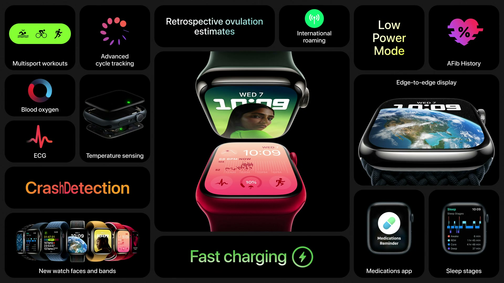
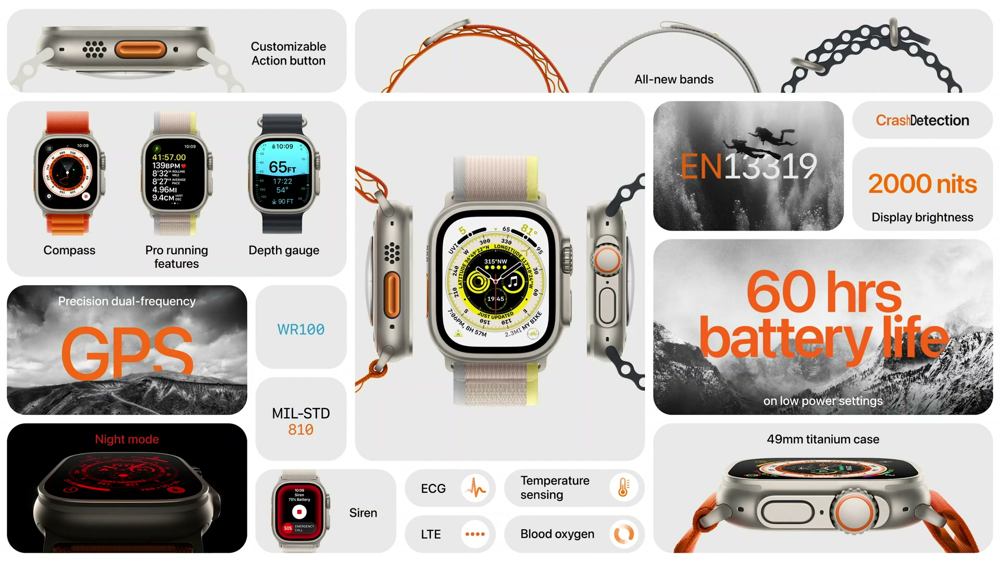
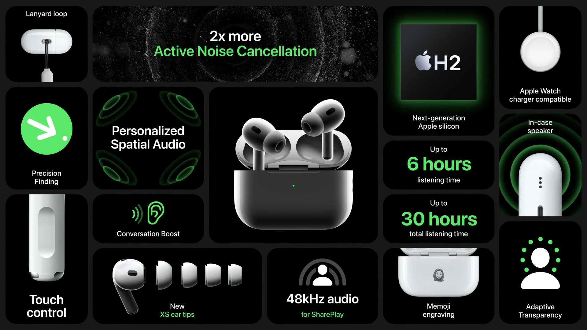
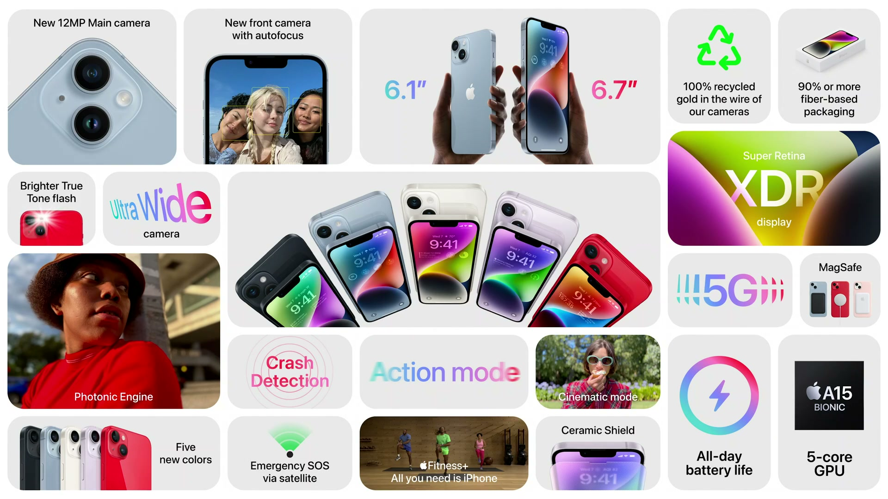
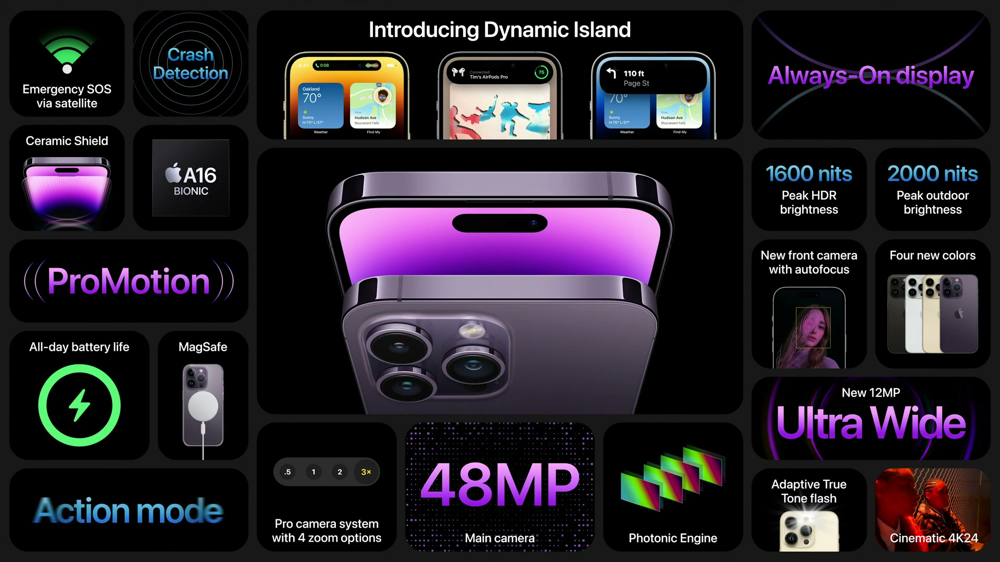

2022年9月7日（現地時間）に開催された Apple Event で、iPhone、AirPods、Apple Watch の新製品が発表された。Apple Watch は Series 8、SE、新シリーズの Ultra、iPhone は iPhone 14 シリーズと iPhone 14 Pro シリーズが登場し、衝突事故検出などの安全機能が複数の製品に加わった。

---

## Apple Watch Series 8

*出典：Apple*

**ハイライト**

- **体温センサー（新機能）**：背面と画面直下の2つのセンサーで手首の夜間体温を測定し、排卵日の推定に使う
- **排卵推定（新機能）**：体温変化から、排卵が起きた時期を後から自動で推定する
- **周期の逸脱通知（新機能）**：iOS 16 と watchOS 9 のユーザー全員に、記録した周期データから周期の乱れを通知
- **衝突事故検出（新機能）**：重大な自動車事故を検出し、緊急通報、位置情報の共有、緊急連絡先への通知を自動で行う
- **新モーションセンサー（新機能）**：改良した3軸ジャイロと、最大256gを測れる高g加速度センサーを搭載
- **低電力モード（新機能）**：フル充電で最大36時間駆動。Series 4 以降の watchOS 9 に対応
- **国際ローミング（新機能）**：セルラーモデルが海外でも携帯回線に接続。Series 5 以降の watchOS 9 に対応
- **ディスプレイ**：狭い縁で画面を端まで広げた常時表示ディスプレイ。新しい文字盤 Lunar、Astronomy、Metropolitan、Modular

### 体温センサーと排卵推定

- 体温センサーは2つ：背面クリスタル（肌に近い側）と画面の直下。2つ使うことで外部環境による偏りを減らし、精度を上げる
- 睡眠中は血管が広がって手足への血流が増えるため、夜間の手首の体温は体温全体の指標になる
- 就寝中に5秒ごとに手首の温度を測定し、0.1℃単位の変化を検出できる
- 「ヘルスケア」アプリで、基準値からの夜ごとのずれを確認できる。運動、時差、飲酒、体調不良などが原因になる
- 排卵に伴うホルモン変化で体温が上昇する二相性の変化を捉え、排卵の有無と時期を後から推定する。従来は体温計と記録で手動管理していた作業を自動化する

### 周期トラッキングとプライバシー

- iOS 16 と watchOS 9 のユーザー全員が、記録した周期データにもとづき、周期の逸脱（長引く不正出血、長い月経期間など）の通知を受け取れる
- 体温、心拍数、記録した周期データを組み合わせて周期を詳しく確認でき、医療従事者との共有も可能
- 周期トラッキングのデータはデバイス上で暗号化され、パスコード、Touch ID、Face ID でのみアクセスできる
- 標準の2ファクタ認証とパスコードを使う場合、iCloud に同期した「ヘルスケア」データはエンドツーエンドで暗号化される
- 共有は明示的な許可があるときのみで、共有するデータの種類と相手を細かく制御できる

### 衝突事故検出

- 新しいセンサーは、改良した3軸ジャイロと高g加速度センサー。加速度センサーは最大256gを測定でき、サンプリングは4倍速の毎秒3,000回超
- 衝突試験施設で何年も車両衝撃を研究し、正面衝突、側面衝突、追突、横転の4種類の重大事故を対象にした
- ジャイロ・加速度センサーに加え、気圧計、マイク、GPS のデータを機械学習でセンサーフュージョンアルゴリズムに統合
- 学習データは100万時間を超える実際の運転・衝突データ
- 乗用車、SUV、ピックアップトラックなど主要な車種に対応
- 運転中のみ動作し、衝突の可能性がある前後のデータだけを、すべてデバイス上で処理する

### バッテリーと接続

- 新しい温度・モーションセンサーが常時動いても、バッテリーは終日（18時間）持つ
- 低電力モードはフル充電で最大36時間。アクティビティ記録や転倒検出などの中核機能は維持し、常時表示ディスプレイや自動ワークアウト検出などを一時的に無効にする
- 国際ローミングは iPhone のローミングプランに Apple Watch を追加して使う（追加費用はわずか、または無料）。年内に世界30以上のキャリアで利用可能になる

### 仕上げとバンド

| 項目 | 内容 |
|------|------|
| アルミニウム（100%再生アルミニウム） | ミッドナイト、スターライト、シルバー、(PRODUCT)RED |
| ステンレススチール | シルバー、ゴールド、グラファイト |
| Nike | Nike スポーツバンドの新色、「Just Do It」を織り込んだ新しい Nike スポーツループ。watchOS 9 ではすべての Nike 文字盤を任意の Apple Watch で利用可 |
| Hermès | 新バンド「H Diagonal」「Gourmette Metal」、新文字盤「Hermès Lucky Horse」 |

- 防水（耐水）、防塵、耐クラックのデザイン
- 既存の機能：ECG、不規則な心拍の通知、血中酸素ウェルネス、睡眠トラッキング、転倒検出、緊急 SOS
- 新規購入のどの Apple Watch にも Fitness+ が3か月無料で付く

---

## Apple Watch SE

**ハイライト**

- **新しい仕上げ（新機能）**：シルバー、ミッドナイト、スターライトの3色。いずれも100%再生アルミニウム
- **背面ケースの刷新**：ナイロンコンポジット素材に変更し、3色のケースと色を合わせた。新しい製造工程でカーボンフットプリントを80%以上削減
- **衝突事故検出に対応（新機能）**：Series 8 と同じモーションセンサーを搭載
- **S8 SiP**：Series 8 と同じ S8 System in Package で、従来より最大20%高速化
- **ディスプレイ**：Series 3 より30%大きい
- **watchOS 9 の機能**：新しい機能をすべて利用可能

### 第2世代 SE の基本機能

- ワークアウトとアクティビティの記録、耐水（スイムプルーフ）、高心拍・低心拍の通知、緊急 SOS、転倒検出を備える
- AirPods を使えばどこでも音楽を聴ける
- SE の購入者の80%超が、初めての Apple Watch として選んでいる

### ファミリー共有設定

- iPhone を持たない子供向けに、親の iPhone で Apple Watch をペアリングできる
- 子供は指定した連絡先への通話とメッセージ、緊急通報、位置情報の共有が可能
- 近日対応予定の「ホーム」アプリと「ウォレット」のホームキーにより、さらに自立した使い方ができる

---

## Apple Watch Ultra

*出典：Apple*

**ハイライト**

- **新デザイン（新機能）**：探検、アドベンチャー、持久系競技向けに設計した、最も頑丈な Apple Watch。航空宇宙グレードのチタニウム49mmケース
- **ディスプレイ**：Apple Watch で最大かつ最も明るい画面（最大2000ニト）。フラットなサファイアクリスタルをチタニウムが囲み、端の衝撃から保護
- **アクションボタン（新機能）**：ハイコントラストのオレンジ色でカスタマイズ可能な物理ボタン
- **デュアル周波数 GPS（新機能）**：L1 に加えて L5 に対応し、専用の測位アルゴリズムを搭載
- **バッテリー**：Apple Watch で最大のバッテリー。最大36時間駆動。今秋提供予定の省電力設定で最大60時間
- **水中機能（新機能）**：耐水性能 WR100（従来の2倍）、水深計、Depth アプリ。EN 13319 認証
- **コンパスの刷新（新機能）**：ウェイポイントと Backtrack に対応
- **サイレン（新機能）**：86デシベルの内蔵サイレンで、最大180m先まで位置を知らせる

### 本体とデザイン

- チタニウムケースは軽さ、耐久性、耐腐食性のバランスを重視
- デジタルクラウンは径を大きくし溝を粗くした。サイドボタンはケースから突き出た形状。いずれも手袋をしたまま操作できる
- スピーカーは2つで音量を増強。マイクは3つで、風の強い環境でも通話音声をクリアに保つ
- セルラーは全モデルに内蔵
- 動作温度の範囲は、氷点下20℃の山岳から55℃（130°F）の砂漠まで

### 文字盤とバンド

- 新文字盤 Wayfinder：文字盤にコンパスを内蔵し、山・海・トレイル向けにカスタマイズできる。クラウンを回すと UI が赤くなるナイトモードに対応
- Alpine Loop：チタニウムのGフックと、縫い目なしで2層を一体に織る新しい製法
- Ocean Band：高性能エラストマー製のチューブ状形状で、ウェットスーツの上からでも装着可能。チタニウムのバックルを採用
- Trail Loop：伸縮性を高めた軽量テキスタイルで、Apple Watch で最も薄いバンド。素早く調整できるタブ付き

### GPS とワークアウト

- デュアル周波数 GPS（L1 と L5）により、高層ビルや密集した樹木で衛星が遮られる都市部でも測位精度を高める
- watchOS 9 のワークアウトで、上下動、心拍ゾーン、カスタムワークアウトなどの新しい指標とビューを追加
- アクションボタンでワークアウトを正確に開始でき、トライアスロンやデュアスロンでは種目の切り替えも可能
- 今秋、陸上トラックへの到着を自動検出する機能が加わる。アクションボタンでセグメントをワンプッシュで記録できる
- 低電力ワークアウト設定により、2.4マイルの水泳、112マイルのバイク、マラソンのトライアスロン全行程を、GPS と心拍の精度を保ったまま記録できる

### コンパスとサイレン

- コンパスアプリを刷新し、精密なビューを追加
- オリエンテーリングビューのコンパスウェイポイントで、登山口やテントなどの位置を記録でき、アクションボタンで素早く追加できる
- Backtrack は GPS データで通った経路を記録し、道を戻れるようにする。圏外になると自動でバックグラウンドで起動する
- サイレンはアクションボタンで鳴らす。特有の音パターンで周囲に位置を知らせる

### ダイビングと Oceanic+

- カイトサーフィンやウェイクボードなどの激しい水上スポーツに耐える。耐水性能は WR100
- 水深計を内蔵し、水中に入ると Depth アプリが自動で起動して水深、水中時間、水温を表示
- EN 13319（ダイブコンピュータとゲージの国際規格）の認証を取得
- Huish Outdoors との提携で、レクリエーショナルスクーバダイビング（水深40mまで）用のダイブコンピュータ化アプリ Oceanic+ を今秋提供予定
- Oceanic+：Bühlmann 減圧アルゴリズムを実行。クラウンの回転で画面を切り替え、アクションボタンでコンパス方位を設定する
- 減圧限界、過度な上昇速度、安全停止ガイダンスなどの警告を色分けで表示
- ダイブ後は GPS の入水・出水位置を含むデータが iPhone とクラウドに自動同期。ログブックで検索・並べ替え・共有ができる
- iPhone アプリのダイブプランナーが、深度と時間に加え、潮汐、水温、視界や流れなどのコミュニティ情報を考慮する

---

## AirPods Pro（第2世代）

*出典：Apple*

**ハイライト**

- **H2 チップ（新機能）**：H1 から性能が向上し、高帯域の接続で新しいオーディオ体験を実現
- **音質の向上**：低歪みのオーディオドライバと専用アンプを新搭載
- **ノイズキャンセリング**：初代 AirPods Pro の最大2倍のノイズを低減
- **アダプティブ透過モード（新機能）**：工事現場などの大きな環境音を動的に抑える。処理は毎秒48,000回
- **パーソナライズされた空間オーディオ（新機能）**：iOS 16 で iPhone の TrueDepth カメラを使い、個人用プロファイルを作成
- **タッチコントロール（新機能）**：軽いスワイプ操作で音量を調整
- **バッテリー**：AirPods 単体で最大6時間（初代比33%向上）、ケース併用で最大30時間（6時間増）
- **充電ケース**：U1 による精密検索、スピーカー内蔵、ストラップ用ループ、Apple Watch 充電器や MagSafe・Qi に対応
- **装着性**：新しい極小サイズのイヤーチップを追加

### H2 とサウンド

- H2 チップは、このサイズのデバイスでは実行できなかった高度なコンピュテーショナルオーディオを可能にする
- 低歪みドライバと専用アンプにより、より広い周波数帯域で細部と明瞭さが向上
- パーソナライズされた空間オーディオは、頭と耳の大きさと形に合わせて音の定位を調整する

### ノイズコントロール

- アクティブノイズキャンセリングは、H2 の演算処理に加えて、音響ベントとマイクの配置を最適化し、初代 AirPods Pro の最大2倍のノイズを低減
- 新しい極小サイズのイヤーチップで、より多くの人が快適に装着でき、パッシブなノイズ低減にも役立つ
- アダプティブ透過モードは、H2 の処理により、建設工事のような大きな環境音の音量を即座に下げる

### 操作とバッテリー

- 従来のフォースセンサー（再生・一時停止、通話応答）に、静電容量センサー層を加えたタッチコントロールを追加。軽く上下にスワイプして音量を調整できる
- H2 は電力効率も高く、AirPods 単体で最大6時間再生（初代 AirPods Pro 比33%増）、充電ケースを含めて最大30時間（6時間増）

### 充電ケース

| 機能 | 内容 |
|------|------|
| 精密検索 | ケースを置き忘れたとき、U1 で正確な方向を案内 |
| スピーカー | ケース底面に内蔵。大きめの音で探しやすくし、ペアリング、バッテリー残量低下、充電開始も音で知らせる |
| 充電方法 | Lightning ケーブルに加え、Apple Watch 充電器、MagSafe、Qi 対応充電器 |
| ストラップ用ループ | ケース側面に追加 |

### 環境への配慮

- すべての磁石に100%再生レアアースを使用
- パッケージの外側のプラスチックフィルムを廃止
- すべての AirPods モデルをリサイクル可能（店頭持ち込みまたは郵送）
- 無料のレーザー刻印（Memoji を含む）に対応

---

## iPhone 14 と iPhone 14 Plus

*出典：Apple*

**ハイライト**

- **iPhone 14 Plus（新モデル）**：6.7インチの大画面を新たに追加。iPhone 14 は6.1インチ
- **バッテリー**：iPhone 14 は終日駆動。iPhone 14 Plus は iPhone で最長のバッテリー駆動時間
- **A15 Bionic**：5コア GPU は18%高速化。6コア CPU（高性能2＋高効率4）、16コア Neural Engine
- **メインカメラ**：12MP、1.9μm の大型ピクセル、f/1.5、センサーシフト式手ブレ補正。低照度で49%向上し、ナイトモードの露光は2倍速
- **フロントカメラ**：f/1.9 でオートフォーカスを初搭載。低照度で38%向上
- **Photonic Engine（新機能）**：低照度写真を向上。前面カメラと超広角は最大2倍、メインは最大2.5倍（iPhone 13 比）
- **アクションモード（新機能）**：ジンバルなしで滑らかな動画を撮影。Dolby Vision HDR に対応
- **衝突事故検出（新機能）**：緊急サービスと緊急連絡先へ自動通知
- **衛星経由の緊急 SOS（新機能）**：圏外でも救助要請が可能。2年間無料、11月に米国とカナダで開始
- **eSIM**：米国モデルは SIM トレイを廃止

### 2つのモデルの違い

| 項目 | iPhone 14 | iPhone 14 Plus |
|------|-----------|----------------|
| ディスプレイ | 6.1インチ | 6.7インチ |
| バッテリー | 終日駆動 | iPhone で最長 |
| 仕上げ | ミッドナイト、スターライト、ブルー、パープル、(PRODUCT)RED | 同左 |

- 両モデルとも Super Retina XDR ディスプレイ（OLED）で、ピーク輝度 HDR 1200ニト、コントラスト比 200万対1、Dolby Vision に対応
- Ceramic Shield、航空宇宙グレードのアルミニウム、耐水・防塵性能を採用
- 内部設計の見直しで放熱性能が向上
- 従来は Pro Max にだけあった大画面と長時間バッテリーを搭載
- 今秋、Apple Watch を持たない iPhone ユーザーも Apple Fitness+ を利用できるようになる
- iOS 16 の新しいロック画面、iCloud 共有写真ライブラリ、Fitness アプリの詳細なワークアウトサマリーに対応

### チップ

- A15 Bionic は iPhone 13 Pro が採用した、5コア GPU 搭載のチップ
- GPU は5コアで18%高速化し、複雑なゲームなど負荷の高い処理を滑らかにする
- 6コア CPU は高性能コア2つと高効率コア4つで構成
- 16コア Neural Engine を搭載
- カスタムのイメージシグナルプロセッサが、新しいカメラシステムを支える

### カメラ

| カメラ | 仕様・改善 |
|--------|-----------|
| メイン | 12MP、大型センサー、1.9μm ピクセル、f/1.5、センサーシフト式 OIS。低照度で49%向上し、ナイトモードの露光は2倍速 |
| 超広角 | 広い構図やユニークな視点の撮影向け。Photonic Engine で低照度が最大2倍 |
| フロント（TrueDepth） | f/1.9、低照度で38%向上、オートフォーカスを初搭載。TrueDepth との組み合わせで暗所でも素早くピントが合うハイブリッド方式 |

- Photonic Engine：Deep Fusion を、圧縮前の画像に対して処理のずっと早い段階で適用する。多くの情報を保持でき、より多くの色と明るい色を描写できる。全カメラが対象
- 低照度の改善幅は iPhone 13 比で、前面カメラ2倍、超広角2倍、新メインカメラ2.5倍
- アクションモード：センサー全体を使い、オーバースキャンの拡大と高度なロール補正で、動きの中でも極めて安定した動画にする。Dolby Vision HDR に対応

### 接続性（5G と eSIM）

- 5G は世界250以上のキャリアが提供
- eSIM は物理 SIM カード不要のデジタル SIM。既存プランの移行や新規契約をデジタルで完結でき、複数の eSIM（複数のプランと番号）を1台に保存できる
- 端末の紛失・盗難時に物理 SIM を抜き取られず、安全性が高い
- Wi-Fi 接続なしでも設定可能
- 米国モデルはすべて SIM トレイを廃止（AT&T、T-Mobile、Verizon などが対応）

### 安全機能

- 衝突事故検出：新しい高ダイナミックレンジジャイロと、最大256gを検出する新しいデュアルコア加速度センサーを搭載。重大な事故では、緊急サービスと緊急連絡先に自動通知する。Apple Watch と iPhone の両方を持っていれば連携して救助を要請
- 衛星経由の緊急 SOS：Wi-Fi も携帯電話サービスもない場所で救助を要請できる。専用部品とソフトウェアで iPhone 14 のアンテナが衛星特有の周波数に接続する。大きな外付けアンテナは不要
- 衛星は肉眼で見えないため、iPhone を向ける方向を画面で案内し、衛星が動いても接続を維持できるようにする
- 独自の短文圧縮アルゴリズムでメッセージの平均サイズを3分の1にする。空が開けていれば送信は15秒以内、木の葉が軽く茂る程度の環境では数分かかる場合がある
- 緊急対応の専門家と相談して質問を絞り込み、よくある回答をタップで選べるようにしてやり取りを減らす
- 緊急サービスがテキストを受け付ける場合は直接接続し、音声のみの場合は専門の担当者が常駐するリレーセンターが代わりに通報する
- 「探す」アプリで衛星経由の位置情報を手動で共有でき、メッセージを送らずに家族へ現在地を伝えられる
- 利用は iPhone 14 の購入から2年間無料。11月に米国とカナダから開始

### 環境への配慮

- Apple の事業活動は2020年以降カーボンニュートラル。製品は2030年までにカーボンニュートラルを目指す
- 200社を超えるサプライヤーが、Apple 向け生産で100%再生可能エネルギーの使用を約束
- 2021年度に iPhone のサプライヤーは25万トン超の廃棄物を埋め立てに回さなかった（約73万世帯の1年分に相当）
- 回収した1トンのメインロジックボードとカメラには、2,000トン超の採掘された岩石と同量の金と銅が含まれる

---

## iPhone 14 Pro と iPhone 14 Pro Max

*出典：Apple*

**ハイライト**

- **Dynamic Island（新機能）**：TrueDepth カメラ周辺の領域に通知とバックグラウンド動作を表示する、インタラクティブな新しい UI
- **ディスプレイ**：ピーク HDR 輝度1600ニト、屋外では最大2000ニト（従来の2倍）。常時表示ディスプレイに対応
- **A16 Bionic**：約160億トランジスタ、4nm プロセスを初採用。16コア Neural Engine は毎秒約17兆回
- **48MP メインカメラ（新機能）**：クアッドピクセルセンサー。iPhone 13 Pro 比で65%大型。24mm の焦点距離を新たに採用
- **2倍望遠（新機能）**：センサー中央の12MPを使い、フル解像度写真と4K 動画に対応
- **48MP ProRAW（新機能）**：センサー全体の解像度で ProRAW を撮影可能
- **超広角カメラ**：センサーを大型化し、Photonic Engine と合わせて写真の集光が最大3倍
- **フラッシュ（新設計）**：9個の LED で適応制御。輝度は最大2倍、均一性は最大3倍
- **動画**：アクションモード、4K・30fps に対応したシネマティックモード（4K・24fps も可）
- **安全機能**：衝突事故検出、衛星経由の緊急 SOS（iPhone 14 と共通）

### 仕上げとフロントデザイン

- ステンレススチールのボディに、Ceramic Shield と耐水性能を備える
- 色は新しいスペースブラック、シルバー、ゴールド、新色のディープパープルの4色
- TrueDepth カメラは全部品を再設計し、占有面積を30%削減。近接センサーを初めてディスプレイの内側に配置
- 2つのサイズに共通して、枠が一段と細くなり、表示領域が広がった

### Dynamic Island

- 通知は Dynamic Island が形を変えながら広がって知らせる。AirPods の接続確認、ミュート、充電の開始、Face ID、交通機関でのタッチなど、システム全体で使う
- 音楽の再生など進行中のバックグラウンド動作を表示。ホームへスワイプすると Music アプリが Dynamic Island に変化し、アルバムアートも表示する
- タップして押し続けるとオプションを表示し、タップするとアプリに戻る。通話中もアプリを離れずに操作できる
- マップの次の経路案内やタイマーなど、進行中のアクティビティを常に表示する
- バックグラウンドのアクティビティが複数あるときは、2つの要素に分かれて表示される
- iOS 16 のロック画面のライブアクティビティと連携し、サードパーティアプリにも対応。野球の試合やライドシェアの配車状況を、アプリを離れずに確認できる
- デベロッパ向けに、どのアプリでも通知の見た目と操作感を統一するためのデザインシステムを用意

### ディスプレイ

| 項目 | 内容 |
|------|------|
| ピーク HDR 輝度 | 1600ニト（Pro Display XDR と同等） |
| 屋外のピーク輝度 | 最大2000ニト（従来の2倍。スマートフォンで最高） |
| 常時表示ディスプレイ | 新しい低電力モードでリフレッシュレートが最小1Hz |

- 常時表示ディスプレイは、改良した LTPO 技術でロック画面全体を賢く減光。チップの複数のコプロセッサで最小限の電力で更新し、時刻、ウィジェット、ライブアクティビティを常に表示する
- 画像セグメンテーションを使って壁紙を減光しつつ肌の色を保つ
- A16 の新しいディスプレイエンジンが、1Hz のリフレッシュレート、常時表示、高いピーク輝度、Dynamic Island のアニメーションを滑らかにする高度なアンチエイリアスを支える

### A16 Bionic

| 項目 | 内容 |
|------|------|
| トランジスタ数 | 約160億（iPhone で最多） |
| プロセス | 4nm（初採用） |
| CPU | 6コア。競合比で最大40%高速 |
| 高性能コア | A15 Bionic 比で高速かつ消費電力20%減 |
| 高効率コア | 同じ性能で、競合の高効率コアの3分の1の電力 |
| Neural Engine | 16コア、毎秒約17兆回の演算 |
| GPU | 5コア、メモリ帯域が50%増 |

- 電力効率、ディスプレイ、カメラの3点を重視して設計
- 写真1枚あたり最大4兆回の演算を、CPU、GPU、Neural Engine、ISP で実行する

### カメラ

- 48MP メインカメラ：iPhone 13 Pro 比で65%大きいセンサー、第2世代のセンサーシフト式 OIS、100%フォーカスピクセル、24mm の焦点距離
- クアッドピクセルセンサーは、通常は4ピクセルを1つの大きなピクセルとして扱い、受光量を4倍にして12MPで撮影する。Photonic Engine と組み合わせ、iPhone 13 Pro 比で低照度が最大2倍に向上
- 各ピクセルを個別に使うと、ディテール重視の撮影や編集ができる
- 2倍望遠：センサー中央の12MPを使い、フル解像度の写真と光学品質の4K ビデオを撮影。従来のどの2倍望遠よりも大きいピクセルと明るい絞りで、ポートレートにも向く
- ProRAW は48MP 解像度で撮影でき、新しい画素配列に合わせた機械学習モデルでディテールを高めノイズを抑える
- 超広角：センサーの大型化とフォーカスピクセルの増加で、Photonic Engine と合わせて集光が最大3倍。レンズも鮮明になり、マクロ撮影が向上
- フラッシュ：9個の LED の配列で、焦点距離に応じて照射パターンと強度を制御。従来比で最大2倍の明るさ、最大3倍の均一性
- Photonic Engine により、望遠カメラを含むすべてのカメラで低照度が向上。望遠は最大2倍

### 動画とバッテリー

- iPhone はスマートフォンで唯一 ProRes で撮影でき、Dolby Vision HDR のエンドツーエンドのワークフローを持つ
- アクションモードで高度な手ブレ補正を使える
- シネマティックモードは4K・30fps までに対応し、シネマの標準である4K・24fps でも記録できる
- 高性能、新カメラシステム、常時表示ディスプレイを備えながら、終日バッテリーが持つ
- 再生金とレアアースなどの素材を使い、エネルギー効率の基準を満たす

---

## 価格・発売日

| 製品 | 価格 | 税込換算 | 発売日 |
| ------ | ------ | ------ | -------- |
| Apple Watch Series 8 | GPS $399／セルラー $499 | 約6万4,000円／約8万円 | 9月16日 |
| Apple Watch SE（第2世代） | GPS $249／セルラー $299 | 約4万円／約4万8,000円 | 9月16日 |
| Apple Watch Ultra | $799（全モデル） | 約12万7,000円 | 9月23日 |
| AirPods Pro（第2世代） | $249 | 約4万円 | 9月23日（注文は9月9日から） |
| iPhone 14 | $799〜 | 約12万7,000円〜 | 9月16日（予約は9月9日から） |
| iPhone 14 Plus | $899〜 | 約14万3,000円〜 | 10月7日（予約は9月9日から） |
| iPhone 14 Pro | $999〜 | 約15万9,000円〜 | 9月16日（予約は9月9日から） |
| iPhone 14 Pro Max | $1,099〜 | 約17万5,000円〜 | 9月16日（予約は9月9日から） |

※日本円は、米国の価格（税抜き）を発表日（2022年9月7日）の為替レート（1ドル＝144.87円、欧州中央銀行の参考レート）で換算し、消費税10%を加えた参考値。実際の日本での販売価格とは異なる。
