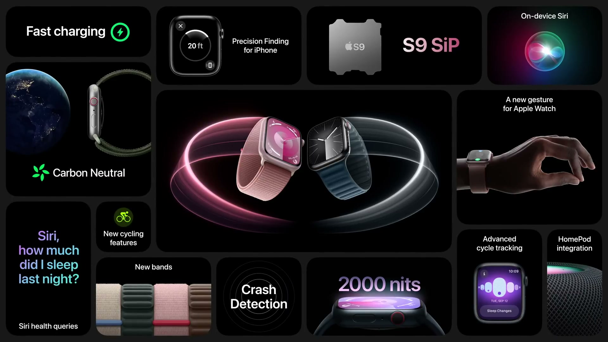
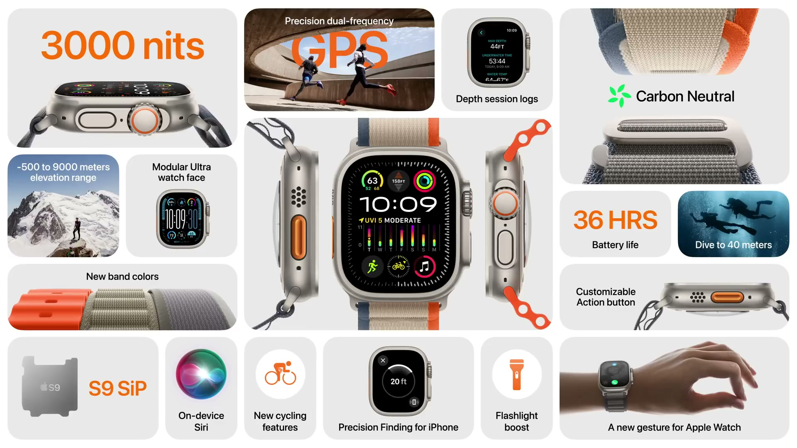
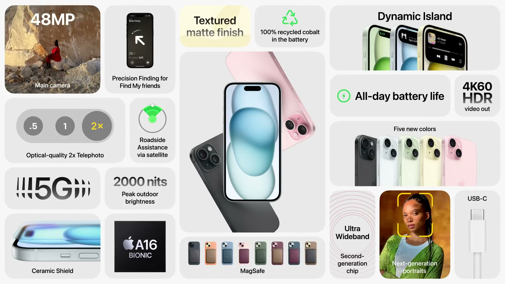
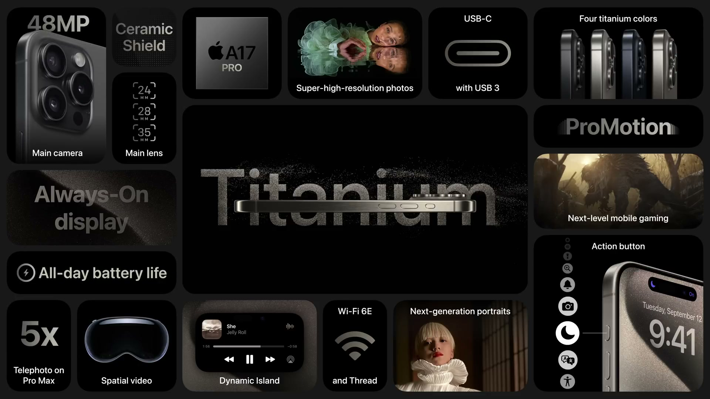

2023年9月12日（現地時間）に Apple Park で開催されたイベントで、Apple Watch と iPhone の新モデルが発表された。Apple Watch Series 9 は Apple 初のカーボンニュートラル製品で、iPhone 15 シリーズは全モデルが USB-C と Dynamic Island を備える。

---

## Apple Watch Series 9

*出典：Apple*

**ハイライト**

- **S9 SiP を新搭載**：トランジスタ数は 56 億個で Series 8 より 60% 増、GPU は 30% 高速化。バッテリーは終日 18 時間を維持
- **Double Tap（新機能）**：人差し指と親指を 2 回タップするだけで操作できるジェスチャー。2023年10月に提供予定
- **Siri がオンデバイス処理に（新機能）**：リクエストを端末内で処理し、ヘルスデータへの Siri アクセスにも対応。ディクテーションの精度は Series 8 比で最大 25% 向上
- **第2世代 Ultra Wideband チップ**：同じチップを搭載した iPhone を探せる Precision Finding に対応し、HomePod との連携も追加
- **ディスプレイの輝度向上**：最大 2000 nit（Series 8 の 2 倍）、最小 1 nit
- **Apple 初のカーボンニュートラル製品**：アルミニウムケースの Series 9 と新しい Sport Loop の組み合わせが対象
- **新しいバンド**：FineWoven の Magnetic Link と Modern Buckle、Hermès と Nike の新作

### S9 SiP

- CPU のトランジスタ数は 56 億個で、Series 8 より 60% 多い
- GPU は 30% 高速。watchOS 10 のアニメーションやエフェクトが滑らかになる
- 新しい 4 コアの Neural Engine により、機械学習の処理が最大 2 倍高速になる
- 終日 18 時間のバッテリー駆動を維持したまま、新機能とシステム全体の改善を追加

### Double Tap

- 時計をつけた手の人差し指と親指を 2 回タップして操作する新しいジェスチャー。もう片方の手がふさがっているときに使える
- 通話の応答と終了、タイマーの停止、音楽の再生・一時停止、アラームのスヌーズなど、アプリの主要ボタンを操作できる
- 文字盤からは Smart Stack を起動でき、もう一度 Double Tap するとウィジェットをスクロールできる（Digital Crown を回す操作と同様）
- 加速度センサー、ジャイロスコープ、光学式心拍センサーのデータを Neural Engine と機械学習アルゴリズムで処理し、タップ時の微細な動きと血流の変化の特徴を検出する
- 2023年10月に提供予定

### Siri とヘルスデータ

- Neural Engine の性能向上により、Siri のリクエストをオンデバイスで処理。よく使うリクエスト（「屋外ウォーキングのワークアウトを開始」など）がクラウドを経由せず、回線状況の影響を受けない。処理の高速化とセキュリティの向上につながる
- より高度な Transformer モデルを実行でき、ディクテーションの精度は Series 8 比で最大 25% 向上
- ヘルスデータへの Siri アクセス（新機能）：睡眠時間、歩行時の平均心拍数、ムーブリングの状況などを音声で尋ねられる
- 体重、生理周期、服薬の記録も音声で行える
- Siri のヘルス関連の質問は 2023年内に英語と中国語（北京語）で提供し、他の言語は順次追加

### 近くのデバイスとの連携

- 第2世代の Ultra Wideband チップにより、同じチップを搭載した iPhone を探す Precision Finding に対応。iPhone までの距離と方向が表示され、近づくと触覚と音で別の部屋にあっても場所を案内する
- HomePod に近づくと、Smart Stack の先頭にメディアの候補が自動で表示され、プレイリストやポッドキャストをすぐ再生できる。すでに再生中なら「再生中」画面が起動して操作できる
- watchOS 10 の NameDrop で、相手の Apple Watch に連絡先をすばやく共有できる

### ディスプレイ

- 画面いっぱいに広がる常時表示 Retina ディスプレイ
- 最大輝度は 2000 nit で Series 8 の 2 倍となり、屋外での視認性が向上
- 最小輝度は 1 nit まで下がり、映画館や早朝など暗い場所でも見やすくなる

### 環境への取り組みとバンド

- Apple 初のカーボンニュートラル製品。素材、電力、輸送の 3 つの排出源を減らし、カーボンフットプリントを 78% 削減。残りはクレジットで相殺し、第三者機関の認証を受けている
- 素材：ケースは 100% 再生アルミニウム、内部には再生ゴールド、スズ、銅、タングステンなどを使用。バッテリーには初めて 100% 再生コバルトを採用
- 電力：Apple Watch の製造は 100% クリーン電力で行われ、充電に使う想定電力量と同量を再生可能エネルギーへの投資で補う
- 輸送：パッケージは 100% 繊維ベースで小型化され、1 回の輸送で最大 25% 多く出荷できる。航空より排出量が 20 分の 1 の海上輸送の比率も増やす
- 対象は、アルミニウムケースの Series 9 と新しい Sport Loop（再生糸 82%）の組み合わせで、箱に専用ロゴが付く
- 今後 Apple の新製品にレザーを使わない方針で、ウォッチバンドも対象
- 新素材 FineWoven は 68% が消費後の再生素材。FineWoven の Magnetic Link と Modern Buckle は新色で展開
- Hermès の新バンド 4 種（織りバンド 2 種、初のニットバンド、スポーティなモールドラバー）と、文字盤の Hermès Radial
- Nike Sport Band（再生素材のフレーク入り）、Nike Sport Loop（過去シーズンの糸を再利用した新しい space dye 調）、秒を地球儀の線上に表示する Nike の新しい文字盤
- ケースの色は、新色の Pink に加え、Starlight、Silver、Midnight、PRODUCT(RED) のアルミニウムと、Gold、Silver、Graphite のステンレススチール

---

## Apple Watch Ultra 2

*出典：Apple*

**ハイライト**

- **S9 SiP を新搭載**：Double Tap、オンデバイス Siri、第2世代 Ultra Wideband による Precision Finding に対応
- **輝度が最大 3000 nit に向上**：Apple が作ったディスプレイで最も明るい
- **Modular Ultra 文字盤（新機能）**：ディスプレイの最外周に高度、水深、秒などをリアルタイム表示
- **ナイトモード**：周囲光センサーで暗い場所では自動的に有効になる
- **サイクリングの機能拡張**：Bluetooth アクセサリーでケイデンス、速度、パワーを計測でき、Power Zones に対応
- **Depth アプリ**：ダイビングのセッションごとのログを保存
- **バッテリー**：通常使用で最大 36 時間、低電力モードで最大 72 時間
- **ケースの再生チタン比率 95%**：昨年の再生素材なしから向上し、カーボンニュートラルに

### S9 SiP と新機能

- Double Tap で、手がふさがっているときも操作できる
- 新しいオンデバイス Siri により、通信できない環境でも声だけでウェイポイントを設定できる
- 第2世代 Ultra Wideband チップの Precision Finding で、iPhone の場所を探せる

### ディスプレイと文字盤

- 新しいディスプレイ構造で輝度は最大 3000 nit。強い日差しの下でも読み取りやすい
- 専用の Modular Ultra 文字盤は、ディスプレイの最外周を初めて使い、高度、水深、秒などを表示する。カスタマイズでき、デジタル文字盤で最も多くの情報を一目で確認できる
- ナイトモードは周囲光センサーを使い、暗い場所で自動的に有効になる

### ランニング・サイクリング・ダイビング

- ランニング：高度なメトリクス、大きく明るいディスプレイ、カスタマイズできる Action ボタン、高精度のデュアル周波数 GPS
- サイクリング：watchOS 10 で Bluetooth アクセサリーを接続し、ケイデンス、速度、パワーを計測。Power Zones でトレーニングを最適化できる
- Apple Watch でサイクリングのワークアウトを開始すると、iPhone にライブアクティビティとして自動表示される
- Depth アプリがセッションごとのログを保存し、Ultra と iPhone の「フィットネス」アプリで振り返れる
- Apple 製品で最も広い高度範囲でテストされている

### バッテリーと環境への取り組み

- バッテリーは通常使用で最大 36 時間、低電力モードで最大 72 時間
- ケースは再生チタン 95%（昨年はすべてバージンチタン）
- Alpine Loop または Trail Loop と組み合わせた Ultra 2 はカーボンニュートラル
- Trail Loop、Alpine Loop、Ocean Band に新色が加わる
- Apple Watch SE（第2世代）も Sport Loop との組み合わせでカーボンニュートラル。これで秋には、新しい Apple Watch のすべてにカーボンニュートラルのモデルがそろう

---

## iPhone 15

*出典：Apple*

**ハイライト**

- **Dynamic Island を搭載**：これまで Pro モデルだった機能が iPhone 15 と 15 Plus に拡大
- **48MP のメインカメラ**：クアッドピクセルセンサーと 100% Focus Pixels を採用し、2x 望遠（12MP 相当）も利用可能
- **次世代ポートレート**：人物・ペットを自動検知して深度情報を取得し、撮影後にピントの対象と深度を変更できる
- **ディスプレイの輝度向上**：HDR のピーク輝度 1600 nit、屋外のピーク輝度は最大 2000 nit（iPhone 14 の 2 倍）
- **A16 Bionic**：16 コア Neural Engine、5 コア GPU（A15 Bionic よりメモリ帯域が 50% 増）
- **USB-C を採用**：充電、データ転送、オーディオ・ビデオ出力に対応
- **第2世代 Ultra Wideband チップ**：Precision Finding で友人を探せる
- **衛星経由の新サービス**：ロードサイドアシスタンスを追加。衛星サービスは 2 年間無料
- **カラーインフューズドガラス**：1 枚のガラスに色を埋め込んだ新しい背面。5 色展開

### デザインとディスプレイ

| | iPhone 15 | iPhone 15 Plus |
|---|---|---|
| 画面サイズ | 6.1 インチ | 6.7 インチ |

- Super Retina XDR ディスプレイ（OLED）は、ベゼルが細く、Dolby Vision に対応
- HDR のピーク輝度は 1600 nit、屋外でのピーク輝度は最大 2000 nit で iPhone 14 の 2 倍
- 航空宇宙グレードのアルミニウムフレームに、新しい丸みを帯びた縁を採用
- 背面は、金属イオンで色を素材そのものに埋め込んだカラーインフューズドガラス（スマートフォンで初）。色は Pink、Yellow、Green、Blue、Black の 5 色
- 独自のデュアルイオン交換プロセスを新素材向けに最適化し、ナノ結晶粒子で研磨したうえでエッチングし、マットな質感に仕上げている
- Ceramic Shield と耐水・防塵性能を備える
- Dynamic Island はアラートとライブアクティビティに合わせて広がり、音楽操作や Maps の次の案内を表示できる。開発者が対応して、フードデリバリーの追跡やスポーツ中継、フライトの搭乗ゲートや搭乗までの時間なども表示できる
- 環境面：エンクロージャーに 75% 再生アルミニウム、バッテリーに 100% 再生コバルト（初）、メインロジックボードと MagSafe 充電器に 100% 再生銅箔を使用

### カメラ

- 48MP のメインカメラ：クアッドピクセルセンサー、100% Focus Pixels によるオートフォーカス
- 48MP の高解像度写真を撮影可能
- 通常は 4 ピクセルをまとめて 2 ミクロンの大きなピクセルとして光を取り込み、Photonic Engine が高解像度の画像と合成して、解像度が 2 倍の 24MP 写真を出力する。ファイルサイズも実用的
- センサー中央の 12MP を使う 2x 望遠（新機能）：写真と 4K ビデオを光学品質で撮影できる。メインカメラのため ƒ/1.6 の絞りとセンサーシフト光学式手ぶれ補正は同じ。ビデオ撮影中も連続ズームに対応し、4K シネマティックモードでも使える
- 次世代ポートレート：ゼロシャッターラグで撮影でき、色の表現と低照度性能が向上。人物の検出を機械学習で行い、ポートレートモードに切り替えなくても深度情報を自動で記録して、撮影後に写真アプリでポートレートにできる。犬と猫にも対応し、iOS 17 のペットアルバムにポートレートが自動で入る
- Focus and Depth Control：撮影後に被写体間でピントを切り替えられる
- ナイトモードの向上、新しい Smart HDR（TrueDepth フロントカメラも含む）。写真アプリの HDR 写真はハイライトが明るく、中間調が豊かになる

### A16 Bionic

- iPhone 14 Pro で導入されたチップ。カスタムのイメージシグナルプロセッサが高度なカメラシステムを支える
- 16 コア Neural Engine が、計算写真やライブ留守番電話の文字起こしをオンデバイスで処理する
- 5 コア GPU は A15 Bionic よりメモリ帯域が 50% 広い
- 6 コア CPU は高性能コア 2 つが A15 Bionic より高速で消費電力は 20% 少ない。高効率コア 4 つが日常の処理を担当し、終日バッテリーを維持
- iPhone 15 Plus はより大きなバッテリーで、さらに長く使える

### ワイヤレスと衛星サービス

- 第2世代 Ultra Wideband チップにより、同じチップを持つデバイスと最大 3 倍離れた距離から接続できる
- Precision Finding で友人を探せる（新機能）：友人が位置情報を共有していれば、距離と方向が案内される。「探す」に組み込まれ、プライバシー保護は同じ
- 通話：機械学習モデルで声を優先して拾う。さらにノイズを除きたいときはボイスアイソレーションを選べる
- 衛星経由の緊急 SOS と「探す」は 3 つの大陸の 14 の国と地域に拡大済みで、今月スペインとスイスに対応する
- ロードサイドアシスタンス（新機能）：セルラーも Wi-Fi も使えない場所で、衛星経由でレッカーなどの支援を依頼できる。テキストで依頼する種類を選ぶと、衛星への接続を案内し、提供事業者へ情報を共有する。米国で AAA と提携して開始し、AAA 会員は補償の対象、非会員は別途利用できる
- 衛星サービスは iPhone 15 で 2 年間無料

### USB-C と MagSafe

- USB-C で、充電、データ転送、オーディオ・ビデオの再生に対応。同じケーブルで Mac、iPad、iPhone、AirPods Pro（第2世代）を充電できる。iPhone から AirPods や Apple Watch の充電も可能
- EarPods も USB-C 版に
- MagSafe は 100% 再生レアアースの磁石を使い、MagSafe と Qi2 の充電器やアクセサリーを正確な位置に合わせる
- レザーの使用をやめ、新しい FineWoven ケースを追加。シリコーンケース、クリアケースも用意

### 2つのモデルの違い

- iPhone 15 は 6.1 インチ、iPhone 15 Plus は 6.7 インチ
- 15 Plus は大きな画面で文字が読みやすく、バッテリーも大きい

---

## iPhone 15 Pro

*出典：Apple*

**ハイライト**

- **チタニウムデザイン（新採用）**：Pro モデルとして過去最軽量。Grade 5 チタニウムのフレームと、100% 再生アルミニウムの内部構造
- **A17 Pro**：業界初の 3 ナノメートルチップ。トランジスタ数は 190 億個で、GPU は新設計の 6 コア
- **ハードウェアアクセラレーテッド・レイトレーシング（新機能）**：A16 Bionic のソフトウェア処理と比べて最大 4 倍高速
- **Action ボタン（新機能）**：着信/サイレントスイッチに代わり、割り当てを変更できる
- **USB-C が USB 3 に対応**：最大 10 Gbps で、USB 2 の最大 20 倍
- **48MP メインカメラ**：センサーが大型化し、24・28・35mm の焦点距離を選べる
- **iPhone 15 Pro Max は 5x 望遠（120mm）を搭載**：iPhone 史上最長の光学ズームで、テトラプリズム構造を採用
- **空間ビデオの撮影（新機能）**：Apple Vision Pro で再生できる。2023年内に提供
- **ProRes の拡張**：外部ストレージへの収録、4K 60fps、Log エンコード、ACES に対応

### チタニウムデザイン

| | iPhone 15 Pro | iPhone 15 Pro Max |
|---|---|---|
| 画面サイズ | 6.1 インチ | 6.7 インチ |
| 望遠カメラ | 3x（77mm） | 5x（120mm） |

- フレームは Grade 5 チタニウム（純チタンより引張強度が高い合金で、火星探査車にも使われる合金）。ステンレススチールよりはるかに軽い
- 内側にはアルミニウムの構造体を固相拡散接合で結合している（業界初）。放熱と軽量化にも効く
- 丸みを帯びた縁と、iPhone で最も細いベゼルにより、画面サイズを変えずに本体寸法を縮小
- 仕上げは精密な機械加工、研磨、ブラシ、ブラストの多段工程による質感に、最大 14 時間かけるナノメートル精度の PVD コーティングで着色。カラーは Black Titanium、White Titanium、Blue Titanium、Natural Titanium の 4 色
- 新しい内部構造により、背面ガラスを簡単に交換できて修理しやすい
- 内部構造のアルミニウムはすべて再生アルミニウム（iPhone で初）
- 前面は Ceramic Shield

### Action ボタン

- 初代 iPhone から続く着信/サイレントスイッチに代わる、カスタマイズできるボタン。初期設定は着信/サイレントの切り替えで、長押しして切り替え、状態ごとに異なる触覚フィードバックが返る
- 割り当てられる操作：ボイスメモの録音開始、カメラの起動、Live Speech などアクセシビリティ機能、ショートカット（アプリの起動やカスタムショートカットの実行）
- 操作の結果は Dynamic Island に表示される

### ディスプレイと StandBy

- Super Retina XDR ディスプレイに、ProMotion、Extreme Dynamic Range、常時表示を備える
- iOS 17 の StandBy：充電中に iPhone を横向きにすると全画面表示になる。常時表示ディスプレイにより表示が続き、デジタル時計や複数のウィジェットを選べる

### A17 Pro

| 項目 | 内容 |
|---|---|
| プロセス | 3 ナノメートル（業界初）、トランジスタ数 190 億個、EUV リソグラフィで製造 |
| CPU | 高性能コアが最大 10% 高速。高効率コアも高速化 |
| GPU | 新しい Apple 設計のシェーダーアーキテクチャによる 6 コア。ピーク性能は最大 20% 向上 |
| Neural Engine | 機械学習モデルの処理が最大 2 倍高速。毎秒最大 35 兆回の演算 |
| 専用エンジン | ProRes コーデック、ProMotion・常時表示用のディスプレイエンジン、AV1 デコーダー |
| USB | USB 3（最大 10 Gbps）に対応する USB コントローラを内蔵 |

- Neural Engine はオンデバイスで、オートコレクト、背景からの被写体の切り抜き、音声を失うリスクのあるユーザー向けの Personal Voice などを処理する
- GPU の新機能：メッシュシェーディング（消費電力を抑えながら精細な環境を描画）と、スマートフォン最速のハードウェアアクセラレーテッド・レイトレーシング。A16 Bionic のソフトウェア処理と比べ最大 4 倍高速で、より省電力
- MetalFX Upscaling は GPU と Neural Engine を組み合わせ、少ない消費電力で高品質なグラフィックスを実現する
- USB 3 ケーブル（別売）を使うと、USB 2 の最大 20 倍の速度で転送できる

### ゲーム

- A17 Pro の性能を活かした対応タイトル：The Division Resurgence（2024年前半に iPhone で提供開始）、Honkai: Star Rail
- Resident Evil Village と Resident Evil 4（リメイク）が 2023年内に iPhone 15 Pro で登場
- Assassin's Creed Mirage が 2024年前半に iPhone 15 Pro に登場し、コンソール版の Assassin's Creed がスマートフォンにネイティブで提供されるのは初

### カメラ

- 7 つのレンズに相当する撮影範囲を提供するカメラシステム
- 48MP メインカメラ：iPhone 15 よりセンサーが大きく、レンズフレアを抑えるナノスケールコーティングを施す。48MP ProRAW に加え、48MP HEIF での撮影にも対応
- デフォルトの 24MP 写真は低照度性能とディテールを両立。Photonic Engine が 48MP の画像を使うことで、24・28・35mm の焦点距離を切り替えて撮影でき、デフォルトのレンズも選べる
- 次世代ポートレートと Focus and Depth Control：低照度性能が 2 倍に向上。LiDAR スキャナにより、ナイトモードのポートレートも撮影できる
- Photonic Engine によるナイトモード、最新の Smart HDR でダイナミックレンジが拡大
- iPhone 15 Pro：3x 望遠（77mm）
- iPhone 15 Pro Max：5x 光学ズーム（120mm）。iPhone 14 Pro Max と比べセンサーが 25% 大きく、100% Focus Pixels、ƒ/2.8 の絞りを備える（この光学ズーム域のスマートフォンで最大）
- テトラプリズム構造で、光がガラス内で 4 回反射し、小型のままレンズとセンサーの距離を確保する。OIS とオートフォーカスを兼ねる 3D センサーシフトモジュールは 3 方向に動き（スマートフォンで初）、毎秒最大 10,000 回の微調整を行う（iPhone 14 Pro の 2 倍）
- 超広角カメラ：新しい反射防止コーティング、ナイトモードの向上、最新の Smart HDR。マクロ撮影にも対応
- 光学ズーム範囲は 13〜120mm の 10x

### プロ向けワークフローと空間ビデオ

- USB 3 ケーブルで、ProRAW 写真や ProRes ビデオを Mac へ高速に転送できる
- Capture One と組み合わせ、48MP ProRAW を撮影して直接 Mac へ即時転送できる
- ProRes ビデオを外部ストレージに直接収録でき、ProRes 4K を 60fps で撮影できる（初）
- Log エンコードに対応し、VFX やカラーグレーディングの自由度が高まる。Academy Color Encoding System（ACES）に対応したスマートフォンとして世界初
- 空間ビデオ：超広角カメラとメインカメラを同時に使って 3D ビデオを撮影し、Apple Vision Pro で再生できる。Apple Vision Pro を持つ人と共有もできる。2023年内に提供
- iCloud+ に 6TB と 12TB のプランが追加される（翌週から）

---

## 価格・発売日

| 製品 | 価格 | 税込換算 | 発売日 |
| ------ | ------ | ------ | -------- |
| Apple Watch Series 9 | $399〜 | 約6万4,000円〜 | 2023年9月22日（Double Tap は2023年10月に提供） |
| Apple Watch Ultra 2 | $799 | 約12万9,000円 | 2023年9月22日 |
| iPhone 15 | $799〜 | 約12万9,000円〜 | 2023年9月22日（予約は9月15日） |
| iPhone 15 Plus | $899〜 | 約14万5,000円〜 | 2023年9月22日（予約は9月15日） |
| iPhone 15 Pro | $999〜 | 約16万1,000円〜 | 2023年9月22日（予約は9月15日） |
| iPhone 15 Pro Max | $1,199〜（256GB） | 約19万4,000円〜 | 2023年9月22日（予約は9月15日） |

※日本円は、米国の価格（税抜き）を発表日（2023年9月12日）の為替レート（1ドル＝146.94円、欧州中央銀行の参考レート）で換算し、消費税10%を加えた参考値。実際の日本での販売価格とは異なる。
