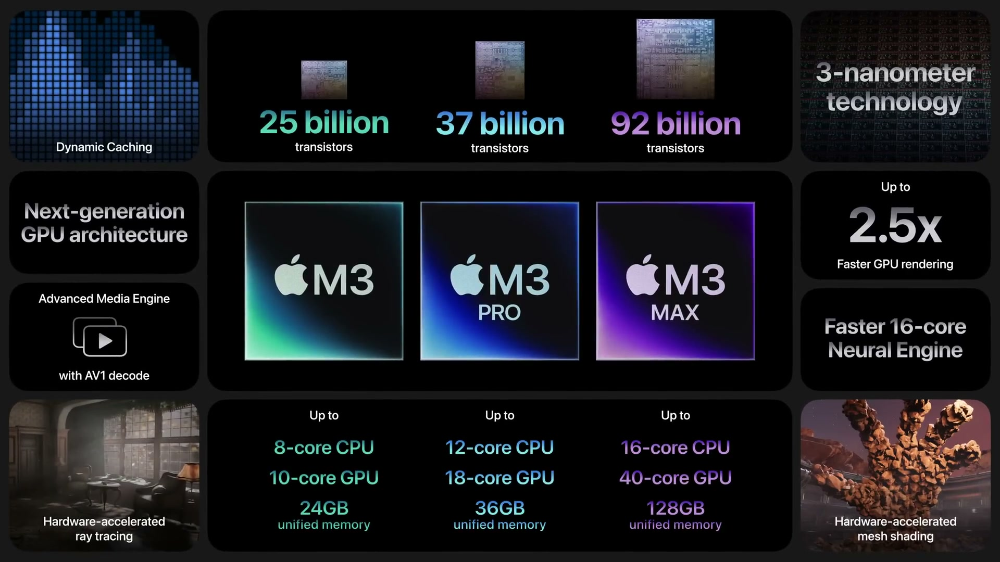
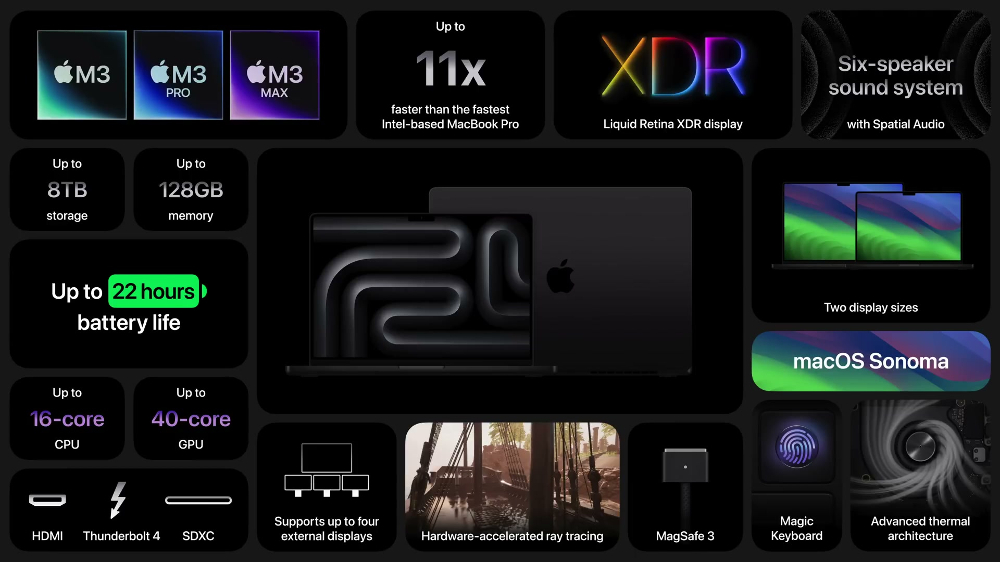
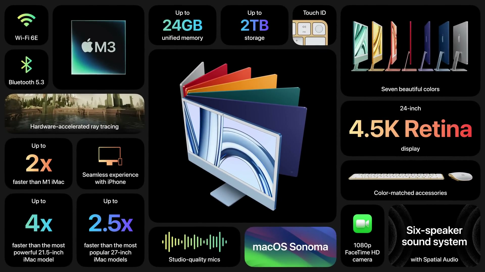

2023 年 10 月 30 日（現地時間）、Apple Park で「Scary Fast」と題した Apple Event が開催された。パーソナルコンピュータ向けとして初の 3 ナノメートルチップ、M3、M3 Pro、M3 Max と、それを搭載する MacBook Pro、M3 を搭載した 24 インチ iMac が発表された。

---

## M3 ファミリーのチップ

*出典：Apple*

**ハイライト**

- **3 ナノメートルプロセス**：パーソナルコンピュータ向けチップとして初めて採用。M3、M3 Pro、M3 Max の3種を同時に発表
- **次世代 GPU**：Apple シリコン史上最大のグラフィックスアーキテクチャの刷新。Dynamic Caching、メッシュシェーディング、レイトレーシングをハードウェアで実装
- **レンダリング性能**：M1 ファミリー比で最大 2.5 倍高速（プロアプリ）
- **CPU**：パフォーマンスコアは M1 ファミリー比で最大 30% 高速、高効率コアは最大 50% 高速
- **Neural Engine**：M1 ファミリー比で 60% 高速
- **Media Engine**：AV1 デコードに対応
- **M3 Max のメモリ**：最大 128GB のユニファイドメモリに対応

### 3 ナノメートルプロセス

極端紫外線（EUV）リソグラフィを用いた 3 ナノメートル技術により、人の髪の断面に 200 万個のトランジスタが収まる大きさを実現している。このトランジスタでチップの各コンポーネントを強化し、ファミリー全体で性能向上と新機能を実現した。

### 次世代 GPU

従来のグラフィックスアーキテクチャでは、GPU のローカルメモリ量をコンパイル時にソフトウェアが決めるため、最も重いタスクに合わせた量が毎回確保され、GPU が十分に使われなかった。M3 ファミリーの Dynamic Caching は、この割り当てをハードウェアがリアルタイムに行い、各タスクに必要な分だけ使う仕組み。業界初の機能で、開発者からは透過的に動作する。

- **Dynamic Caching**：GPU の平均使用率を高め、負荷の高いプロアプリやゲームの性能を向上
- **メッシュシェーディング**：ハードウェアアクセラレーション対応。ジオメトリ処理の能力と効率が上がり、より複雑なシーンを描画できる
- **レイトレーシング**：Mac で初めてハードウェアアクセラレーションに対応。ゲームでより正確な影や反射を描画でき、3D レンダリングアプリのレイトレース描画も高速化

### CPU・Neural Engine・Media Engine

| 項目 | M1 ファミリー比 |
|------|----------------|
| パフォーマンスコア | 最大 30% 高速 |
| 高効率コア | 最大 50% 高速 |
| Neural Engine | 60% 高速 |

Neural Engine の高速化により、データをデバイス上に置いたまま AI 処理を行える。Media Engine は主要なビデオコーデックのハードウェアアクセラレーションに対応しており、AV1 のサポートが加わった。YouTube や Netflix などのストリーミング動画を省電力で再生できる。

### 電力効率

| 比較対象 | 同等性能に必要な消費電力 |
|----------|--------------------------|
| M1（CPU のマルチスレッド性能） | 約半分 |
| M1（GPU 性能） | 約半分 |
| 最新の 12 コア PC ノート向けチップ（CPU 性能） | 4 分の 1 |
| 同チップ（GPU 性能） | 5 分の 1 |

### 3 つのチップの違い

| チップ | CPU | GPU | 性能向上 |
|--------|-----|-----|----------|
| M3 | 8 コア | 10 コア | M1 比で最大 65% 高速 |
| M3 Pro | 12 コア | 18 コア | M1 Pro 比で最大 40% 高速 |
| M3 Max | 16 コア | 40 コア | M1 Max 比で最大 80% 高速 |

M3 Max は最大 128GB のユニファイドメモリに対応し、数十億パラメータ規模の大きな Transformer モデルを扱う AI 開発者にも対応する。

---

## MacBook Pro（M3 / M3 Pro / M3 Max）

*出典：Apple*

**ハイライト**

- **14 インチが M3 から開始**：13 インチ MacBook Pro（M1）比で最大 60% 高速
- **M3 Pro 搭載モデル**：16 インチ MacBook Pro（M1 Pro）比で最大 40% 高速。外部ディスプレイは 2 台まで
- **M3 Max 搭載モデル**：16 インチ MacBook Pro（M1 Max）比で最大 2.5 倍高速。ProRes エンジンを 2 基搭載し、最大 128GB のユニファイドメモリと外部ディスプレイ 4 台に対応
- **バッテリー**：最大 22 時間。Intel 搭載モデルより最大 11 時間長い
- **Liquid Retina XDR ディスプレイ**：SDR コンテンツの輝度が最大 600 nits に向上（従来比 20% 明るい）
- **スペースブラック**：M3 Pro / M3 Max 搭載モデルに新色。指紋の付きにくいアルマイト処理
- **Intel モデルからの移行**：最速の Intel 搭載モデルより最大 11 倍高速

### チップ別のモデル

| 構成 | 比較対象 | 性能向上 | 主な特徴 |
|------|----------|----------|----------|
| 14 インチ・M3 | 13 インチ・M1 | 最大 60% 高速 | 高度な冷却システムで負荷が続いても性能を維持 |
| 14・16 インチ・M3 Pro | 16 インチ・M1 Pro | 最大 40% 高速 | 追加のユニファイドメモリ、外部ディスプレイ 2 台 |
| 14・16 インチ・M3 Max | 16 インチ・M1 Max | 最大 2.5 倍高速 | 最大 128GB メモリ、ProRes エンジン 2 基、外部ディスプレイ 4 台 |

M3 搭載モデルではハードウェアアクセラレーションによるレイトレーシングで、ゲームの光や影、反射の表現も向上する。M3 Max の 128GB メモリは Mac Studio（M1 Ultra）で初めて対応したもので、約 18 か月後に MacBook Pro へ搭載された。

### 電源接続時とバッテリー駆動時の性能

全モデルで、電源接続時とバッテリー駆動時の性能が変わらない。バッテリーは最大 22 時間。

### Intel 搭載モデルからの移行

最速の Intel 搭載モデルと比べて最大 11 倍高速で、バッテリー駆動時間は最大 11 時間長くなる。多くの作業ではファンの音が聞こえない。

### ディスプレイ

Liquid Retina XDR ディスプレイは、持続輝度 1000 nits、HDR コンテンツのピーク輝度 1600 nits。新モデルでは SDR コンテンツを最大 600 nits で表示でき、従来より 20% 明るい。同じく最大 600 nits に対応する Studio Display に接続すると、作業全体で輝度を揃えられる。

### スペースブラックと素材

- **スペースブラック**：M3 Pro と M3 Max 搭載モデルで選べる新色。暗い色のアルミニウム仕上げで、新しい化学処理によるアルマイト封孔で指紋を大幅に抑える
- **素材**：筐体は 100% リサイクルアルミニウムの特製合金。2030 年までにカーボンニュートラルな製品を実現する目標の一環

### macOS Sonoma

- **デスクトップウィジェット**：天気、リマインダーなどを表示
- **Screen Sharing のパフォーマンスモード**：別の Mac へ応答性の高いリモートアクセスが可能
- **ゲームモード**：グラフィックス処理を優先してフレームレートを安定させ、ワイヤレスアクセサリの遅延を大幅に低減

---

## iMac（24 インチ）

*出典：Apple*

**ハイライト**

- **M3 チップを搭載**：24 インチ iMac として初のアップデート
- **性能向上**：M1 搭載 iMac 比で最大 2 倍高速
- **Intel 搭載 iMac との比較**：最も売れた 27 インチモデル比で最大 2.5 倍、最上位の 21.5 インチモデル比で最大 4 倍高速
- **ディスプレイ**：4.5K Retina、1100 万画素、輝度 500 nits、10 億色以上
- **デザインとカラー**：薄型のデザインと 7 色のカラーバリエーションを継承
- **ワイヤレス**：より高速な無線接続に対応

### パフォーマンス

M3 の搭載により、マルチタスク、高解像度写真や複数の 4K ビデオストリームの編集、ゲームの読み込みなどが高速になる。

| 比較対象 | 性能向上 |
|----------|----------|
| M1 搭載 iMac | 最大 2 倍 |
| Intel 搭載 27 インチ（最も売れたモデル） | 最大 2.5 倍 |
| Intel 搭載 21.5 インチ（最上位モデル） | 最大 4 倍 |

### ディスプレイ

24 インチの 4.5K Retina ディスプレイは、Intel 搭載の 4K モデルと 5K モデルの両方の置き換えに適したサイズと解像度。仕様は 1100 万画素、500 nits、10 億色以上。

### カメラ・サウンド・入力

- **カメラ**：1080p FaceTime カメラ
- **スピーカー**：Spatial Audio 対応の 6 スピーカーサウンドシステム
- **マイク**：スタジオ品質のマイク
- **Apple シリコンの機能**：Neural Engine と Media Engine
- **Touch ID**：Touch ID 搭載の Magic Keyboard を選択可能。安全なログインと支払いに利用できる

### iPhone などとの連携

Mac から直接メッセージの送信や電話への応答ができる。iPhone で書類をスキャンすると、すぐに Mac に表示される。

---

## 価格・発売日

| 製品 | 価格 | 税込換算 | 発売日 |
| ------ | ------ | ------ | -------- |
| 14 インチ MacBook Pro（M3） | $1,599 から | 約26万3,000円〜 | 発表日に予約開始、翌週に発売 |
| 14 インチ MacBook Pro（M3 Pro） | 言及なし | — | 発表日に予約開始、翌週に発売 |
| 16 インチ MacBook Pro（M3 Pro / M3 Max） | $2,499 から | 約41万2,000円〜 | M3 Pro 搭載モデルは発表日に予約開始・翌週発売、M3 Max 搭載モデルは 11 月中に発売 |
| 14 インチ MacBook Pro（M3 Max） | 言及なし | — | 11 月中に発売 |
| 24 インチ iMac（M3） | $1,299 から | 約21万4,000円〜 | 発表日に予約開始、翌週に発売 |

※日本円は、米国の価格（税抜き）を発表日（2023年10月30日）の為替レート（1ドル＝149.74円、欧州中央銀行の参考レート）で換算し、消費税10%を加えた参考値。実際の日本での販売価格とは異なる。
