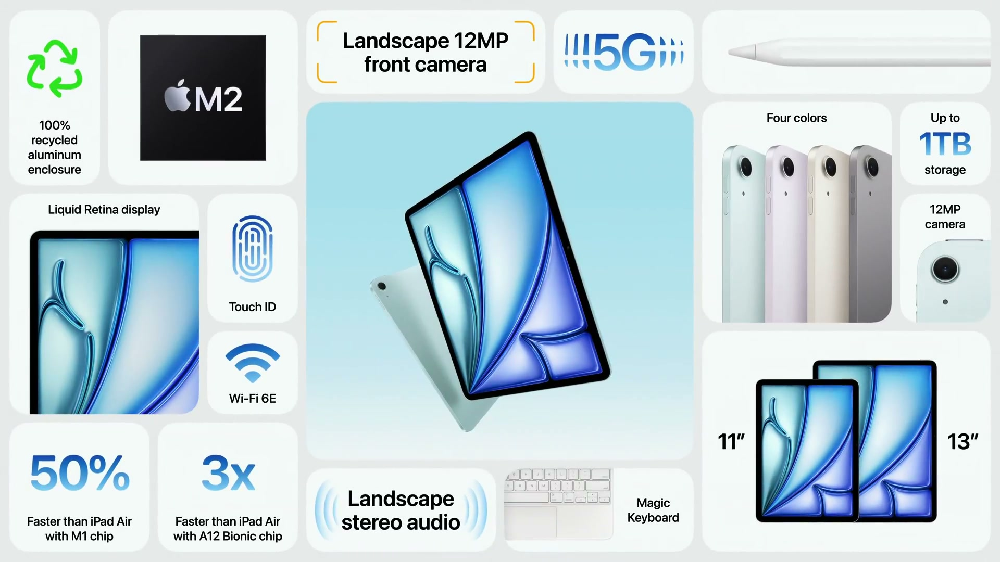
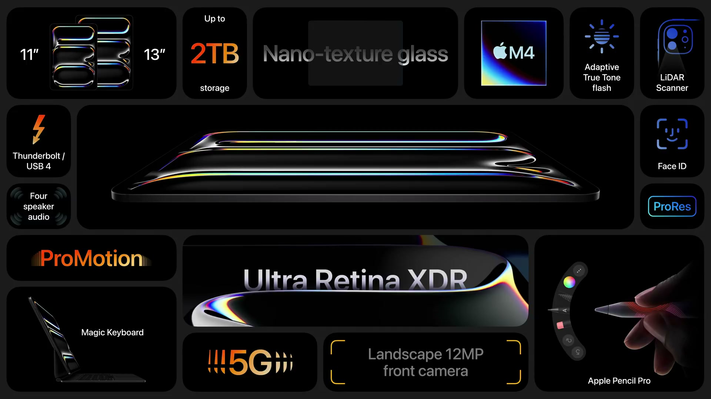
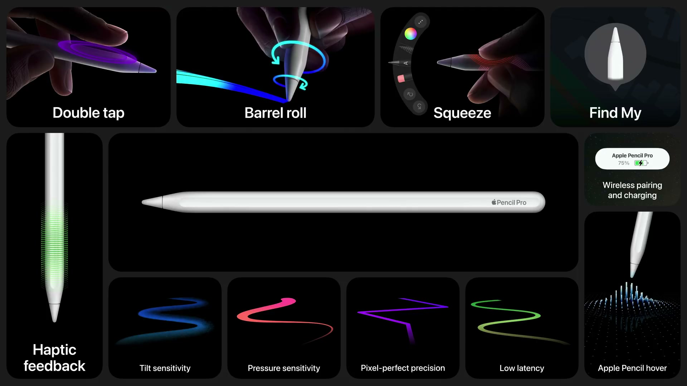

2024年5月7日（現地時間）、Apple Park で開催されたイベント。iPad Air は初めて 11 インチと 13 インチの2サイズになり M2 を搭載、iPad Pro はタンデム OLED ディスプレイと M4 チップで刷新された。Final Cut Pro 2、Logic Pro 2、新しい Magic Keyboard、Apple Pencil Pro も発表された。

---

## iPad Air

*出典：Apple*

**ハイライト**

- **2サイズ展開（新）**：iPad Air として初めて 11 インチと 13 インチの2サイズになった。13 インチは 11 インチより画面領域が 30% 広い
- **M2 チップ搭載（向上）**：M1 搭載の前モデルより約 50% 高速、A14 Bionic 搭載モデルより最大3倍高速。CPU・GPU・Neural Engine が高速化し、メモリ帯域幅も向上
- **フロントカメラを横向きの辺に配置（新）**：Center Stage に対応し、横向きでの FaceTime やビデオ会議で全員を画角に収める
- **スピーカー（向上）**：横向きステレオスピーカーと空間オーディオに対応。13 インチは低音が2倍
- **Apple Pencil hover 対応（新）**：M2 により、描く前に筆跡をプレビューできる
- **ストレージ（拡大）**：開始容量が 2 倍の 128GB になり、512GB と 1TB を追加
- **カラー（新）**：新色のブルーとパープルに、スターライトとスペースグレイを加えた4色

### 2つのサイズ

| | 11 インチ | 13 インチ |
|---|---|---|
| ディスプレイ | Liquid Retina | Liquid Retina |
| 画面領域 | — | 11 インチより 30% 広い |
| スピーカー | 横向きステレオ、空間オーディオ | 横向きステレオ、空間オーディオ（低音が2倍） |

- 両モデルのディスプレイ機能は同じ
- 13 インチは Freeform での作業スペースの拡大、Zoom での参加者表示数の増加、iPadOS の Split View での複数アプリ表示に向く
- 11 インチは持ち運びやすさと、メモ取りなどの用途を重視したサイズ

### M2 チップ

- M1 に比べて CPU・GPU・Neural Engine が高速になり、メモリ帯域幅も拡大
- 前モデル（M1）比で約 50% 高速、A14 Bionic 搭載の iPad Air 比で最大3倍高速
- Affinity Designer 2 などの制作アプリや、Assassin's Creed Mirage、近日登場の Zenless Zone Zero といったグラフィックス負荷の高いゲームに対応
- 機械学習機能にも強く、iPadOS の Visual Look Up、被写体の切り抜き、Live Text キャプチャが高速に動作する
- Photomator の ML Enhance は、2,000 万枚超のプロ品質の画像で学習した AI モデルで、ワンクリックで写真を補正する

### カメラとオーディオ

- フロントカメラを横向きの辺に移設。Center Stage は機械学習で全員を自動的に画角に収める
- 横向きステレオスピーカーが空間オーディオに対応
- 13 インチは低音が2倍で、音質がさらに向上

### デザインとカラー

- 4色展開：新色のブルー、新色のパープル、スターライト、スペースグレイ
- 筐体は 100% リサイクルアルミニウム
- Wi-Fi が高速化

### アクセサリとストレージ

- Magic Keyboard（トラックパッド、バックライト付きキー、フローティングデザイン）に対応
- Apple Pencil に対応し、M2 により Apple Pencil hover で筆跡を事前にプレビューできる
- ストレージは 128GB から開始（従来の 2 倍）。512GB と 1TB を新たに追加

---

## iPad Pro

*出典：Apple*

**ハイライト**

- **薄型化（新デザイン）**：11 インチは 5.3mm、13 インチは 5.1mm。iPod nano より薄く、Apple 製品として最も薄い。11 インチは 1 ポンド未満、13 インチは前モデルより約 4分の1ポンド軽い
- **タンデム OLED（新）**：iPad に初めて OLED を採用。2枚の OLED パネルの光を重ね、フルスクリーン輝度 1000 nit（SDR・HDR とも）、ピーク HDR 輝度 1600 nit
- **Ultra Retina XDR ディスプレイ**：11 インチ・13 インチの両モデルに搭載。ナノテクスチャガラスのオプションも iPad Pro で初めて用意
- **M4 チップ搭載（新）**：M2 から一気に M4 へ。CPU は M2 比で最大 50% 高速、Neural Engine は毎秒 38 兆回の演算
- **GPU の新機能**：Dynamic Caching に加え、ハードウェアアクセラレーションのメッシュシェーディングとレイトレーシングが iPad で初めて利用可能に
- **放熱（向上）**：グラファイトシートとロゴ部の銅で、熱性能が約 20% 向上
- **カメラ（変更）**：12MP の超広角フロントカメラを横向きの辺へ移動。Face ID も同じ位置に
- **ストレージ（拡大）**：開始容量が 2 倍の 256GB
- **カラー**：シルバーとスペースブラック

### 薄くて軽い新デザイン

| | 11 インチ | 13 インチ |
|---|---|---|
| 厚さ | 5.3mm | 5.1mm |
| 重さ | 1 ポンド未満 | 前モデルより約 4分の1ポンド軽い |

- 仕上げはシルバーとスペースブラックの2色で、どちらも 100% リサイクルアルミニウムの筐体
- 薄型化しても、強度は従来デザインと同等

### Ultra Retina XDR ディスプレイ

- 1枚の OLED パネルではフルスクリーンで XDR に必要な輝度が足りないため、2枚の OLED パネルの光を合成するタンデム OLED を開発
- フルスクリーン輝度は SDR・HDR コンテンツともに 1000 nit、HDR のピーク輝度は 1600 nit
- 各ピクセルの色と輝度をミリ秒未満で制御でき、ハイライトはより明るく、黒はより深く、暗部のディテールはより豊かに表現。動きのあるコンテンツへの応答性も向上
- 従来のディスプレイより薄く軽く、新デザインを可能にした
- ナノテクスチャガラスは、ナノメートル単位でエッチングし、画質とコントラストを保ちながら周囲光を散乱させて映り込みを抑える。カラーマネージドなワークフローや強い環境光下の作業向け

### M4 チップ

- 第2世代の 3 ナノメートル技術で製造され、電力効率が向上
- 新しいディスプレイエンジンが Ultra Retina XDR の精度・色・輝度を支える
- CPU は高性能コア最大4つと効率コア6つ構成で、全コアに次世代の ML アクセラレータを搭載。M2 比で最大 50% 高速
- 10 コア GPU は M3 で登場した次世代アーキテクチャがベースで、Dynamic Caching、ハードウェアアクセラレーションのメッシュシェーディング、レイトレーシングに対応。Octane などのレンダリングアプリは M2 比で最大4倍高速
- 電力効率：M2 と同じ性能を半分の電力で、薄型軽量ノート PC 向けの最新 PC チップと同じ性能を4分の1の電力で発揮
- Neural Engine は毎秒 38 兆回の演算で、A11 Bionic の最初の Neural Engine の 60 倍。Final Cut Pro では 4K ビデオの被写体を背景からタップだけで切り抜ける

### 熱性能と iPadOS

- メインハウジングにグラファイトシート、Apple ロゴに銅を採用し、熱性能が約 20% 向上
- 前の iPad Pro（M2）より最大4倍、初代 iPad Pro より最大10倍高速
- iPadOS の Reference Mode は、カラーグレーディングのように正確で一貫した画質が必要な作業で色要件に合わせられる
- Stage Manager は重なり合う複数ウィンドウと外部ディスプレイに対応
- Core ML により、デベロッパーが Neural Engine を使ったオンデバイス AI 機能を実装できる
- Shapr3D（Apple Pencil での CAD）や ZBrush（3D モデリングとスカルプト）などのプロ向けアプリが利用可能

### カメラと書類スキャン

- 背面は 12MP カメラ（4K ProRes ビデオ撮影）、スタジオ品質のマイク4つ、LiDAR スキャナを搭載
- 新しいアダプティブ True Tone フラッシュにより書類スキャンが向上。AI がフォームやレシートなどの書類を自動検出し、影が入る場合はフラッシュ付きで複数枚を撮影して合成する
- この機能は iPadOS に組み込まれており、カメラ、ファイル、メモ、サードパーティ製アプリで使える
- 12MP の超広角フロントカメラは縦向きの辺から横向きの辺へ移動。Face ID と、Apple Pencil の新しい充電・ペアリング機構も同じ位置に配置

---

## Final Cut Pro 2 for iPad

**ハイライト**

- **Live Multicam（新機能）**：最大4台のカメラを接続してプレビューし、1画面で操作
- **Final Cut Camera（新アプリ）**：iPhone・iPad 用。Live Multicam のカメラ役、または無料の単体撮影アプリとして使える
- **外部プロジェクトのサポート（新機能）**：ドライブ上のプロジェクトを直接編集
- **M4 での性能（向上）**：最終レンダリングは M1 比で最大2倍高速、ProRes RAW は M1 比で最大4倍のストリーム数を扱える

### Live Multicam と Final Cut Camera

- iPad が複数カメラ撮影のスタジオになり、各アングルの露出、ホワイトバランス、フォーカスなどをリモートで調整できる
- Final Cut Camera は、複数の iPhone や iPad を接続して追加アングルを撮影するためのアプリ。手動の精密なコントロールでプロ品質の動画を撮影する単体利用も可能（無料）
- 各アングルは Final Cut Pro に自動転送・同期され、撮影から編集へそのまま移れる

### 編集と書き出し

- 外部プロジェクトのサポートにより、iPad Pro の Thunderbolt 接続を生かして、ドライブ上のプロジェクトを直接編集できる
- ProRes RAW は M1 比で最大4倍のストリームに対応し、カラーグレーディング、複数エフェクト、負荷の高いタイムラインのレンダリングが高速化。HDR コンテンツにも対応
- 最終レンダリングは M1 比で最大2倍高速

---

## Logic Pro 2 for iPad

**ハイライト**

- **Session Players（新機能）**：Drummer に加え、AI で作られた Bass Player と Keyboard Player を追加
- **ChromaGlow（新プラグイン）**：機械学習でアナログ機器の温かみあるサウンドをモデリング
- **Stem Splitter（新機能）**：録音を声・ベース・ドラム・その他の楽器の4パートに分離。M4 によりオンデバイスで高速に処理

### Session Players

- 既存の Drummer に、新たに Bass Player と Keyboard Player を追加
- Drummer と同様に AI で構築されており、シンプルなコントロールで演奏を調整できる

### ChromaGlow

- デジタル録音にアナログの温かみを加えるプラグインで、ハードウェアのサウンドを機械学習で詳細にモデリング
- M4 の性能により、多数のトラックで使える

### Stem Splitter

- 元のトラックやステムが無い録音から、声、ベース、ドラム、その他の楽器の4パートを抽出
- 処理は M4 によりオンデバイスで高速に実行され、リミックスやサンプリングに使える

---

## Magic Keyboard（iPad Pro 用）

**ハイライト**

- **ファンクションキー列（新機能）**：画面の明るさなどにすばやくアクセス
- **アルミニウム製パームレスト（新）**：新デザインに合わせた素材
- **大型トラックパッド（拡大）**：触覚フィードバック付きで応答性が向上
- **薄型軽量化（向上）**：従来より大幅に薄く軽い。フローティングデザインは維持
- **カラー**：新しい iPad Pro に合わせた2色

### 新しい Magic Keyboard

- 開くとフローティングデザインが現れる構造は従来どおり
- 2色展開で、新しい iPad Pro の仕上げと揃う
- キーボード面にファンクションキー列を備え、トラックパッドは大型化して触覚フィードバックに対応。MacBook に近い操作感になった

---

## Apple Pencil Pro

*出典：Apple*

**ハイライト**

- **スクイーズ（新機能）**：軸のセンサーで握るとツールパレットを表示。触覚エンジンがフィードバックを返す
- **バレルロール（新機能）**：ジャイロスコープで回転を検出し、シェイプドペンやブラシの向きなどを精密に操作
- **Find My 対応（新機能）**：紛失時に探せる
- **iPad Pro の側面で磁気によるペアリング・充電・保管**
- **対応機種**：新しい iPad Pro のほか、新しい iPad Air でも使える

### 新しいインタラクション

- 軸に新しいセンサーを搭載し、スクイーズでツールパレットを呼び出せる。操作時は触覚エンジンが感触を返す
- ジャイロスコープでペンを回転させる操作（バレルロール）に対応
- Find My に対応し、紛失しても場所を確認できる
- デベロッパーは独自のインタラクションを実装できる

### Procreate での活用

- バレルロールでブラシのサイズや色を変えるなど、反応の異なるブラシを作れる
- スクイーズで、画面に触れずにショートカットやブラシ、ツールを起動したり、ホバー中にレイヤーを選択したりできる
- オブジェクトの移動・変形時は、整列にスナップするタイミングを触覚フィードバックで伝える
- Procreate Dreams では、バレルロールを活用した Performing 機能で、ムービー再生中の操作を録音してアニメーションを作成。オブジェクトの移動と回転を同時に行える
- M4 により、リアルなボケやフォーカスアニメーションを作る Lens Blur などの負荷の高いエフェクトが追加され、性能は新しい iPad Pro 上で 50% 向上

### 対応機種

| 機種 | 対応 |
|---|---|
| iPad Pro（新） | 対応 |
| iPad Air（新） | 対応 |

- iPad Air と iPad Pro のユーザーは、2種類の Apple Pencil から選べる

---

## 価格・発売日

| 製品 | 価格 | 税込換算 | 発売日 |
| ------ | ------ | ------ | -------- |
| iPad Air（11 インチ） | $599 から | 約10万2,000円〜 | 5月7日から注文可能、発売は翌週 |
| iPad Air（13 インチ） | $799 から | 約13万6,000円〜 | 5月7日から注文可能、発売は翌週 |
| iPad Pro（11 インチ） | $999 から | 約17万円〜 | 5月7日から注文可能、発売は翌週 |
| iPad Pro（13 インチ） | $1,299 から | 約22万1,000円〜 | 5月7日から注文可能、発売は翌週 |
| Final Cut Pro 2 for iPad | 言及なし | — | 言及なし |
| Logic Pro 2 for iPad | 言及なし | — | 言及なし |
| Magic Keyboard（11 インチ用） | $299 | 約5万1,000円 | 5月7日から注文可能、発売は翌週 |
| Magic Keyboard（13 インチ用） | $349 | 約5万9,000円 | 5月7日から注文可能、発売は翌週 |
| Apple Pencil Pro | $129 | 約2万2,000円 | 5月7日から注文可能、発売は翌週 |

※日本円は、米国の価格（税抜き）を発表日（2024年5月7日）の為替レート（1ドル＝154.61円、欧州中央銀行の参考レート）で換算し、消費税10%を加えた参考値。実際の日本での販売価格とは異なる。
