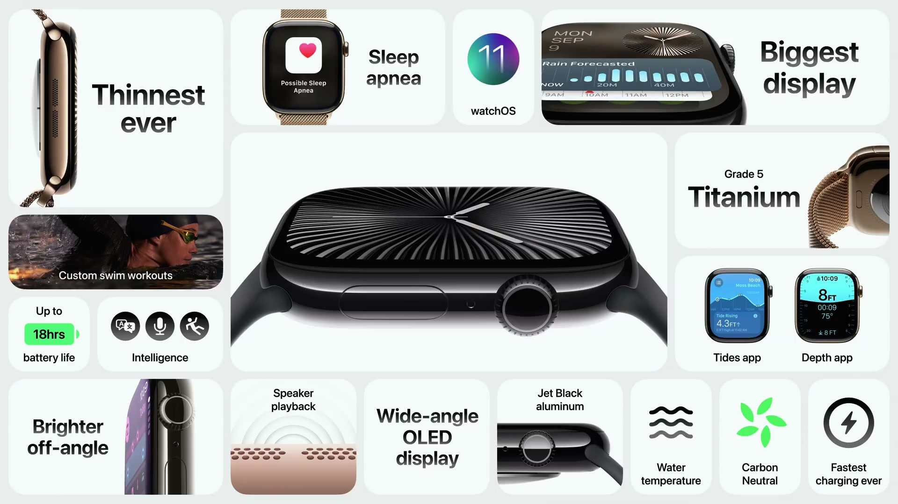
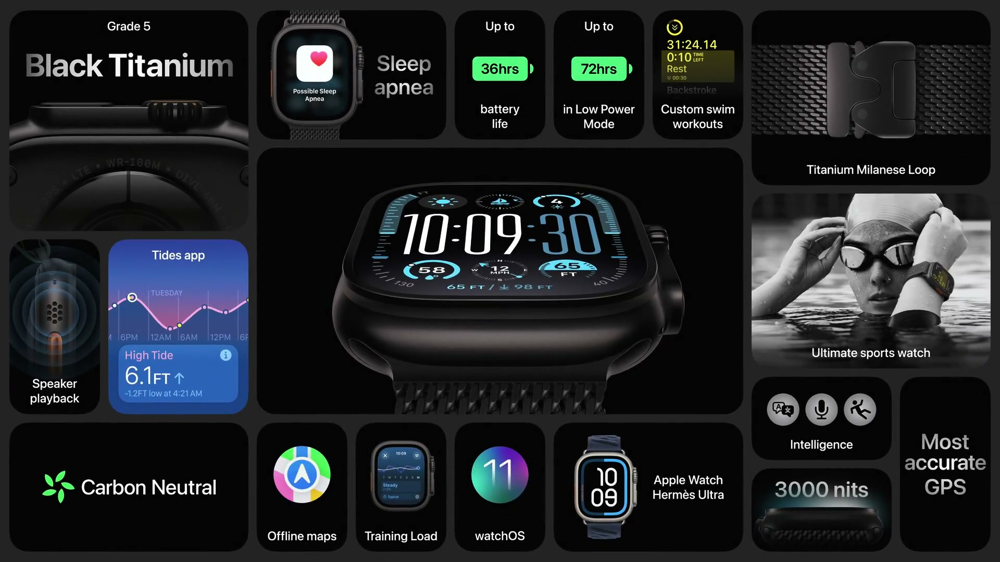
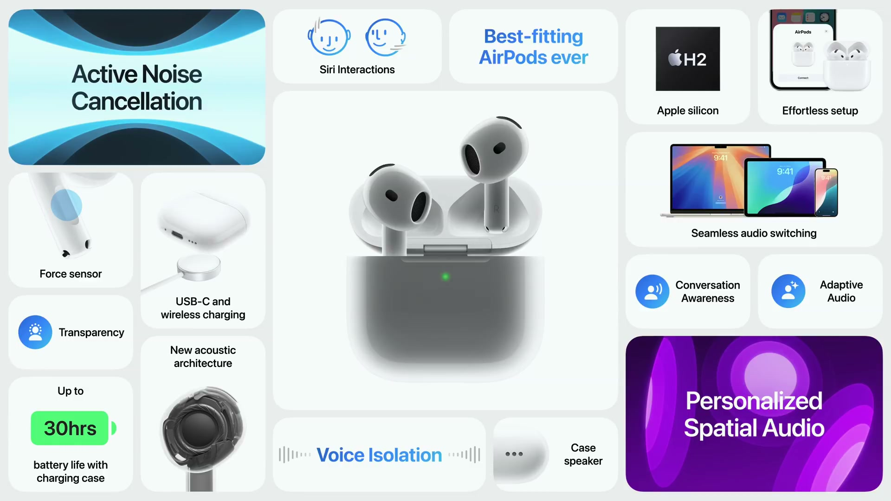
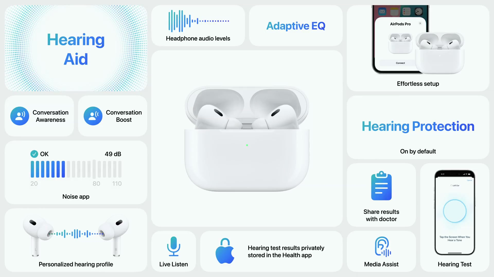
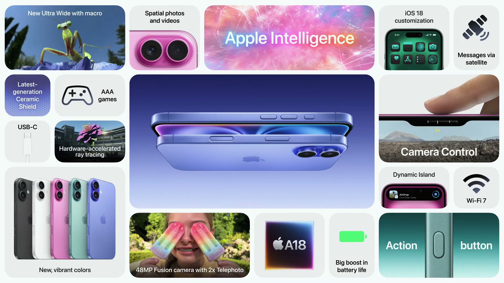
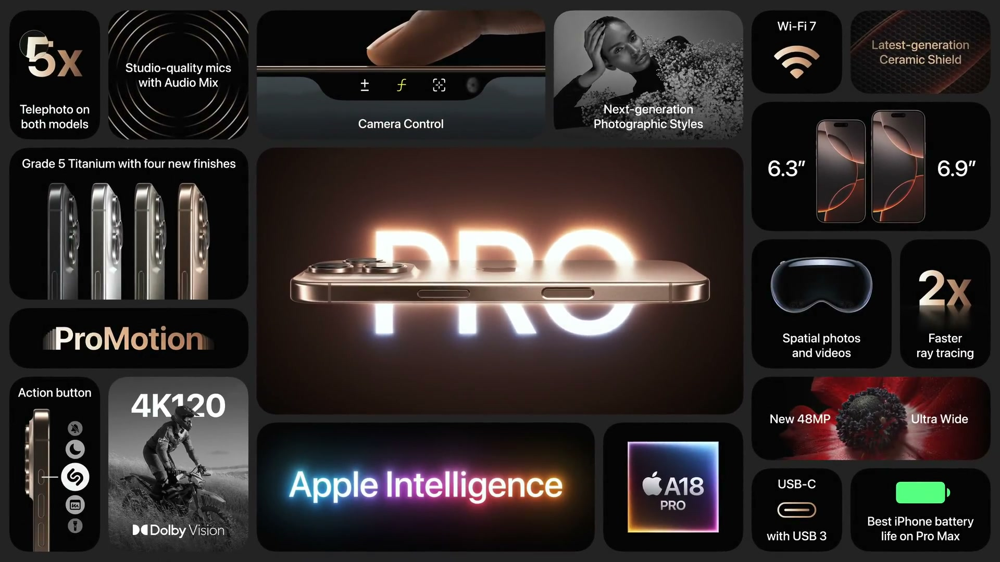

2024年9月9日（現地時間）、Apple は Apple Park で Apple Event を開催した。テーマは **Apple Intelligence** で、iPhone 16 シリーズは Apple Intelligence のために一から設計された初の iPhone と位置づけられた。

---

## Apple Watch Series 10

*出典：Apple*

**ハイライト**

- **ディスプレイ**：Apple Watch 史上最大の画面に拡大。従来世代比で表示面積が最大30%増え、Apple Watch Ultra よりわずかに大きい
- **ワイドアングル OLED**：新搭載。斜めから見たときの明るさが最大40%向上し、常時表示でも秒単位の更新が可能に
- **薄型・軽量化**：厚さ9.7mmで Series 9 より約10%薄い。アルミニウムモデルは前世代比で最大10%軽く、チタニウムモデルはステンレススチールの Series 9 より約20%軽い
- **新仕上げ**：初のポリッシュ仕上げのアルミニウム「ジェットブラック」と、ポリッシュ仕上げのチタニウム（ステンレススチールに代わる）が新登場
- **充電**：Apple Watch で最速の充電。30分で最大80%まで充電でき、バッテリー駆動時間は18時間
- **睡眠時無呼吸の通知**：新機能。加速度センサーで「呼吸の乱れ」を測定して通知する。Series 9 と Ultra 2 にも提供
- **水中機能**：新機能として深度計と水温センサーを内蔵。深度は6mまで表示
- **S10 SiP と watchOS 11**：4コア Neural Engine を搭載した新チップ。Smart Stack の自動ウィジェット、写真文字盤、翻訳アプリなどが加わる

### ディスプレイ

- 表示面積は従来世代比で最大30%拡大。フォントサイズを上げても情報量を保てるほか、メッセージ、メール、ニュースなどでテキストを1行多く表示できる
- ディスプレイとケースの角はより丸みを帯び、アスペクト比は横に広がった
- 前面のクリスタルは Ion-X ガラスで、ケース側面のより下まで回り込む
- Apple 初のワイドアングル OLED ディスプレイを採用。各ピクセルが広い角度へより多くの光を出すよう最適化され、斜めから見たときの明るさが最大40%向上した
- 消費電力が低いため、常時表示モードでの更新が1分に1回から1秒に1回になり、手首を下ろしていても秒針が動く
- 新しい文字盤「Flux」は大画面向けで、秒ごとに画面を色で満たす。メタリックな外観に合わせた文字盤「Reflections」は、動きに反応して光る文字盤で、常時表示モードへ滑らかに切り替わる

### ケースと素材

| 項目 | アルミニウム | チタニウム |
| --- | --- | --- |
| 仕上げ | ジェットブラック、ローズゴールド、シルバー | ナチュラル、ゴールド、スレートグレイ |
| 材質 | アルミニウム合金 | グレード5チタニウム（航空宇宙グレード） |
| 重量 | 前世代比で最大10%軽量化 | ステンレススチールの Series 9 より約20%軽量 |

- ジェットブラックは Apple Watch 初のポリッシュ仕上げのアルミニウム。シリカナノ粒子で磨いて光沢を出し、30工程のアルマイト処理で有機染料を分子レベルで筐体に結合させる
- チタニウムモデルは鏡面のように磨いた後、PVD コーティングで3色に仕上げる
- ミラネーゼループとリンクブレスレットがチタニウムの仕上げに合わせて更新された
- チタニウムモデルは95%再生チタンと100%再生可能電力で製造され、カーボンニュートラル製品となる。輸送では空輸以外を優先する
- バンドは Nike の新カラーと Hermès の新スタイルが登場した

### 薄型化と内部設計

- 厚さは9.7mmで、Series 9 より約10%薄い
- SiP、Digital Crown、スピーカーなどの内部モジュールをさらに小型化した。スピーカーは音響性能を保ったまま30%小型化している
- Apple Watch で初めて、音楽やポッドキャストなどのメディアをスピーカーから直接再生できる
- 金属製の背面がアンテナを筐体と一体化し、2層を1層にまとめた。周囲の細い絶縁分割がセルラー性能を支え、防水層と接合して50メートルの耐水性能を維持する
- 新しい金属背面により充電コイルが大型化・高効率化し、30分で最大80%まで充電できる。バッテリー駆動時間は18時間

### S10 SiP と watchOS 11

- 新しい S10 SiP は、性能・電力効率・知能処理を重視して設計された。4コア Neural Engine が Transformer モデルを使った機械学習処理を高速に行う
- この処理が、ダブルタップ、オンデバイス Siri、音声入力、ワークアウトの自動検出といった既存機能を支える。衝突事故検出と転倒検出（滑り・つまずき・転倒時の動きと衝撃の特徴を機械学習で識別）も対応する
- 新しいニューラルネットワークで通話中の背景ノイズを抑え、混雑した場所や風の強い日でも声をはっきり届ける
- watchOS 11 の新機能：
  - Smart Stack が必要なタイミングで新しいウィジェットを自動追加する
  - 写真文字盤が機械学習でライブラリから写真を選び、評価してキュレーションする
  - 翻訳アプリが Apple Watch に登場し、機械学習で音声認識と高速翻訳を行う
- 既存の健康機能として、服薬リマインダー、騒音通知、心房細動の通知、睡眠中の手首温度測定による排卵推定、新しい Vitals アプリ、睡眠ステージの判定がある

### 睡眠時無呼吸の通知

- 加速度センサーで睡眠中に新指標「呼吸の乱れ（Breathing Disturbances）」を測定する。夜ごとの値は「ヘルスケア」アプリで確認でき、睡眠の質の把握にも役立つ
- 30日ごとにデータを分析し、中等度から重度の睡眠時無呼吸の兆候が一貫して見られる場合に通知する
- 通知時は、睡眠時無呼吸が起きていた可能性、医療従事者に相談することの重要性に関する情報、相談を支える詳細レポートが「ヘルスケア」アプリに表示される
- 検出アルゴリズムは、臨床グレードの睡眠時無呼吸検査の大規模データセットを用いた機械学習で開発し、睡眠時無呼吸の技術として過去に例のない規模の臨床研究で検証した
- 睡眠時無呼吸は世界で10億人以上に影響する疾患で、患者の80%が未診断とされる
- FDA などの規制当局の認可は近日中に得られる見込み。今月中に米国、欧州、日本を含む150以上の国と地域で提供予定
- Series 10 のほか、Series 9 と Ultra 2 でも利用できる

### 水中機能とフィットネス

- 深度計と水温センサーを内蔵。水中に入ると Depth アプリが自動で起動し、6メートル（約20フィート）までの深度と水温を表示する
- 水温はプールとオープンウォーターのスイムでは Workout アプリにも表示される
- Huish Outdoors の Oceanic+ アプリが Series 10 に対応する。シュノーケリング向けに、時間、最大深度、方向などを水中で記録できる
- watchOS 11 の Tides アプリは、満潮・干潮、潮位の上昇・下降、日の出・日の入りを7日分表示し、世界各地の海岸のデータに対応する
- Workout アプリのカヤック、カヌー、ボート向け機能が拡充され、距離、速度、ルートマップを表示する。Paddle Logger アプリではフロートプランを作成でき、触覚フィードバックでコースを維持できる

---

## Apple Watch Ultra 2

*出典：Apple*

**ハイライト**

- **サテンブラック仕上げ**：新色として追加。カスタムブラスト加工と DLC（ダイヤモンドライクカーボン）PVD コーティングで傷に強い表面にした
- **Titanium Milanese Loop**：新バンド。耐腐食性のチタン製でスキューバ向け。Natural と Black の2色
- **Hermès En Mer バンド**：Ultra 向けのHermès 提携が始まり、高密度 3D ニットのバンドとチタン製バックルを用意。専用の Maritime 文字盤も追加
- **Training Load**：新機能。トレーニングの負荷から、追い込む日と回復する日を計画しやすくする
- **自動トラック検出**：ランニングトラックを自動で検出する機能。業界初
- **プールスイムのカスタムワークアウト**：watchOS 11 で対応。インターバルの追跡と、次のセグメントの表示ができる
- **オフラインマップ**：watchOS 11 で対応。カスタムルート作成とターンバイターン案内を iPhone なしで使える
- **カーボンニュートラル**：2024年は、どの仕上げの Apple Watch でもカーボンニュートラルにできる

### サテンブラックと素材

- 新しい仕上げはサテンブラック。カスタムブラスト加工で深い黒を出し、DLC PVD コーティングで表面の耐傷性と耐久性を高めている
- ケースは再生グレード5チタン（再生材 95%）製。航空宇宙産業でも使われる素材
- 背面クリスタルはブラックに合わせたダークジルコニア
- 前面クリスタルはサファイア
- watchOS 11 の機能を搭載する

### バンド

| バンド | 内容 |
| --- | --- |
| Titanium Milanese Loop（新） | かつてダイバーが使ったステンレスメッシュが着想元。チタンワイヤーを編み、平らにして磨いた滑らかな面。パラシュート式バックルは両側のリリースボタンでカチッと閉まる。Natural と Black |
| Hermès En Mer（新） | 高密度 3D ニット。水上スポーツ向けのチタン製バックル |
| Trail Loop／Alpine Loop／Ocean Band | 新色を追加 |

- 既存バンドも、ブラックチタンの金具を組み合わせた更新版になった
- Hermès Maritime 文字盤は視認性の高い数字を使う。Action ボタンでセーリングをイメージしたカウントダウンタイマーが起動する

### ランニングとトレーニング

- バッテリーはアイアンマンの距離を通して使える持ち
- Action ボタンでワークアウトを細かく操作できる
- 2周波 GPS と高度な測位ソフトウェアを搭載
- カスタムワークアウト、心拍ゾーン、ペース機能に対応
- ランニングトラックの自動検出は業界初の機能
- 新機能 Training Load は、いつ追い込み、いつ回復するかの計画に使える。レースに向けたトレーニング時に向く

### サイクリング・スイム・ハイキング

- サイクリング：距離、速度、高度、心拍に加え、iPhone のライブアクティビティでワークアウトを確認できる。パワーメーターを接続すると、ケイデンスやパワーゾーンなどの指標を使える
- スイム：ストロークの自動検出とラップ数のカウントに対応。watchOS 11 でプールスイムにカスタムワークアウトが加わり、インターバルの追跡、現在のセグメントの案内、次のセグメントの確認ができる
- ハイキング：コンパスアプリに緯度・経度、ウェイポイント、Backtrack がある。watchOS 11 のオフラインマップはカスタムルート作成とターンバイターン案内に対応し、iPhone が近くにない・電源が入っていない場合に使える
- 水深計を備え、スキューバに対応する
- ゴルフ、スキー、スノーボード、ダイビング、サーフィン、ローイングにも対応する
- Apple Watch の基本機能（アクティビティ、ヘルスケア、通信、安全機能）も備える

---

## AirPods 4

*出典：Apple*

**ハイライト**

- **新設計**：3D フォトグラメトリとレーザートポグラフィで数千の耳形状・5,000万超のデータ点を解析し、フィット感と快適性を向上
- **H2 チップ搭載**：新しい音響アーキテクチャで低音と高音の再現性が向上し、パーソナライズされた空間オーディオに対応
- **新機能（Siri 操作）**：Siri の通知に対し、頷く・首を振るで応答可能
- **新機能（Voice Isolation）**：通話中の背景ノイズを除去
- **新機能（フォースセンサー）**：軽く押して再生・一時停止、通話のミュート・終了を操作
- **ケースが USB-C 化**：AirPods 史上最小のケースで、合計最大30時間のバッテリー駆動
- **新モデル（ANC 搭載）**：AirPods 4 として初めてアクティブノイズキャンセリング、外部音取り込み、適応型オーディオ、会話感知に対応
- **ワイヤレス充電（ANC モデルのみ）**：Apple Watch や Qi 充電器に対応し、ケースにスピーカーを内蔵して「探す」に対応

### 2つのモデルの違い

| 機能 | AirPods 4 | AirPods 4（アクティブノイズキャンセリング搭載） |
| --- | --- | --- |
| H2 チップ | ○ | ○ |
| パーソナライズされた空間オーディオ | ○ | ○ |
| Voice Isolation | ○ | ○ |
| Siri 操作（頷く・首を振る） | ○ | ○ |
| フォースセンサー | ○ | ○ |
| USB-C ケース | ○ | ○ |
| アクティブノイズキャンセリング | — | ○ |
| 外部音取り込みモード | — | ○ |
| 適応型オーディオ | — | ○ |
| 会話感知 | — | ○ |
| ワイヤレス充電（Apple Watch・Qi 対応） | — | ○ |
| 「探す」用スピーカー内蔵ケース | — | ○ |

### フィット感の設計

- 耳の形状は個人差が大きいため、3D フォトグラメトリとレーザートポグラフィで数千の耳形状をマッピングし、解析した
- 生成したデータ点は5,000万以上で、これをもとに形状を改良した
- 従来のオープンイヤー型のデザインを踏襲している

### 音質とコントロール

- 新しい音響アーキテクチャにより、低音の厚みと高音の明瞭さが向上した
- H2 チップと機械学習により、パーソナライズされた空間オーディオを音楽・映画・ゲームで利用できる
- Siri からの通知には、頷くと「はい」、首を振ると「いいえ」で返答できる
- Voice Isolation は環境を問わず背景ノイズを除去し、通話相手に届く音声を明瞭にする
- フォースセンサーを軽く押すことで、音楽の再生・一時停止と通話のミュート・終了ができる

### ノイズ制御と聞こえ方（ANC モデル）

- アップグレードされたマイク、H2 チップ、高度なコンピュテーショナルオーディオにより、飛行機のエンジンや街の交通騒音を低減する
- 音量を抑えても音質を保ったまま聴ける
- 外部音取り込みモードで周囲の音を自然に聞ける
- 適応型オーディオは環境の変化に合わせて自動でノイズを低減し、モード切り替えが不要になる
- 会話感知は話し始めるとメディア音量を自動で下げ、話し終えると元に戻す

### 充電ケースと環境配慮

- ケースは USB-C 充電で、AirPods 史上最小。合計バッテリー駆動時間は最大30時間
- ANC モデルのケースは、Apple Watch または Qi 認証の充電器によるワイヤレス充電に対応し、「探す」を補助するスピーカーを備える
- 外側のプラスチックフィルムを廃止し、100% 繊維ベースの素材を採用、パッケージを30%以上削減した（2030年までのカーボンニュートラルに向けた取り組み）

---

## AirPods Max

**ハイライト**

- **新色**：ミッドナイト、ブルー、パープル、オレンジ、スターライトの5色を追加
- **USB-C 対応**：充電端子が USB-C になり、充電が便利に
- **iOS 18 で向上**：音楽・映画・ゲームでパーソナライズされた空間オーディオを利用可能（**AirPods 4と共通**）

### 新色と USB-C

| 項目 | 内容 |
| --- | --- |
| カラー | ミッドナイト、ブルー、パープル、オレンジ、スターライト |
| 充電端子 | USB-C |

### 継続する特長

- オーバーイヤー型のデザインを維持している
- 高音質とアクティブノイズキャンセリングを引き続き備える
- iOS 18 との組み合わせで、パーソナライズされた空間オーディオが音楽・映画・ゲームに対応する

---

## AirPods Pro 2

*出典：Apple*

**ハイライト**

- **新機能（聴覚保護）**：すべてのリスニングモードで初期状態からオン。H2 チップの機械学習が大きな断続的な騒音を毎秒48,000回低減
- **新機能（聴力テスト）**：臨床的に検証された約5分のテストを、AirPods Pro と iPhone で自宅から実施
- **新機能（補聴器）**：OTC（処方箋不要）の臨床グレードの補聴器機能。軽度から中等度の難聴が対象
- **提供時期**：聴力テストと補聴器機能は今秋、100以上の国と地域（米国、ドイツ、日本を含む）で提供予定
- **提供方法**：AirPods Pro 2 と iOS 18 向けのソフトウェアアップデートで追加
- **対応範囲**：聴覚プロファイルは音楽・映画・通話に、すべてのデバイスで自動適用

### 背景と3つの柱

- WHO の推計では、15億人以上が難聴とともに生活している
- 放置すると認知機能の低下、転倒、社会的孤立（うつ病の要因）のリスクが高まるとされる
- これまでに Apple Watch の「ノイズ」App、iPhone のヘッドフォン音量の記録、160,000人超が参加する Apple Hearing Study を整備してきた
- 今回は予防（聴覚保護）、認識（聴力テスト）、支援（補聴器）の3機能を追加する

### 聴覚保護

- 3人に1人が、聴覚に影響しうる環境騒音に定期的にさらされている
- すべてのリスニングモードで初期状態からオン
- イヤーチップによる受動的な遮音に加え、H2 チップの機械学習が大きな断続的な音を毎秒48,000回の頻度で低減する
- 聴いている音のダイナミックレンジ全体を保つ

### 聴力テスト

- AirPods Pro と iPhone で行う、臨床的に検証されたテスト。所要時間は約5分
- 音量と周波数の異なる一連の音が聞こえたら画面をタップする
- Apple Hearing Study の知見と大規模な実環境データをもとに開発し、純音聴力検査（臨床の標準）と照合して検証された
- 結果はパーソナライズされた聴覚プロファイルとして表示され、「ヘルスケア」App に安全に保存される
- 定期的な再テスト、難聴に関する情報の閲覧、医療従事者への結果共有ができる
- 米国の成人の80%は過去5年間に聴力検査を受けていない

### 補聴器機能

- 聴力テストの後、AirPods Pro が個人向けの補聴器になり、会話の一部や環境音など必要な音をリアルタイムで増幅する
- 軽度から中等度の難聴がある10億人以上が対象
- 聴覚プロファイルは音楽・映画・通話に、設定なしですべてのデバイスで自動適用される
- Apple Hearing Study では、難聴と診断された人の75%が必要な支援を受けていなかった
- FDA などの規制当局の認可を近く取得する見込みで、取得後に提供される

### 提供時期と対応

| 項目 | 内容 |
| --- | --- |
| 対象製品 | AirPods Pro 2 |
| 必要な環境 | iOS 18、ソフトウェアアップデート |
| 提供機能 | 聴力テスト、補聴器機能 |
| 提供時期 | 今秋 |
| 提供地域 | 100以上の国と地域（米国、ドイツ、日本を含む） |
| 規制 | FDA などの認可を取得予定 |

---

## iPhone 16

*出典：Apple*

**ハイライト**

- **A18 チップ**：新機能として A18 を搭載。A16 Bionic（iPhone 15）から2世代分の進化で、CPU は iPhone 15 比で最大30%高速、GPU は最大40%高速
- **Camera Control**：新機能。クリック・スライド・軽い押し込みでカメラを操作でき、ビジュアルインテリジェンスの入口にもなる
- **48MP Fusion カメラ**：新機能。48MP 撮影に加え、センサー中央の12MPを使った光学品質の 2x 望遠に対応
- **Ultra Wide カメラ**：オートフォーカス対応に向上し、集光量は最大2.6倍。マクロ撮影が可能に
- **空間写真・空間ビデオ**：iPhone で初めて空間写真の撮影に対応し、空間ビデオも撮影できる
- **Apple Intelligence**：新機能。オンデバイスのモデルと Private Cloud Compute で動作し、無料のソフトウェアアップデートとして提供
- **Action ボタン**：iPhone 16 でも利用可能に。機能を割り当てられる
- **バッテリー**：バッテリー容量が増え、A18 の効率と iOS 18 の電力管理と合わせて駆動時間が向上
- **ゲーミング**：持続性能が最大30%向上し、ハードウェアレイトレーシングに対応

### 2つのモデルとデザイン

iPhone 16 と iPhone 16 Plus はサイズ違いの2モデルで、機能は共通。筐体は再生材85%を使ったエアロスペースグレードのアルミニウムで、カラーインフューズド背面ガラスの製法を改良して新色を作った。防水・防塵に対応する。

| 項目 | iPhone 16 | iPhone 16 Plus |
| --- | --- | --- |
| ディスプレイサイズ | 6.1インチ | 6.7インチ |

- **カラー**：Ultramarine、Teal、Pink（新色）、White、Black
- **耐久性**：最新世代の Ceramic Shield は第1世代より50%強く、他のスマートフォンのガラスの2倍の強度
- **ディスプレイ輝度**：屋外で最大2000ニト、暗所では最小1ニト
- **Action ボタン**：ボイスメモの録音、曲の識別、翻訳のほか、ショートカットを割り当てて時間帯で Calendar や懐中電灯を開くことも可能。FordPass アプリでの車の施錠・解錠など、アプリ内機能の直接呼び出しにも対応

### A18 チップとゲーミング

A18 は iPhone 16 専用に作られた第2世代3ナノメートルプロセスのチップ。

| 項目 | A18 の変更点 | 比較対象 |
| --- | --- | --- |
| CPU | 6コア（高性能2＋高効率4）、最大30%高速 | iPhone 15 |
| CPU | 最大60%高速 | iPhone 12 |
| CPU 電力 | 同等性能を30%少ない電力で実現 | A16 Bionic |
| GPU | 5コア、最大40%高速 | iPhone 15 |
| GPU | 最大2倍高速 | iPhone 12 |
| GPU 電力 | 同等性能を35%少ない電力で実現 | A16 |
| Neural Engine | 16コア、機械学習が最大2倍高速 | — |
| メモリ帯域 | システムメモリ帯域が17%増加 | — |

- **ゲーミングの持続性能**：メインロジックボード上のチップ配置の集約、再生アルミニウム100%の放熱用サブ構造により、持続性能が最大30%向上
- **ハードウェアレイトレーシング**：ソフトウェア方式と比べて最大5倍のフレームレートで動作。War Thunder Mobile が水面への太陽の反射表現に利用
- **対応ゲーム**：iPhone 15 Pro 向けだった AAA タイトル（Resident Evil 7 Biohazard、Assassin's Creed Mirage）に対応し、コントローラーも使える
- **Honor of Kings: World**：Tencent の新作。iPhone 16 向けに最適化したウルトラグラフィックスモードを備え、2025年に iPhone で提供

### Camera Control とカメラ

**Camera Control**：カメラ操作用の新しい物理コントロール。縦持ち・横持ちのどちらでも使え、表面とフラットなサファイアクリスタルで覆われ、周囲はカラーマッチしたステンレススチールのトリムで囲まれる。

- **クリック**：カメラを起動。カメラ起動中にもう一度クリックすると撮影、クリックしたままにすると動画撮影
- **軽い押し込み**：UI 要素を消したクリーンなプレビューを表示し、構図に集中できる。オーバーレイで主要な機能にもアクセスできる
- **スライド**：ズームなどの調整。軽く2回押すと他のコントロールが表示され、スライドで選んで軽く押して決定する（例：ポートレートの被写界深度）
- **サードパーティ対応**：Snapchat などのアプリが Camera Control を活用
- **内部構造**：クリック用のタクタイルスイッチ、Taptic Engine と連動して機械式シャッターのような触覚を返す高精度フォースセンサー、サファイアクリスタル下のマルチピクセル静電容量センサーと信号プロセッサ。完全なクリックと軽い押し込みを区別し、タッチジェスチャーを認識する

**カメラ**

- **48MP Fusion カメラ**：48MP 写真は iPhone 14 のカメラの4倍の解像度。4ピクセルを1つの大きなピクセルにまとめる方式で、高解像度画像と集光重視の画像を融合し、24MP の写真も撮れる（画質と光、ディテールのバランスが良く、ファイルサイズも小さい）
- **2x 望遠**：センサー中央の12MPを使うフルレゾリューションの 2x 望遠。過去の iPhone の専用 2x 望遠カメラより明るい絞りで、集光量は最大1.6倍。専用の画像パイプラインで Deep Fusion、シャッターラグゼロ、低照度性能に対応し、4K60 の Dolby Vision HDR ビデオを光学品質で撮影できる
- **Ultra Wide カメラ**：オートフォーカス対応。絞りが大きく、ピクセルも大きくなり、集光量は最大2.6倍。マクロ撮影にも対応
- **4つのレンズ相当**：マクロと 2x 望遠を含め、4本のレンズに相当する撮影ができる
- **空間キャプチャ**：Ultra Wide と Fusion カメラからステレオ情報を取得し、空間ビデオを撮影。iPhone で初めて空間写真の撮影にも対応し、Apple Vision Pro で再生できる
- **風切り音の低減**：機械学習アルゴリズムで動画の風切り音を低減
- **写真アプリ**：iOS 18 で刷新。人物や旅行などのコレクションに自動整理され、コレクションの並べ替えとピン留めができる
- **クリーンアップ**：Apple Intelligence の機能として提供予定。写真から不要な物体を、反射や影も含めて消去できる

### Apple Intelligence とビジュアルインテリジェンス

iPhone 16 シリーズは Apple Intelligence を前提に設計された。個人のコンテキストに基づき、言語と画像の理解・生成と、ユーザーに代わる操作を行うパーソナルインテリジェンスシステム。Apple が作った複数の生成モデルを端末上で動かし、利用状況に応じて動的に適応する。

- **Private Cloud Compute**：負荷の高い処理を Apple シリコン製のサーバーで実行。データは保存も Apple との共有もされず、要求の処理にのみ使われる。独立した専門家がプライバシー保証を継続的に検証でき、サーバーは再生可能エネルギー100%で稼働
- **ライティングツール**：iOS に統合され、入力できるほぼすべての場所で使える。文章の書き換え、トーンの調整、校正に対応
- **絵文字の作成**：説明文を入力して新しい絵文字を生成
- **Image Playground**：画像を生成する新しい専用アプリ。メッセージなどのアプリにも統合される
- **写真の検索**：説明文を入力して写真を探せる。動画内の特定の場面にも対応
- **ムービー作成**：説明文を入力すると、関連する写真と動画を自動で選び、ストーリーとして構成したムービーを作成
- **メールの要約**：受信トレイで冒頭数行の代わりに要約を表示
- **通知の要約**：通知を要約し、優先度の高い通知をスタックの上部に表示
- **Siri**：言語理解が向上し、言い淀んでも文脈を追える。Siri へのテキスト入力にも対応。機能や設定に関する知識が広がり、操作手順を案内できる

Siri には今後、個人のコンテキストの利用（以前に受け取ったテレビ番組のおすすめを探すなど）、オンスクリーン認識（画面上の内容を指して「それを再生」と指示できる）、アプリ内での数百の新しいアクション（連絡先の住所の更新、写真の特定アルバムへの追加など）、そしてそれらを組み合わせた操作（特定の日の写真を探して送信するなど）が追加される。

| 時期 | 内容 |
| --- | --- |
| 翌月 | 最初の機能群をベータで提供（米国英語、世界のほとんどの地域） |
| 12月 | オーストラリア、カナダ、ニュージーランド、南アフリカ、英国向けのローカライズ英語 |
| 来年 | 中国語、フランス語、日本語、スペイン語などへ拡大予定 |

**ビジュアルインテリジェンス**：Camera Control を押し続けて iPhone を向けると、見ているものについての情報を得られる、iPhone 16 向けの機能。処理はオンデバイスのインテリジェンスと、画像を保存しない Apple のサービスの組み合わせで行われる。Camera Control での提供は年内に開始する。

- **店舗情報**：レストランの営業時間、評価、メニューの確認や予約への導線を表示
- **イベントの登録**：チラシを撮ると、タイトル、日時、場所が自動入力され、カレンダーに追加できる
- **対象の識別**：犬の種類などを判別
- **サードパーティ連携**：Google 検索で似た商品を探せる。ChatGPT に質問して学習内容の解説も得られる。サードパーティツールを使うタイミングと共有する情報はユーザーが制御する

### iOS 18、バッテリー、衛星機能

- **バッテリー**：バッテリー容量が増加。A18 の電力効率と iOS 18 の電力管理を合わせ、駆動時間が大きく向上
- **iOS 18**：新しいカスタマイズ方法、新しいテキストエフェクト、トレイルネットワークとハイキングコースを表示するマップを搭載
- **Emergency SOS ライブビデオ**：対応する 911 の通信指令員にライブ映像や写真を共有でき、状況把握と医療トリアージに役立てられる
- **衛星経由のメッセージ**：メッセージと Tapback の送受信が可能。ほかの衛星機能と同じく、米国とカナダで開始
- **衛星サービスの拡大**：Emergency SOS と探すの衛星経由機能は4大陸17の国と地域で利用可能。衛星経由のロードサイドアシスタンスは、昨年に米国で開始したのに続き英国でも提供
- **下取り**：iPhone 12 以降の下取りで、米国では最大800ドル引き

---

## iPhone 16 Pro

*出典：Apple*

**ハイライト**

- **ディスプレイ拡大**：iPhone 16 Pro は 6.3 インチ、Pro Max は 6.9 インチ。Pro Max は iPhone 史上最大の画面で、Apple 製品で最も細いベゼルを採用
- **A18 Pro 新搭載**：第2世代 3 ナノメートルプロセス。CPU は A17 Pro 比で最大 15% 高速、同じ性能なら消費電力は 20% 減。GPU は最大 20% 高速
- **48MP Ultra Wide 新搭載**：クアッドピクセルセンサーでオートフォーカス付きの高解像度撮影とマクロに対応。48MP Fusion も第2世代センサーでゼロシャッターラグ
- **5x 望遠が Pro にも拡大**：テトラプリズム設計の 5x 望遠カメラを iPhone 16 Pro と Pro Max の両方に搭載
- **4K 120fps 新対応**：Dolby Vision でのフレーム単位のカラーグレーディングに対応。再生速度は撮影後に変更可能
- **Audio Mix 新機能**：機械学習で音声と背景音を分離。In-frame、Studio、Cinematic の3種類のミックスを選べる
- **スタジオ品質マイク 4 基**：ノイズフロアが大きく低下。動画撮影中の空間オーディオ収録にも新対応
- **持続性能向上**：新しい筐体構造で持続的な性能が最大 20% 向上。iPhone 16 Pro Max は iPhone 史上最長のバッテリー駆動時間
- **iPhone 16 と共通**：Apple Intelligence、Camera Control、MagSafe・Qi2 対応、100% 繊維ベースのパッケージ

### ディスプレイと筐体

2つのモデルの違いは画面サイズが中心です。

| 項目 | iPhone 16 Pro | iPhone 16 Pro Max |
| --- | --- | --- |
| ディスプレイ | 6.3 インチ | 6.9 インチ（iPhone 史上最大） |

- ProMotion（最大 120Hz の可変リフレッシュレート）と Always-On に対応し、最新世代の Ceramic Shield を採用
- 素材は Grade 5 チタニウム。ステンレスの約半分の重さで、低グレードのチタンより強度と耐傷性が高く、マイクロブラスト仕上げの新しいテクスチャ
- カラーは Black Titanium、White Titanium、Natural Titanium、新色の Desert Titanium の4種類
- 100% 再生アルミニウムの切削シャーシを固相拡散接合でチタンフレームに結合し、グラファイト被覆のアルミ内部構造と組み合わせることで、持続的な性能が最大 20% 向上
- バッテリーの最適化、大型化、電力管理の改善で駆動時間が延び、Pro Max が iPhone で最長

### A18 Pro

A18 Pro は A18 より高速で高効率な Pro 専用チップです。スマートフォン向けチップとして世界で初めて第2世代 3 ナノメートルのトランジスタを採用しています。

| 項目 | A17 Pro 比 |
| --- | --- |
| CPU | 最大 15% 高速、同じ性能で消費電力 20% 減 |
| GPU（新しい 6 コア） | 最大 20% 高速 |
| レイトレーシング | ハードウェアアクセラレーションで最大 2 倍高速 |
| Apple Intelligence の処理 | 最大 15% 高速 |
| システムメモリ帯域幅 | 17% 増加 |

- Neural Engine は 16 コアで、生成 AI 処理に強く、A17 Pro のものより高速かつ高効率
- CPU は高性能コア 2 基と高効率コア 4 基の 6 コア構成。A18 より大きなキャッシュを備え、スマートフォン最速の CPU
- 次世代の ML アクセラレータは直接プログラム可能で、高効率・高スループット・低レイテンシの演算ができる
- Pro モデル専用の機能として、ProMotion と Always-On 向けの新しいディスプレイエンジン、高速な USB 3、ProRes ビデオ録画に対応
- 新しいビデオエンコーダーとイメージシグナルプロセッサーにより、2 倍のデータ量を処理でき、動画のエンコードが高速化し効率も向上

### カメラと Camera Control

- **48MP Fusion カメラ**：第2世代クアッドピクセルセンサーは読み出しが 2 倍高速で、48MP の ProRAW と HEIF でゼロシャッターラグ。センサーからチップへの高速転送のため Apple Camera Interface を新たに搭載
- **48MP Ultra Wide カメラ**：新しいクアッドピクセルセンサーでオートフォーカスに対応し、広角でもマクロでも高精細に撮影
- **5x 望遠カメラ**：iPhone 16 Pro Max にあったテトラプリズム設計が iPhone 16 Pro にも入り、Pro 2 モデルで利用可能
- **Camera Control**：カメラアプリの起動、レンズの切り替え（5x 望遠など）、被写界深度と露出の調整に使える。今年後半の更新で、軽く押してフォーカスと露出をロックし、そのまま構図を変えられる 2 段階シャッターに対応予定
- **Photographic Styles（最新世代）**：肌の色を認識して色・ハイライト・シャドウを局所的にリアルタイム調整。特定の色に作用する新しいスタイルや白黒のスタイルを追加し、トーンと色を同時に調整するコントロールパッドを搭載。撮影後にスタイルを変更でき、Camera Control でスタイルを切り替えながらライブプレビューで確認できる

### ビデオ

- **4K 120fps**：48MP Fusion の高速センサーと Apple Camera Interface で実現。A18 Pro の ISP により Dolby Vision でフレーム単位のカラーグレーディングが可能
- 4K120 の ProRes と Log は外部ストレージへ直接記録でき、Slo-mo でも通常のビデオモードでも使える
- 再生速度は撮影後に写真アプリで変更でき、4分の1速、新設の2分の1速、通常速、24fps 再生に相当する5分の1速を選べる
- Camera Control で 4K120 の HDR 撮影を素早く開始できる
- Kino などのビデオ撮影アプリは Camera Control を使った独自操作を提供し、たとえばグリッドコンポーザーでは三分割、グリッド、SNS 向けフォーマット、ディレクターズビューファインダーでフレーミングできる

### オーディオ

- **スタジオ品質マイク 4 基**：ノイズフロアが大きく下がり、ボーカルやアコースティック録音の品質が向上。マイクを使うすべての用途で音質が改善
- **空間オーディオ収録**：動画撮影中に空間オーディオを収録でき、AirPods、Apple Vision Pro の空間ビデオ、ホームシアターでの再生に対応
- **Audio Mix**：機械学習で背景音と音声を分離する機能。業界初
  - In-frame Mix：画面内の人物の声だけを分離
  - Studio Mix：吸音壁のあるスタジオで録ったように残響を除去
  - Cinematic Mix：声を前方に、環境音をサラウンドに配置
- **ボイスメモ（今年後半に提供予定）**：既存の録音に別のトラックを重ねて録音可能。再生中のトラックを iPhone のスピーカーから流しながら録音し、新しい声だけを分離して背景音を除去するため、ヘッドフォンは不要

### MagSafe・充電・パッケージ

- iPhone 16 シリーズ向けに、Camera Control と連動する MagSafe 対応のクリアケースとシリコーンケースを新たに用意。サファイアクリスタルと導電層で指の動きを Camera Control に伝える
- 新しい MagSafe 充電器は、より高速なワイヤレス充電に対応し、長さは 1 m と 2 m の2種類
- iPhone 16 シリーズは Qi2 に対応し、充電効率、磁気吸着、互換性が向上
- iPhone 16 シリーズのパッケージは 100% 繊維ベースで、より薄型になり輸送時の環境負荷も低減

---

## 価格・発売日

| 製品 | 価格 | 税込換算 | 発売日 |
| ------ | ------ | ------ | -------- |
| Apple Watch Series 10 | $399〜 | 約6万3,000円〜 | 9月20日（発表当日から予約受付） |
| Apple Watch Ultra 2 | $799〜 | 約12万6,000円〜 | 9月20日（発表当日から予約受付） |
| AirPods 4 | $129 | 約2万円 | 9月20日（発表当日から予約受付） |
| AirPods 4（アクティブノイズキャンセリング搭載） | $179 | 約2万8,000円 | 9月20日（発表当日から予約受付） |
| AirPods Max | $549 | 約8万7,000円 | 9月20日（発表当日から予約受付） |
| AirPods Pro 2（聴力テスト・補聴器機能） | ソフトウェアアップデートで提供 | — | 今秋（規制当局の認可後） |
| iPhone 16 | $799〜 | 約12万6,000円〜 | 9月20日（金曜日から予約受付） |
| iPhone 16 Plus | $899〜 | 約14万2,000円〜 | 9月20日（金曜日から予約受付） |
| iPhone 16 Pro | $999〜 | 約15万8,000円〜 | 9月20日（金曜日から予約受付） |
| iPhone 16 Pro Max | $1,199〜 | 約18万9,000円〜 | 9月20日（金曜日から予約受付） |

※日本円は、米国の価格（税抜き）を発表日（2024年9月9日）の為替レート（1ドル＝143.56円、欧州中央銀行の参考レート）で換算し、消費税10%を加えた参考値。実際の日本での販売価格とは異なる。
