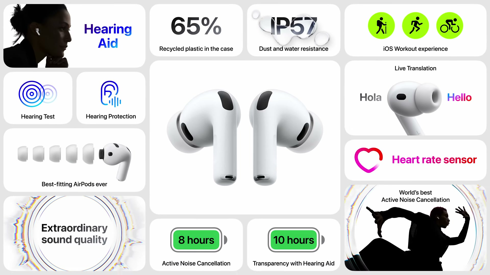
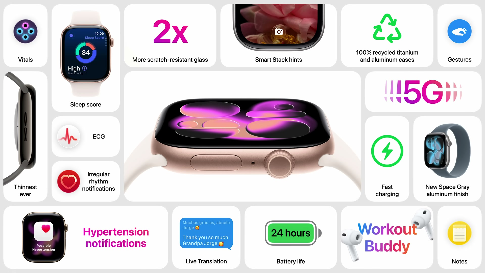
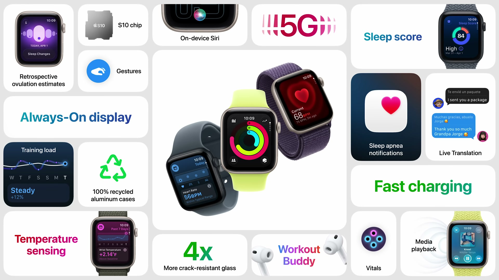
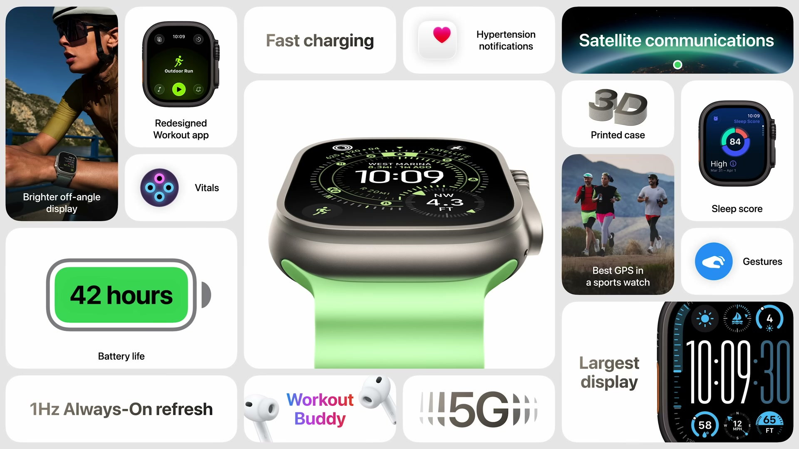
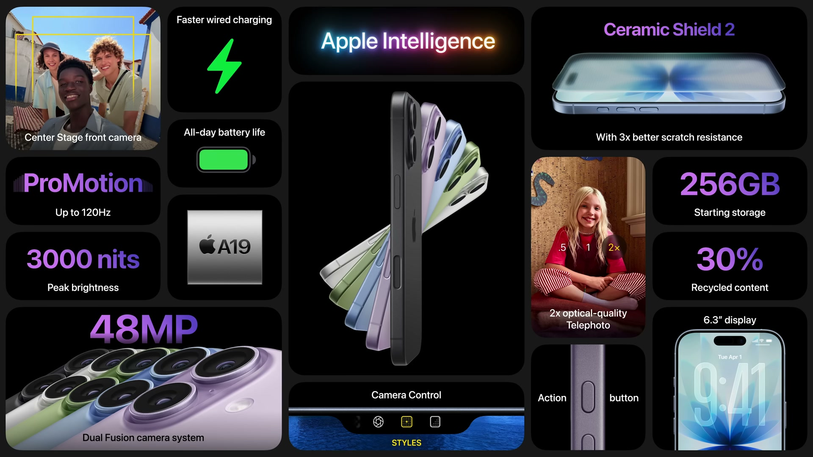
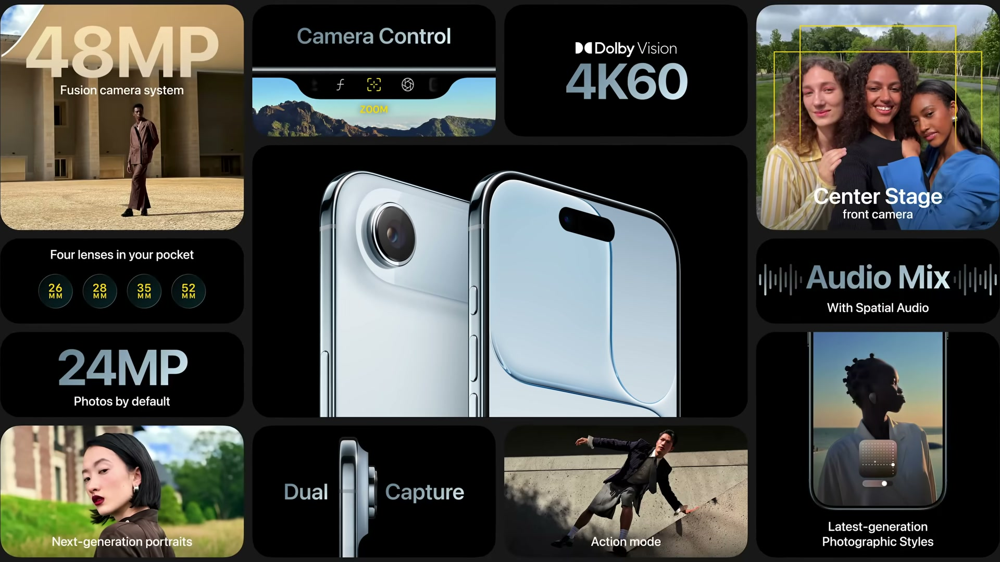
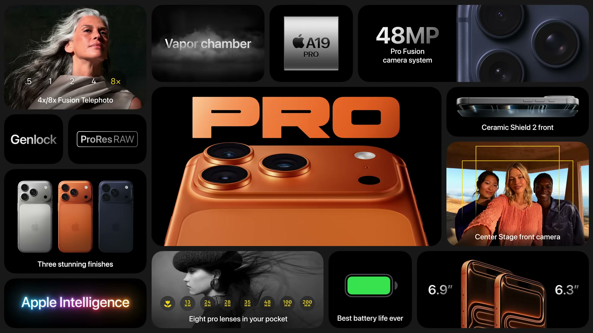

2025年9月9日（日本時間9月10日）、Appleはカリフォルニア州クパチーノのApple Parkにてスペシャルイベントを開催した。今年のキーワードはデザイン哲学——「見た目だけでなく、どう機能するか」——がすべての製品に貫かれたイベントとなった。AirPods Pro 3、Apple Watch Series 11 / SE 3 / Ultra 3、そしてiPhone 17 / Air / 17 Proの計7製品が発表された。ソフトウェア面でもLiquid Glassデザインを採用したiOS 26 / watchOS 26が紹介された。

---

## AirPods Pro 3

*出典：Apple*

前世代で世界初のエンドツーエンド聴覚健康体験を実現したAirPods Proが、さらに高みを目指した第3世代へ。音質・ノイズキャンセリング・フィット・フィットネス機能のすべてが刷新された。

### 音質とノイズキャンセリング

カスタム設計のマルチポート音響アーキテクチャを採用し、耳への音の流れを精密に制御。これにより低音応答が変革的に向上し、サウンドステージが広がり、音楽・映像・通話で各楽器や声がより鮮明に聴こえるようになった。

ノイズキャンセリング（ANC）は**前世代比2倍の性能**を達成。超低ノイズマイクと先進の計算オーディオに加え、新たな発泡体入りイヤーチップを組み合わせることで外部ノイズ遮断を大幅に強化した。初代AirPods Proユーザーにとっては**4倍の効果**となる。

### Live Translation（Apple Intelligence）

異なる言語を話す相手とその場にいるとき、AirPods Proがリアルタイムで翻訳を届ける新機能。新しいシンプルなジェスチャーで翻訳が開始され、ANCが自動で相手の声量を下げて翻訳音声に集中しやすくなる。ユーザーが話す際はiPhoneが相手の言語でテキスト表示し、必要なら読み上げも行う。両者がAirPods Proを装着している場合はさらに快適に双方向翻訳が機能する。

### フィット感とIP57

10,000件以上の3D耳スキャンと100,000時間超のユーザー調査をもとに設計を最適化。AirPod本体をより小型化し、耳道の自然な形状に合わせたシェイプに変更。イヤーチップは5サイズに増量し、激しいワークアウト中も外れない「これまでで最もフィットするAirPods」を実現。耐水・耐汗性能は**IP57**（AirPods初）に強化され、土砂降りの雨でも使用可能。

### 心拍センサーとフィットネス

Apple独自設計の最小心拍センサーをAirPods Pro 3に内蔵。機械学習がセンサーとアクセレロメーターのデータを融合し、ワークアウト中の心拍数を精密に計測する。Apple Heart and Movement Studyの**5,000万時間以上のデータ**で訓練した新しいオンデバイスAIモデルがアクティビティとカロリーを追跡する。

iPhoneのFitnessアプリに新しいワークoutエクスペリエンスが追加され、AirPods Proだけで**50種類以上のワークアウト**を記録できる。ムーブリングの消化、歩数カウント、アワードの獲得にも対応。Fitness+ワークアウト中は心拍・カロリー・バーンバーの表示も可能。Ladder等サードパーティアプリも新APIを通じて主要指標を組み込める。

Workout Buddy（Apple Intelligence）も利用でき、ワークアウト中にパーソナライズされた音声フィードバックでモチベーションを維持できる。

### バッテリー

| モード | バッテリー |
|--------|-----------|
| ANC使用時 | **8時間**（前世代6時間から向上） |
| Hearing Aid（透過モード） | **10時間**（前世代比+4時間） |

### 価格・発売日

| モデル | 価格 |
|--------|------|
| AirPods Pro 3 | **$249** |

本日より予約受付開始、**2025年9月19日発売**。

---

## Apple Watch Series 11

*出典：Apple*

歴代最薄・最軽量のApple Watchとして登場したSeries 11。耐久性・通信・ヘルスケア機能が全面強化された。

### 耐久性とガラス

独自のIon-Xガラスに、Appleが設計したセラミックコーティングを原子レベルで結合させる新プロセスを採用。**前世代比2倍の耐傷性**を実現し、日常使いとアクティブライフスタイルの両方に対応する。

### 5G

Series 11に初めて最新世代の**5G**を搭載。新設計の5Gモデムとアンテナアーキテクチャにより、カバレッジ向上・パフォーマンス改善・省電力化を同時に達成。多数の大手キャリアパートナーが発売時から対応予定。

### watchOS 26の新機能

新しい文字盤「Flow」はLiquid Glassの数字が美しく光を屈折させながら揺れる。「Exactograph」は伝統的なレギュレータークロックの現代的な再解釈で、時・分・秒を独立表示し精密な時刻確認ができる。

### 高血圧通知（世界初）

光学式心拍センサーのデータから、心臓の鼓動に対する血管の反応パターンを解析して高血圧（hypertension）の可能性を検出する。アルゴリズムはバックグラウンドで**30日間のデータ**を定期的に審査し、高血圧のパターンを検出した場合に通知を送る。

- 100,000人超を対象とした一連の研究で開発
- **初年度だけで100万人以上の未診断高血圧者への通知**を見込む
- FDA等規制当局の承認を近日中に取得予定
- **150か国・地域**で提供開始予定（米国・欧州含む）

### 睡眠スコア

睡眠の質を定量化する新機能。**睡眠時間・就寝時刻の一貫性・中途覚醒回数・各睡眠ステージの時間**という4つの要因を毎晩分析し、分類とスコアを算出。World Sleep Society等の専門家の知見とApple Heart and Movement Studyの**500万晩分の睡眠データ**をもとに開発した。SleepアプリとHealthアプリ（iPhone）でスコアと改善ガイダンスを確認できる。

### バッテリー・素材・カラー

バッテリーを再設計し、最大**24時間のバッテリー駆動**（終日＋一晩装着に対応）。

| 素材 | カラー |
|------|--------|
| 100%リサイクルアルミニウム | Jet Black / Silver / Rose Gold / 新色Space Gray |
| 100%リサイクルチタニウム | Natural / Gold / Slate |

バンドはNikeスポーツバンド・ループ（反射糸入り）、エルメス ジャガードニットバンド等の新色・新デザインも追加。

### 価格・発売日

| モデル | 価格 |
|--------|------|
| Apple Watch Series 11 | **$399〜** |

本日より予約受付開始、**2025年9月19日発売**。

---

## Apple Watch SE 3

*出典：Apple*

「コアな機能を手頃な価格で」というSEのコンセプトを維持しつつ、Appleの最新チップ搭載により機能の幅が一気に広がった第3世代。

### S10チップとAlways-Onディスプレイ

Apple Watchの最強チップ**S10**を初めてSEに搭載。これによりSE史上初の**Always-Onディスプレイ**が実現し、ディスプレイを起こさずに時刻や文字盤を確認できる。

またS10によって、**ダブルタップ**（指を2回つまむジェスチャー）と**手首フリック**ジェスチャーが利用可能になり、片手だけでApple Watchの操作が可能になった。

### 新たなヘルスケア機能

| 機能 | 内容 |
|------|------|
| 手首温度センシング | 遡及的排卵推定が可能に |
| Vitalsアプリ | 健康指標の異常を通知 |
| 睡眠時無呼吸通知 | 初搭載 |
| 睡眠スコア | Series 11と同様 |

既存の心拍数通知・転倒検出・衝突事故検出はそのまま継続。

### メディア再生とスピーカー

AirPodsがなくてもApple Watch単体で音楽やポッドキャストをスピーカーから再生できるようになった。

### ファスト充電と5G

**ファスト充電**がSEに初対応。前世代比**2倍の充電速度**で、わずか15分の充電で最大8時間使用できる。また5Gも搭載。省電力性に優れたS10により、最大**18時間のバッテリー駆動**を維持。

### カラー・価格・発売日

| 素材 | カラー |
|------|--------|
| 100%リサイクルアルミニウム | Starlight / Midnight |

| モデル | 価格 |
|--------|------|
| Apple Watch SE 3 | **$249〜** |

本日より予約受付開始、**2025年9月19日発売**。

---

## Apple Watch Ultra 3

*出典：Apple*

スポーツ・アドベンチャー用途のフラッグシップウォッチが、ディスプレイ・衛星通信・バッテリーの三点で大きく進化した。

### 史上最大のディスプレイ

広角OLEDとLTPO3技術を組み合わせた新ディスプレイを採用。斜め方向からの視認性が向上し、ベゼルを細くすることで**ケースサイズを変えずに最大の画面面積**を実現。Always-Onモードでバッテリーへの影響なしに高頻度のリフレッシュが可能になり、文字盤で秒針がリアルタイムに動くようになった。新文字盤「Waypoint」は周囲のポイントオブインタレストを動的に表示する。

### 衛星通信（大型アップデート）

グリッド圏外に出た際も、**衛星経由で連絡・安全確認**ができる機能が新搭載。

- 緊急SOS via satellite：Ultra 3に標準付属
- Messages・Find Myも衛星経由で利用可能
- バックカントリースキー・トレイルランニングなどオフグリッドでも繋がる
- ラジオとアンテナを再設計して**信号強度を2倍**に強化
- 地上800マイル上空の衛星との通信を可能にした

実現のために内部ラジオとアンテナをゼロから設計し直した。

### 5G・バッテリー・素材

5Gによりさらに広いカバレッジと高速・安定した接続を実現。バッテリー容量も拡大し、最大**42時間**のバッテリー駆動を達成。

素材に3Dプリンティングプロセスを採用し、**100%リサイクルチタン**を使用しながら前世代比でも原材料を半分に削減。Black TitaniumとNatural Titaniumの2色展開。

### ワークアウトとAI

Workoutアプリを刷新し、カスタムビューの設定が素早くできるようになった。Workout Buddy（Apple Intelligence搭載の生成型音声アシスタント）がワークアウト中にパーソナライズされたフィードバックを提供する。

### 価格・発売日

| モデル | 価格 |
|--------|------|
| Apple Watch Ultra 3 | **$799〜** |

本日より予約受付開始、**2025年9月19日発売**。

---

## iPhone 17

*出典：Apple*

スタンダードモデルがProに追いついた年。ProMotion搭載、センター撮影フロントカメラ、そして超高解像度超広角カメラが一気に加わった。

### デザインと5色

Lavender・Mist Blue・Black・White・Sageの5色展開。ディスプレイは**6.3インチ**に拡大し、ベゼルを薄くしてより多くを表示できる。

### ProMotionと輝度

スタンダードiPhoneに初めて**ProMotion（最大120Hz・適応リフレッシュレート）**が搭載。Always-Onディスプレイは未使用時に1Hzまで自動低下。屋外では**最大輝度3,000nit**（iPhoneで過去最高）。

### Ceramic Shield 2

Apple設計のコーティングをCeramic Shieldに原子レベルで結合する新プロセスにより、**前世代比3倍の耐傷性**を実現。さらに7層の反射防止コーティングにより、屋内外の明るい環境でも見やすくなった。

### A19チップ

最先端の**3nmプロセス**で製造。6コアCPU・5コアGPU・改良されたNeural Engineを搭載。Apple Intelligenceのオンデバイス生成AIや大規模言語モデルがさらに高速化。特にメモリ帯域幅が増加し、LLMの実行速度が向上した。

### バッテリーと充電

ProMotionの省電力設計により、iPhone 16比で**最大8時間多いビデオ再生**が可能。高速有線充電は**20分で最大50%充電**（10分で最大8時間のビデオ再生に相当）。

### カメラシステム

**48MP Dual Fusionカメラシステム**（リア）：
- メインカメラ：48MP（デフォルト24MP）
- 光学品質の2x望遠

**新搭載：48MP Fusion超広角カメラ**：iPhone 16比で**4倍の解像度**。広大なシーンから極小マクロまで、より多くのディテールを捉える。

**フロントカメラ：Center Stage（新設計）**：
- センサーを2倍近く大型化し、正方形センサーを初採用
- 最大18MPの解像度
- 縦横どちらの向きでも4つの異なる構図から選べる
- 横向き自撮りがiPhoneを回転せずに可能
- 友人が加わると自動でフィールドを拡大（Center Stage for photos）
- Action Modeと同技術で自撮り動画を超安定化

### Apple Intelligence

Live Translation（Phone・FaceTime・Messages）、Visual Intelligence（画面の内容を検索・操作・質問）など、iOS 26の新Apple Intelligence機能に対応。プライバシー保護設計を維持。

### ストレージと価格・発売日

全モデル**256GBスタート**。

| モデル | 価格 |
|--------|------|
| iPhone 17 | **$799〜** |

今週金曜より予約受付開始、**2025年9月19日発売**。

---

## iPhone Air

*出典：Apple*

「未来の一切れ」——強くて薄く、手の中に溶け込むような感覚。Appleシリコンの進化が生み出した全く新しいiPhone。

### 厚さ5.6mm・チタニウムフレーム

史上最薄の**5.6mm**（従来最薄のiPhoneより大幅薄型）。軽さも際立つ。

フレームはGrade 5 spacecraft titanium（80%リサイクルチタン、iPhoneで過去最高）を使用し、鏡面仕上げに磨き上げた。外観カラーはSpace Black / Cloud White / Light Gold / Sky Blue。

### Ceramic ShieldがバックにもFront初採用

**フロント側：Ceramic Shield 2**（前世代比3倍の耐傷性）。  
**バック側：Ceramic Shield（iPhoneで初）**——前世代バックガラス比4倍の耐クラック性能。

新しい「プラトー」構造で主要内部コンポーネントを端末上部に集約。精密ミル加工で内部スペースを最大化し、リアカメラ・フロントカメラ・スピーカー・Apple Siliconを収納しつつ、残りのスペースを高密度バッテリーに充てた。

### A19 Pro——最高効率のProチップ

**CPU**：シングルスレッド性能をさらに向上（フロントエンド帯域幅・分岐予測を改善）。効率コアのラストレベルキャッシュを50%増量し、日常タスクのエネルギー効率を高めた。A19より高速かつ高効率。

**GPU**：
- 第2世代Dynamic Cachingアーキテクチャ
- 16ビット浮動小数点演算を2倍化
- 新しいUnified Image Compressionを搭載
- 各GPUコアにNeural Acceleratorを内蔵 → A18 Pro比で**最大3倍のピークGPUコンピュート**
- MacBook Proレベルのコンピュートをポケットサイズに

**N1チップ（新登場）**：AppleがApple Watch / AirPods向けに蓄積してきたWi-Fi / Bluetoothチップ技術をiPhoneに初搭載。**Wi-Fi 7・Bluetooth 6・Thread**に対応し、Personal HotspotやAirDropの性能・信頼性を向上。

**C1Xモデム（第2世代）**：C1の後継。C1比最大**2倍高速**、iPhone 16 Proのモデムより速く、**エネルギー消費30%削減**。iPhone Air史上最も省電力なiPhoneを実現。

### カメラシステム

**リアカメラ（48MP Fusion）**：一見単眼レンズに見えるが、実質的に複数の高度なカメラとして機能する。
- メイン：48MP、大型センサー・高速絞り・センサーシフト光学式手ぶれ補正
- 内蔵2x望遠：更新されたPhotonic Engine（機械学習を強化）
- デフォルト24MP撮影
- 独自28mm・35mmレンズを追加し**ポケットに4レンズ（26 / 28 / 35 / 52mm相当）**
- 次世代ポートレート（被写体を選ばない）
- 最新世代Photographic Styles（新しい「Bright」スタイル追加）

**フロントカメラ**：Center Stage（iPhone 17と同設計）。  
**新機能：Dual Captureビデオ**——フロントとリアカメラを同時に録画。コンサートでの自分の反応を記録しながら会場も映す、等の用途に対応。

### eSIM専用（世界全モデル）

物理SIMスロットを廃し、全世界で**eSIM専用**とした。空いたスペースはバッテリーに充当。多数のキャリアパートナーと連携し、旅行先でもeSIM設定が容易。

### バッテリーとAdaptive Power Mode

全日バッテリー駆動を達成。iOS 26の**Adaptive Power Mode**が使用パターンを学習し、バッテリー残量が少なくなりそうな状況を予測して自動で電力を節約する。

**アクセサリーエコシステム**：
| アクセサリー | 内容 |
|------------|------|
| MagSafe Battery（低プロファイル） | 装着でポケットに収まる薄さ。合計**最大40時間ビデオ再生** |
| 薄型トランスルーセントケース | バックパネル厚1mm未満。Frost / Shadow |
| バンパーケース | 強化ポリカーボネート、4色展開 |
| Crossbodyストラップ | 薄型フレキシブルマグネットでホールド |

### 価格・発売日

| モデル | 価格 |
|--------|------|
| iPhone Air | **$999〜** |

今週金曜より予約受付開始、**2025年9月19日発売**。

---

## iPhone 17 Pro

*出典：Apple*

「Proを一から作り直す」——アルミニウムユニボディ、ベイパーチャンバー熱設計、全カメラ48MP Fusion、ProRes RAW／Genlock対応。Appleが定義する「最もPro」が更新された。

### 完全新設計：アルミニウムユニボディ

チタニウムフレームからApple設計の**航空宇宙グレードアルミニウム合金**のユニボディへ。カスタム押出し成形→加熱・鍛造→精密切削（多段パス）→連続アノダイズ処理により、カラフルで耐久性の高い酸化皮膜層を形成した。

- **熱伝導率がチタニウム比20倍**（かつ大幅軽量）
- 軽くて熱効率が高く剛性の高い筐体
- カラー：Refined Silver / Deep Blue / **Cosmic Orange**

### ベイパーチャンバーと熱設計

新開発の熱管理システムを搭載。脱イオン水を密封したベイパーチャンバーをアルミニウムシャーシにレーザー溶接し、コンポーネントから熱を効率的に移動・放散。アルミニウムユニボディ全体を介して戦略的に熱を逃がすことで、より高い持続パフォーマンスを実現した。

結果として**iPhone 16 Pro比40%高い持続パフォーマンス**——ゲーム・写真/動画編集・Apple Intelligence機能・ローカルLLM実行などの高負荷タスクで差が出る。Arknights: Endfieldのようなハードウェアアクセラレーションによるレイトレーシングゲームを高フレームレートで何時間でもプレイ可能。

### Ceramic ShieldとバッテリーとeSIM

**バック面もCeramic Shield**（iPhone Air同様）——前世代バックガラス比4倍の耐クラック性能。フロント面は**Ceramic Shield 2**（前世代比3倍の耐傷性）。

バッテリーは大幅拡大。**eSIM専用モデルは物理SIMが占有していたスペースも活用**し、さらにバッテリーを大型化——最大**39時間のビデオ再生**（Pro Max・eSIM）。Pro Maxが**iPhone史上最長のバッテリー駆動**を達成した。

サイズ展開：iPhone 17 Pro（6.3インチ）、iPhone 17 Pro Max（6.9インチ）。

### A19 Proチップ

6コアCPU・6コアGPU（各コアにNeural Accelerator内蔵）。A18 ProよりもキャッシュとメモリーPを増量。新しい熱設計との組み合わせでポテンシャルを最大限に発揮できる。

### 史上最高のカメラシステム——全3カメラ48MP Fusion

**フロントカメラ**：18MP Center Stage（iPhone 17と同設計）。コンテンツクリエイターに最適な広視野角と高解像度。

**リア3カメラがすべて48MP Fusion**（初）：
| カメラ | スペック |
|--------|---------|
| メイン（Fusion） | 48MP |
| 超広角（Fusion） | 48MP |
| 新型望遠（Fusion Telephoto） | 48MP、4x（100mm）＋8x（200mm）、次世代テトラプリズム、3Dセンサーシフト手ぶれ補正、センサーサイズ前世代比56%大型化 |

全カメラで更新されたPhotonic Engineを採用し、機械学習をデモザイクプロセスに深く統合。自然なディテール保持・ノイズ低減・特に低光量下での色精度が大幅向上。

**8x 200mmレンズ**：光学品質のズームで被写体により肉薄できる、美しいボケ感のある描写。

**デジタルズームは最大40x**。ポケット内の**8つのProレンズ**（相当）を実現。

### プロ動画：ProRes RAW・Genlock

**ProRes RAW収録**（新対応）：カメラセンサーが捉えた全情報を記録するApple独自の業界標準コーデック。HDRビデオに最適で、ポストプロダクションでの最大限の柔軟性を提供。Final Cut CameraとBlackmagic Cameraがサポート済み。他デベロッパー向けAPIも提供。

**Genlock**（新対応）：複数カメラやオンスクリーングラフィックを使う際の映像同期を超精密に制御する技術。手作業によるフレーム単位の調整なしにプロ品質のトランジションを実現。「タイムスプライシング（バレットタイム）」のような高度な映像技法も可能。Blackmagic Camera ProDockとAPIで対応。

**既存の対応フォーマット**：Dolby Vision HDR・4K120・ProRes Log・ACES。  
※このAppleイベント自体がiPhone 17 Proで撮影された。

### アクセサリー

**TechWovenケース**：新素材。技術的な工程で複数の糸色から作られた織物素材で、傷・汚れに耐えるコーティングを施した。クリアケース・シリコンケースも展開。全ケースはボタンのタクタイル感を改善した新設計。Crossbodyストラップ（iPhone Airのものと同デザイン）も対応。

### ストレージと価格・発売日

全モデル**256GBスタート**。iPhone 17 Pro Maxには初めて**2TBモデル**が登場。

| モデル | 価格 |
|--------|------|
| iPhone 17 Pro | **$1,099〜** |
| iPhone 17 Pro Max | **$1,199〜** |

今週金曜より予約受付開始、**2025年9月19日発売**。

---

## まとめ

| 製品 | 価格 | 発売日 |
|------|------|--------|
| AirPods Pro 3 | $249 | 2025年9月19日 |
| Apple Watch SE 3 | $249〜 | 2025年9月19日 |
| Apple Watch Series 11 | $399〜 | 2025年9月19日 |
| Apple Watch Ultra 3 | $799〜 | 2025年9月19日 |
| iPhone 17 | $799〜 | 2025年9月19日 |
| iPhone Air | $999〜 | 2025年9月19日 |
| iPhone 17 Pro | $1,099〜 | 2025年9月19日 |
| iPhone 17 Pro Max | $1,199〜 | 2025年9月19日 |

iPhone 13 Pro以降のモデルを下取りに出すと最大$1,100割引。iPhone 16eは$599から継続販売。

今回のApple Eventで最も注目すべきは2点。1つは**iPhone Air**——5.6mmという衝撃の薄さを実現しながら、A19 Proチップ・全日バッテリー・カメラ4レンズと妥協なしのスペックを持つ。もう1つは**iPhone 17 Pro**のアルミユニボディへの移行で、熱設計と持続パフォーマンスが劇的に向上したこと。Apple Watchではウルトラへの衛星通信搭載、SEへのAlways-On搭載が、それぞれの製品の新たな価値軸を作った一年となった。
