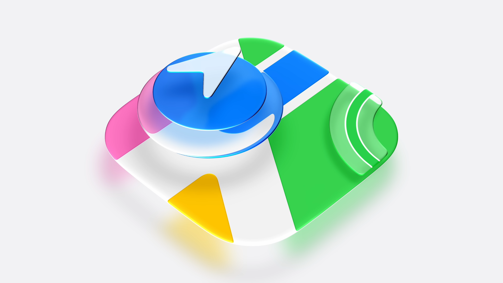
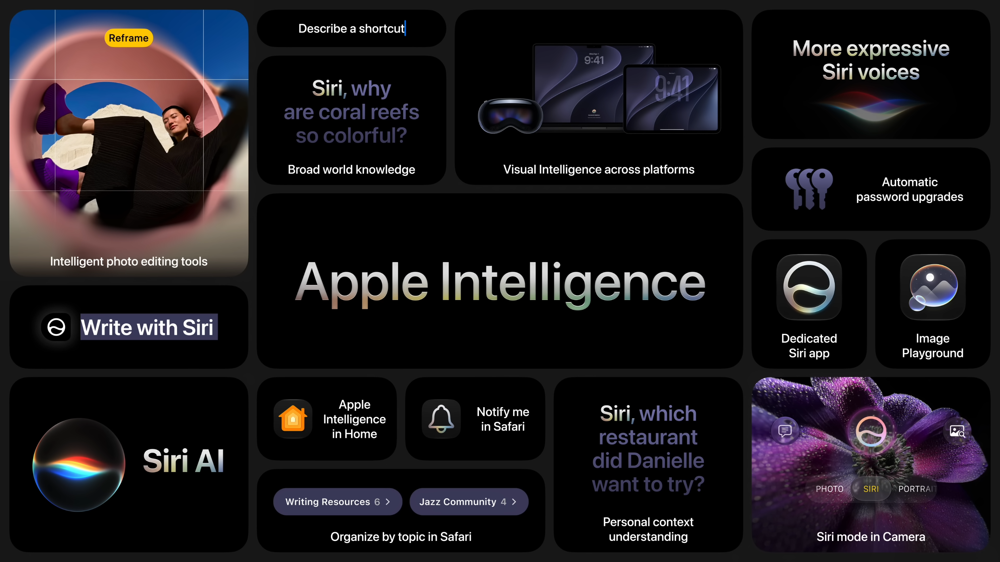
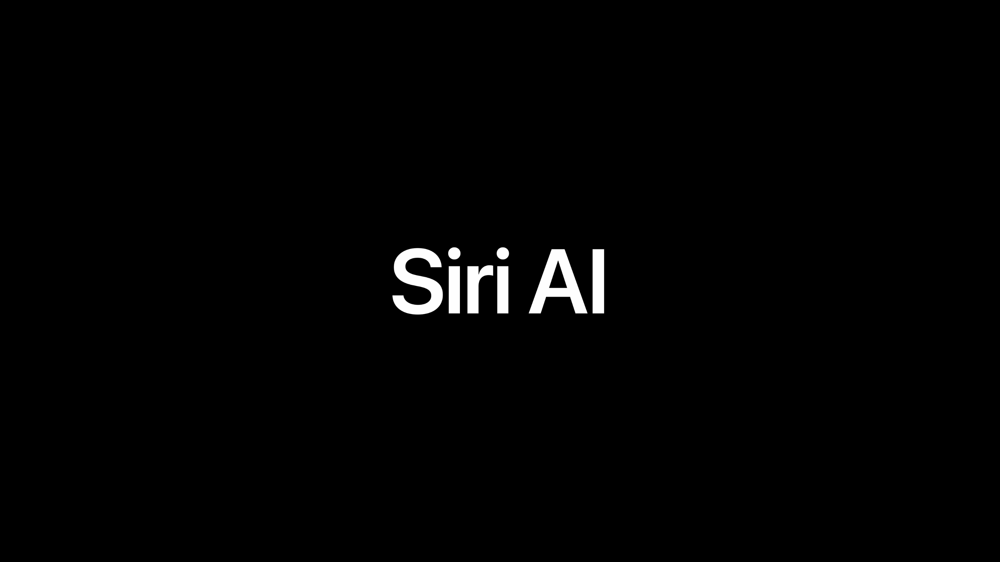

2026年6月8日（現地時間）、Apple は WWDC 2026 の基調講演を開催した。発表の柱は「プラットフォームの改良」「信頼性と安全性」「Apple Intelligence と Siri」の3つで、次期 macOS の名前は macOS Golden Gate。

---

## Liquid Glass の改良

*出典：Apple*

**ハイライト**

- **読みやすさの向上**：Liquid Glass の土台を調整し、背後の複雑な内容をより効果的にぼかしつつ、奥行きと分離感を強化
- **新機能：Liquid Glass スライダー**：設定で「ultra clear」から「fully tinted」まで透明度を調整可能
- **即時反映**：Liquid Glass 採用済みのアプリには、スライダーの設定がそのまま適用される
- **macOS の新機能：統一ツールバー**：アプリ上部に、より均一なツールバーを配置
- **変更：サイドバーがウィンドウ端まで拡大**：スクロール中のコンテンツによる屈折表現も同様に表示
- **復活：サイドバーアイコンの色**：アプリの見分けやアクティブウィンドウの判別が容易に
- **統一：ウィンドウの角丸**：macOS の全ウィンドウが同じ、より小さい角丸半径になる
- **刷新：アプリアイコン**：アイコン自体に Liquid Glass の層を追加し、輪郭がより鮮明に

### Liquid Glass の基本調整

- 背後のコンテンツを拡散する処理を強化し、可読性を高めつつ奥行きと分離感を向上
- 新しい標準の見た目に加え、より透明にしたい人・より色味を付けたい人向けに、設定へスライダーを追加
- スライダーの範囲は ultra clear（極めて透明）から fully tinted（完全に着色）まで
- すでに Liquid Glass に対応しているアプリでは、デベロッパの追加作業なしでカスタマイズが反映される

### macOS のデザイン要素

macOS で長く親しまれてきたデザインの要素を取り戻す変更が中心です。

- **ツールバー**：アプリ上部が均一なツールバーになり、大きなコントロール群やテキストをその下のコンテンツから区別しやすくなる。ラベルや見出しの視認性を保ち、構造も明確になる
- **サイドバー**：ウィンドウの左端いっぱいまで広がり、左端の煩雑さを抑える。コンテンツがスクロールして下を通る際の屈折表現も表示される
- **サイドバーアイコン**：色が戻り、アプリの判別やフォアグラウンドのウィンドウの特定がしやすくなる
- **ウィンドウの角丸**：すべてのウィンドウで同じ、より小さい角丸半径になる。未更新のアプリでも一貫性が保たれる

### アプリアイコン

| 項目 | 前年 | 今年 |
| --- | --- | --- |
| 内容 | 全アプリアイコンを再設計し、アプリ間・プラットフォーム間で統一感のある見た目に | アイコンのアートワーク自体に Liquid Glass の層を追加 |
| 効果 | 統一感のある見た目 | 層間の屈折でアイコンごとの個性を出し、より鮮明で輪郭がはっきりして見える |

- Dock、ホーム画面、オールクリア表示のいずれでも使える

---

## 動作の高速化と応答性

**ハイライト**

- **向上：システムアニメーション**：ホーム画面のページ切り替え（iPhone）、Mission Control、Mac のスペース間の移動が滑らかに
- **向上：iPhone と iPad のアプリ起動**：最大 30% 高速化。サードパーティ製アプリにも適用
- **向上：新規写真の表示**：撮影した写真がライブラリに表示されるまでが最大 70% 高速化
- **向上：AirDrop**：転送が最大 80% 高速化
- **向上：iPad の外部ドライブとのファイル転送・閲覧**：最大 5 倍高速化し、Mac の Finder と同等に
- **拡大：CPU スケジューラ**：最適化を加え、iPhone 11 までの旧機種にも導入
- **対応機種**：iOS 27 は iOS 26 と同じ iPhone モデルすべてをサポートし、iPhone 11 も対象
- **新機能：検索基盤の再構築**：Spotlight、写真、メールの検索インデックスを作り直し、メールには新しいランキングを導入

### 速度の向上

| 項目 | 高速化 |
| --- | --- |
| iPhone / iPad のアプリ起動 | 最大 30% |
| 新規撮影した写真のライブラリ表示 | 最大 70% |
| AirDrop での転送 | 最大 80% |
| iPad と外部ドライブ間のファイル閲覧・転送 | 最大 5 倍 |

- アプリ起動は、開いたときに必要な主要データを事前に読み込む方式で高速化
- メモリ使用量、CPU 使用率、ネットワーク処理、ディスプレイの描画といった基盤部分も最適化

### CPU スケジューラと対応機種

- CPU スケジューラは、日々の使用の中で CPU リソースを各処理に配分する中核コンポーネント
- 新しい iPhone にはすでに高度なスケジューラがあり、今年は負荷の高い処理での効率をさらに最適化
- 同様の仕組みを旧モデルにも導入し、iPhone 11 まで遡って応答性を向上
- iOS 27 は iOS 26 と同じ iPhone モデルすべてに対応し、iPhone 11 も含まれる。過去のどの iOS よりも多くのユーザーが利用できる

### ネットワーク切り替えとメッセージ

- **セルラーと Wi-Fi の切り替え**：接続を維持するか切り替えるかの判断を賢くし、コントロールセンターで Wi-Fi を手動でオフにする場面を減らす
- **低帯域幅時のメッセージ**：Messages で大きな写真や動画を送っても、会話の進行を妨げない
- **新機能：送信インジケータ**：送信に時間がかかっているメッセージごとに表示され、配信済みかどうかを確認できる

### 検索基盤の再構築

iOS、iPadOS、macOS で、Spotlight、写真、メールを支える検索基盤を作り直しました。

- 中核の検索インデックス（デバイス上のすべてのコンテンツのカタログ）を再設計し、安定性・効率・新旧コンテンツの網羅性が向上
- アップデート後は新しい基盤が端末内のコンテンツをインデックス化し、既存の内容も把握する
- 新しく届いたコンテンツはほぼ即座にインデックスされる
- メールは新しいランキングシステムにより、トップヒットに関連性の高い結果が表示される。数か月前に送られたメールも先頭に出やすくなる

---

## 各アプリ・製品の新機能

**ハイライト**

- **新機能：写真の共有アルバム**：Android や Windows の友人も参加して写真・動画を追加可能
- **新機能：共有アルバムのフル解像度共有**
- **新機能：ヘルスケアの周期記録が更年期移行期と更年期に対応**：周期パターンから更年期移行期が疑われる場合に通知
- **新機能：AirPods のカスタム EQ**：音の聴こえ方をさらに調整可能
- **新機能：Apple Vision Pro でパノラマを空間シーン化**：奥行きのある表示になり、環境としても利用可能
- **向上：マップの Flyover**：航空写真と Vision Intelligence モデルで、街並みを鮮明に描画

### 写真

- iCloud 共有アルバムに、Android や Windows のユーザーも参加して自分の撮影した写真や動画を追加できる
- 共有アルバムがフル解像度での共有に対応

### ヘルスケア

- 周期記録が更年期移行期（perimenopause）と更年期（menopause）に対応
- 周期パターンが更年期移行期を示唆する場合に通知
- 関連する症状の記録と、教育的な情報の閲覧が可能

### AirPods

- カスタム EQ を提供し、AirPods の音を自分好みに調整できる

### Apple Vision Pro

- 撮影したパノラマを、奥行きのある空間シーンに変換できる
- そのパノラマを環境として使い、周囲に表示できる

### マップ

- Flyover が大幅に強化され、航空写真と Vision Intelligence モデルを組み合わせて描画
- 建物の細部、個々の樹木の形、高層ビルのガラスへの光の反射まで細かく表現

---

## 信頼性と安全性

**ハイライト**

- **Ask to Browse（新機能）**：新しいWebサイトを見たいとき、子どもが親に許可を求める仕組み。iPhone・iPad・Mac の Safari で動作する
- **Ask to Browse / Ask to Buy の初期設定**：13歳未満ではどちらもデフォルトでオン。ティーンでも親が有効化できる
- **ペアレンタルコントロールの設定アシスタント（新機能）**：許可するアプリを「必要最小限」「おすすめセット」「個別指定」から選んで始め、あとから追加できる
- **Communication Safety（拡充）**：ヌードに加え、共有された画像・動画に含まれる流血や暴力的な内容も、見る前に介入する
- **Screen Time の時間枠（新機能）**：エンタメ・ゲーム・ソーシャルメディアの3カテゴリ合計と各カテゴリごとに、年齢に応じた1日の推奨時間を提示する
- **スケジュール（新機能）**：時間帯ごとに使えるアプリを設定でき、時間枠と併用できる
- **Screen Time（再設計）**：利用状況を一目で確認でき、ワンタップでアクセスを調整できる
- **デベロッパ向けAPI**：Declared Age Range API をはじめ、子ども向けの保護機能を実装するAPI群を提供

### 子どもアカウントとコンテンツ管理

子どもアカウントを作成すると、年齢に応じた保護がシステム全体で有効になる。アダルトサイトのブロック、年齢に適したメディアだけの許可、App Store での年齢別制限が含まれ、ペアレンタルコントロールも使えるようになる。すでに子どもが使っているアカウントも、子どもアカウントに変換できる。

今年は「見られるコンテンツ」「話せる相手」「使える時間」「親による見守り」の4点に重点が置かれ、専門家の知見にもとづく推奨設定も提供される。

- 設定アシスタントで、許可するアプリを最小限のもの、おすすめセット、個別指定のいずれかから選んで開始できる
- 子どもが成長したら、親の管理下で許可するアプリを徐々に増やせる
- App Store の全アプリに年齢レーティングが付く。子どもがアプリを求めるとき許可を申請し、親はメッセージ内で Ask to Buy として確認できる

### Ask to Browse

承認の対象がアプリからWebへ広がった。子どもは新しいWebサイトを開きたいとき許可を求め、親は内容を確認してから承認できる。iPhone、iPad、Mac の Safari で共通して動作する。

| 設定 | 13歳未満 | ティーン |
| --- | --- | --- |
| Ask to Buy | デフォルトでオン | 親が有効化できる |
| Ask to Browse | デフォルトでオン | 親が有効化できる |

### 連絡相手と Communication Safety

連絡できる相手は、家族のみから始めて祖父母などを加えるように、親が段階的に管理できる。アプリと同様に、新しい相手とつながる前に子どもが親へ許可を求める設定も可能。

Communication Safety は、ヌードが含まれる可能性のある画像・動画の受信や送信を警告し、内容をぼかす。この機能は FaceTime のライブ通話でも動作する。今年は、共有された画像・動画に含まれる流血や暴力的な内容にも、子どもが見る前に介入する対象が広がった。

### Screen Time の時間枠とスケジュール

- **時間枠**：エンタメ、ゲーム、ソーシャルメディアを前面に出し、3つを合わせた1日の時間枠の推奨値と、各カテゴリごとの推奨値を提示する。推奨値は子どもの年齢にもとづき、American Academy of Pediatrics を含む臨床・児童発達の専門家と作成した。科学的知見の更新や親の意見に応じて、推奨値も更新される
- **ソーシャルメディア**：専門家は13歳未満の利用を勧めておらず、ティーンについては親が慎重に判断することを勧めている。推奨値は親がいつでも調整できる
- **スケジュール**：時間帯ごとに使えるアプリを選べ、授業中などに集中しやすくなる。時間枠と連携するため、週末は視聴時間を増やすといった設定ができる。内容は家庭の生活リズムに合わせて自由にカスタマイズできる
- **再設計**：Screen Time 全体が作り直され、利用状況を一目で把握でき、その場でタップ1つでアクセスを調整できる

### 設計の考え方と専門機関との連携

子どもの安全機能は、「子どもはそれぞれ違い、何が合うかは親が最もよく判断できる」「専門家の健康研究にもとづく」という2つの原則にもとづく。研究では、学び・創造・つながりと、テクノロジー利用の境界設定とのバランスが重要とされ、対面での交流、学業、運動、睡眠の時間の確保が挙げられている。また、18歳未満には大人の見守りのもと年齢に応じた保護が有効で、13歳未満は個人用デバイスの利用を限定し、準備ができてから広げることが望ましいとされる。

- American Academy of Pediatrics が作成した Family Media Plan を、Apple の子ども向け機能を使って健全なデジタル習慣を築くための親向けガイドに仕立てる取り組みを同団体と進めている
- 子どものウェルビーイングへのテクノロジーの影響について、研究者との共同研究を継続する
- 子どもの安全機能をまとめ、よくある質問や始め方に答える新しいWebサイトを公開する

### デベロッパ向けAPIとリソース

アプリ内での年齢に適した体験づくりはデベロッパの責任とされ、そのための一連のAPIとリソースが用意される。

- ヌードや暴力的なコンテンツからの保護を実装するAPI
- アプリ内での新しい連絡先を親が承認する仕組みを実装するAPI
- **Declared Age Range API**：プライバシーを保ったまま、子どもの年齢層を取得してアプリの体験を調整できる

---

## Apple Intelligence

*出典：Apple*

**ハイライト**

- **新機能：次世代 Apple Foundation Models**：Google の Gemini ファミリーの技術を活用して共同開発。オンデバイスと Private Cloud Compute（サーバ）の両方で動作する
- **新機能：マルチモーダル対応**：画像の理解と生成、写真編集、視覚コンテンツへの質問に対応
- **新機能：第2のオンデバイスモデル**：最上位の Apple Silicon 向け。音声の理解と生成、テキスト・画像の理解に対応し、システム全体のディクテーション精度が向上
- **新機能：システムオーケストレーター**：個人コンテキスト、世界の知識、App アクション、画面認識の各機能を安全に連携させる
- **向上：プライバシー**：オンデバイス処理と Private Cloud Compute を使い、データは Apple を含め保存・参照されない
- **拡大：提供範囲**：現在 Apple Intelligence に対応する機種で利用可能。EU の iOS/iPadOS と中国では Siri AI などを当面提供しない

### 新アーキテクチャとモデル

- 新しい Apple Foundation Models は、オンデバイスと Private Cloud Compute 上のサーバで動作する
- 能力は、理解と推論の高度化、画像の理解と生成（リアルな画像の作成、写真編集、視覚コンテンツへの質問）
- 第2のオンデバイスモデルは最も高性能な Apple Silicon 搭載機向けで、音声の理解・生成に加えてテキスト・画像も扱う。ディクテーションの精度、自然言語の理解、表現力のある音声が向上する

### システム全体の4つの能力

| 能力 | 内容 |
|---|---|
| 個人コンテキストの理解 | 古い写真や最近のメモを質問するだけで探せる。Spotlight とそのセマンティックインデックスを利用し、連携する App で使える |
| 世界の知識 | Web から最新情報を取得し、Private Cloud Compute で回答を生成する |
| App アクション | App のツール群（App toolbox）から要求に合うツールを選んで実行する。メールの下書き、写真の編集・共有など |
| 画面認識 | 使用中の App と操作内容に応じて支援を調整する |

### プライバシー

- 多くの AI 提供元は既定で対話を保持するが、Apple Intelligence はオンデバイス処理と Private Cloud Compute を使い、データを Apple など第三者が保存・参照できない状態にする
- データはリクエストの実行にのみ使われ、外部の専門家が検証し続けられる

### 提供時期・対応状況

- 今回のアップデートは、現在 Apple Intelligence に対応する機種で利用できる
- 最上位のオンデバイスモデルと、それによる表現力のある音声・高度なディクテーションは、最も高性能な iPhone、iPad、Mac が対象
- Siri AI は、開発者が本日から試用でき、一般ユーザー向けには年内にベータ提供。まず英語で提供し、対応言語を順次拡大する
- EU の iOS/iPadOS では当初提供しない。中国では規制対応が済むまで Siri AI と新しい Apple Intelligence 機能を提供しない
- アプリ内の新機能は Apple Intelligence 対応の全言語に展開し、最新ソフトウェアで無料。画像生成など一部はサーバモデルを使うため1日の利用上限があり、ほとんどの iCloud+ プランで上限が拡大される（iCloud+ には対応ホームカメラの Apple Intelligence 対応も含まれる）
- 新 OS は開発者ベータが当日、パブリックベータが翌月、一般提供は秋

---

## Siri AI

*出典：Apple*

**ハイライト**

- **新機能：Siri AI**：Apple Intelligence 上に作り直された新しい Siri。「Hey Siri」など従来と同じ方法で呼び出せる
- **新機能：Siri アプリ**：会話履歴を一覧・再開できる専用アプリ。履歴は iCloud で非公開に同期され、iPhone、iPad、Mac で続きができる
- **向上：会話能力**：詳細な計画作成、ブレインストーミング、文書へのフィードバックなど、一問一答を超えるやり取りに対応
- **新機能：Siri のビジュアルインテリジェンス**：iPhone のカメラ、Mac、iPad、visionOS に対応
- **新機能：Siri での文章作成**：入力できる場所ならほぼどこでも利用可。自動校正はサードパーティ App を含むシステム全体で動作
- **新機能：表現力のある音声とカスタマイズ**：表現の強さと速さを調整可能（最上位オンデバイスモデル対応機種）
- **向上：ディクテーション**：スペル、句読点、大文字小文字の精度が大幅に向上
- **拡大：プラットフォーム**：iOS、iPadOS、macOS、watchOS、visionOS に加え、CarPlay と AirPods にも反映

### 能力の拡張

- Siri AI は個人コンテキストの理解、App アクション、画面認識、画像理解、世界の知識を使う
- 世界の知識で、公演日程やチケット購入方法などの質問に回答し、リマインダー作成や音楽再生へとつなげられる
- 画面認識で、表示中の写真の撮影場所を特定できる
- 個人コンテキストで、メッセージで受け取った住所を探して経由地付きの経路案内を出したり、写真を検索して共有アルバムに追加したりできる（Photos アプリを開く必要はない）

### 会話体験とプラットフォーム別の対応

| プラットフォーム | 内容 |
|---|---|
| iOS | Dynamic Island から下にスワイプして検索や文字入力での会話を開始。「Hey Siri」やサイドボタンも利用可。回答画面を下に引くと詳細な会話画面に移り、画像を含む回答や、メッセージ内容の取り込み、メニュー作成、グループチャットへの送信まで進められる |
| macOS | Spotlight に Siri を統合し、入力内容が Siri 向けの質問と判断されると会話を開始できる。ウィンドウはドラッグ・リサイズ可。Control クリックのコンテキストメニューに Siri 欄が加わり、画像・ファイル・テキストについて質問できる。複数ファイルの比較表の作成、メッセージやメールの横断検索、メール下書きの作成も可能 |
| iPadOS | Siri AI と会話体験に対応 |
| watchOS | 手首上で質問や操作が可能。新しい App グリッドから Siri アプリを開ける |
| visionOS | Siri の 3D 表示を空間の好きな位置に置ける。「Hey Siri」なしで、Siri を見て話しかけるだけで使える |

### Siri アプリ

- 既存の会話を再開したり新しい会話を始めたりできる専用アプリで、全 Apple 製品に提供される
- 会話履歴の概要を表示し、iCloud で非公開に同期する
- ビジュアルインテリジェンスで撮った画像と会話も保存される

### ビジュアルインテリジェンス

- **iPhone**：カメラ App に新しい Siri モードを追加。シャッターボタンで被写体を認識し、下に引くと詳細表示とフォローアップ質問ができる。画像理解は Private Cloud Compute 上の Apple Foundation Models が担当する
- **iPhone の提案アクション**：料理の栄養情報の表示や、会計の請求書から注文分を選んで Apple Cash で割り勘する操作などを提案する
- **macOS**：専用キーボードショートカットで起動。画面上の対象を選んで Siri に入力して質問でき、予定表のような画面からは複数イベントを一度にカレンダーへ追加する提案も出る
- **iPadOS**：画面についての質問、視覚的な検索、操作に対応。スクリーンショットの体験に統合
- **visionOS**：見ている対象について質問でき、世界の知識と個人コンテキストを組み合わせて回答する。身の回りの物理的な物体についても聞ける

### 文章作成と音声

- Siri で、自然言語で説明するだけで下書きをゼロから生成できる。Mail と Messages では、相手ごとの普段の書き方（箇条書き中心など）を反映する
- 書いた文章を選んで Siri に尋ねると、改善案などのフィードバックが得られる
- Apple Intelligence による自動校正は、サードパーティ App を含むシステム全体で自動的に動作する
- 最上位オンデバイスモデル対応機種では、より表現力のある Siri の音声が使え、表現の強さと速さを調整できる
- ディクテーションはキーボードに組み込まれ、システム全体で使える

---

## Safari とパスワード

**ハイライト**

- **新機能：タブの自動整理**：Apple Intelligence でページを分析し、関連するタブをトピックにまとめる
- **新機能：Notify Me**：自然言語で指定した変化をページから自動で監視し、検出時に通知する
- **新機能：Describing extension**：自然言語で説明するだけで、Web ページを調整する Safari 拡張機能を作成できる
- **新機能：パスワードの自動更新**：対象アカウントの弱い／漏洩したパスワードを、タップ1回で強力なものに更新する
- **向上：プライバシー**：閲覧データは Apple を含め誰とも共有されない

### タブの整理

- ページごとに類似性を分析し、関連タブをトピックにまとめる
- 閲覧を続けると、新しい関連タブが既存のトピックに自動で追加される
- 1日の終わりにはトピックごと閉じたり、タブグループとして保存したりできる

### Notify Me

- キャンプの申込受付や在庫の復活など、待っている更新を自然言語で指定すると、Safari がページを代わりに監視する
- タブを閉じたままでも、変化を検出すると通知が届く

### Describing extension

- 例として、レシピの保存と評価用のボタンをツールバーに追加するといった拡張を、自然言語の説明から作成できる
- 作成した拡張機能は、Web ページを自分向けに調整する

### パスワードの自動更新

- パスワード App は従来から弱いパスワードや漏洩したパスワードを警告している
- 新機能では、対象アカウントを Safari 経由で自動的に各サイトにサインインして更新し、強力なパスワードに変更する

---

## Messages・Mail・Calendar・Phone

**ハイライト**

- **新機能：Messages のワンタップ提案**：会話の文脈から、リマインダーやメモの作成を提案する
- **新機能：写真検索の提案**：写真を求められたとき、キーワード・場所・人物を手がかりにライブラリから候補を探す
- **向上：Mail の提案**：文脈に応じた提案が高度化し、サードパーティ App と連携して操作できる
- **新機能：Calendar の自然言語入力**：説明を入力するだけで、連絡先、場所、タイトルを補ってイベントを追加できる
- **新機能：Phone の情報表示**：事業者への通話時に、各 App から関連情報を自動で表示する

### Messages

- 会話の内容を理解し、リマインダーやメモの作成をワンタップで提案する
- 写真を求められたときは「写真を検索」をタップすると、キーワード、場所、ライブラリ内の人物名から最適な写真を見つける

### Mail

- 受信メールの文脈に基づく提案が強化され、サードパーティ App を含むお気に入りの App ですばやく操作できる

### Calendar

- 自然言語の説明からイベントを追加でき、入力中に連絡先の人物、場所、タイトルを識別して埋める
- 既存イベントの編集も自然言語で行え、毎週の予定を隔週に変えるといった頻度の変更を自動で調整する

### Phone

- 事業者に電話すると、各 App の関連情報を自動表示する。航空会社への通話なら、Mail から予約確認コードを見つけて通話開始時に表示する
- 判断材料は通話の相手であり、通話内容ではない。処理は完全にオンデバイスで、Apple を含め誰とも共有されない

---

## Home と Shortcuts

**ハイライト**

- **新機能：アクセサリ通知の集約**：関連する通知を1つの「アクティビティ」にまとめ、進行に合わせて更新する
- **新機能：カメラクリップの説明生成**：対応カメラの録画クリップを解析して内容の要約を作る
- **新機能：クリップの連結とカメラ横断検索**：複数カメラの関連映像をつなげて再生し、撮影内容で検索できる
- **新機能：4K 録画クリップの表示**：対応カメラの録画クリップを 4K 解像度で表示する
- **新機能：Shortcuts の自然言語作成**：説明を入力すると、必要な手順を Apple Intelligence が組み立てる

### アクセサリ通知

- Home App は関連する通知を1つのアクティビティとして理解し、1件の通知が状況に合わせて更新され続ける

### カメラクリップの解析と検索

- 対応カメラの録画クリップを解析して、何が起きたかの説明を生成する
- 内容を理解するため、すべてのカメラから関連映像を探し出し、再生時には複数のクリップをつなげて全体像を見せる
- 検索では撮影内容で探せ、入力前から重要なクリップが上位に表示される。荷物の配達のような特定の瞬間も、複数のカメラにまたがって見つけられる
- 対応カメラでは、録画クリップを 4K 解像度で表示できる
- ホームカメラの Apple Intelligence 対応は iCloud+ に含まれる

### Shortcuts の自然言語作成

- 自然言語の説明を Apple Intelligence が解釈し、必要な手順を自動で組み立てる
- たとえば「仕事場を出るときに、到着予定時刻付きでメッセージを送る」と書くと、勤務先の住所を出るときに実行する自動化を作り、Maps で帰宅の予想時間を計算し、Messages で送信する
- 修正や追加も説明で指示でき、好きなポッドキャストを再生する手順を足すといった変更が可能

---

## Image Playground

**ハイライト**

- **新機能：新しい生成モデル**：Private Cloud Compute 上で動き、写実的なものを含むほぼあらゆるスタイルの高品質画像を生成できる
- **新機能：写真ライブラリの人物利用**：複数人を使った画像の生成や、写真のスタイル変換に対応
- **新機能：タッチによる修正**：オブジェクトを丸で囲んで選択し、移動・リサイズ、または自然言語での変更ができる
- **新機能：サイズ指定**：用途に応じて縦長・横長などの寸法を選べる
- **拡大：システム統合**：メッセージの背景、連絡先ポスター、ロック画面の壁紙の生成に対応
- **新機能：Image Playground API**：開発者がこれらの機能を利用できる

### 画像生成

- 新しい生成モデルは Private Cloud Compute 上で動作し、写実的なスタイルを含めて指定できる
- 写真ライブラリの複数の人物を使った画像を作れるほか、自分の写真を自然言語の説明でさまざまなスタイルに変換できる
- Private Cloud Compute により、写真は Apple を含め保存・共有されない

### 画像の修正

- 説明だけで生成した画像を、変更内容を説明して更新できる
- タッチ操作で対象を丸で囲んで選び、移動・リサイズするか、自然言語で変更する（ケーキを選んでろうそくを追加するなど）
- 寸法を選べるため、Web サイト用の横長画像やチラシ用の縦長画像も作成できる

### システムへの統合

- システム全体に統合され、メッセージの背景を作れる
- 連絡先ポスターとロック画面の壁紙の生成にも対応する
- 写真に写る場所や行動を元にした、一人ひとり向けの提案が表示される
- 開発者は Image Playground API でこれらの新機能を使える

---

## Photos

**ハイライト**

- **向上：クリーンアップ**：新しい画像モデルにより画質と、複雑な場面での埋め込みの自然さが向上
- **新機能：拡張ツール（Extend）**：被写体の周囲に余白を足したり、アスペクト比を変えたり、水平線を傾きの補正で切らずに直したりできる
- **新機能：空間リフレーミング**：撮影後に、カメラ位置を動かしたように構図を調整できる
- **新機能：ツールメニュー**：編集画面の右下に新しい「ツール」が加わり、Apple Intelligence の画像モデルを使う編集機能が集約される
- **拡大：対象写真**：古い写真や他のカメラで撮った写真など、ライブラリのほぼすべての写真で使える

### クリーンアップの強化

- 不要なものを除去する既存のクリーンアップが、新しい画像モデルでアップグレードされた
- 複雑なシーンでも、より高品質でリアルな埋め込みで除去できる

### 拡張ツール

- 被写体の周囲に余白を生成して広げられる
- プロジェクトに合わせてアスペクト比を変えられる
- 曲がった水平線を、重要な部分を切り取らずに補正できる

### 空間リフレーミング

- 編集画面の「ツール」から「リフレーム」を選び、写真を直接ドラッグして視点を動かす。ピンチでズームも可能
- 空間モデル（Apple Vision Pro で培った理解）がオンデバイスで動くため、効果をリアルタイムでプレビューできる
- 元の画像の端は、プレビュー中はぼかして表示され、最終処理で生成モデルが埋める
- 最終処理は、オンデバイスの空間モデルと、Private Cloud Compute 上の画像生成モデルの組み合わせで行う。視点移動で空いた部分にだけ新しい内容を生成するため、元の場面との整合性が保たれる
- 看板の写り込み、左右対称の構図、視線の合わない写真の調整などが想定されている

---

## 開発者向け Apple Intelligence

**ハイライト**

- **新機能：Siri 連携**：App Intents などの既存技術で、App の情報や操作を Siri から使えるようにできる
- **向上：Foundation Models framework**：画像を入力に使え、カスタムスキルでモデルを拡張でき、サーバ上のモデルも同じ Swift API で使える
- **新機能：Core AI フレームワーク**：Apple Foundation Models 以外のモデルを、Apple Silicon の性能を活かして App 内でローカル実行する（全プラットフォーム対応）
- **向上：Xcode のコーディングアシスタント**：App 全体のローカライズやシミュレータ操作に対応し、カスタムスキルで拡張できる
- **新機能：Gemini 対応**：Xcode で使うモデルとエージェントを選べるようになり、Gemini も対象。Figma や GitHub などのツールにも接続できる
- **新機能：Device hub**：シミュレータと実機をひとつの画面にまとめたテスト環境

### Siri との連携

- App Intents などの既知の技術で、ユーザーが Siri に頼むだけで情報を探し操作を行えるようにする
- Spotlight にコンテンツをインデックスすれば、Siri が App 内の会話などから情報を探せる（メッセージ App の LINE の例）
- App Intents を採用すると、Siri からイベント作成などの操作が可能になる（カレンダー App の Structured の例）

### Foundation Models framework

- オンデバイスモデルを使い、高速かつプライバシーを保ったインテリジェント App を作れる
- 新たに、テキストに加えて画像を入力できる
- カスタムスキルでモデルの機能を拡張できる
- サーバ上で動くモデルも、同じ Swift API で使える

### Core AI

- Apple Foundation Models に加えて、他のモデルを App 内でローカル実行できる新フレームワーク
- Apple Silicon の性能をフルに利用でき、すべてのプラットフォームで使える

### Xcode のエージェント型コーディング

- コーディングアシスタントは、App 全体のローカライズやシミュレータ上のデバイス操作に対応する
- カスタムスキルで機能を拡張できる
- 使うモデルとエージェントを選べ、Gemini も含まれる。Figma や GitHub などのツールにも接続できる

### Device hub

- シミュレータと実機のすべてのデバイスを、ひとつの統合インターフェースにまとめる
- スワイプやピンチなどのマルチタッチ操作のシミュレーション、1クリックでの外観変更、動的なリサイズに対応する

---

## 提供時期

| 対象 | 提供時期 |
|------|----------|
| 新 OS のデベロッパベータ | 基調講演当日 |
| 新 OS のパブリックベータ | 翌月 |
| 新 OS の正式リリース | 今秋 |
| Siri AI（一般向け） | 年内にベータ提供（当初は英語のみ。EU の iOS／iPadOS と中国では当面提供なし） |
