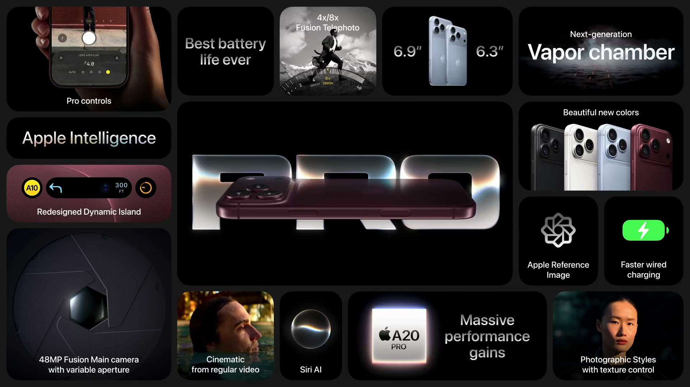
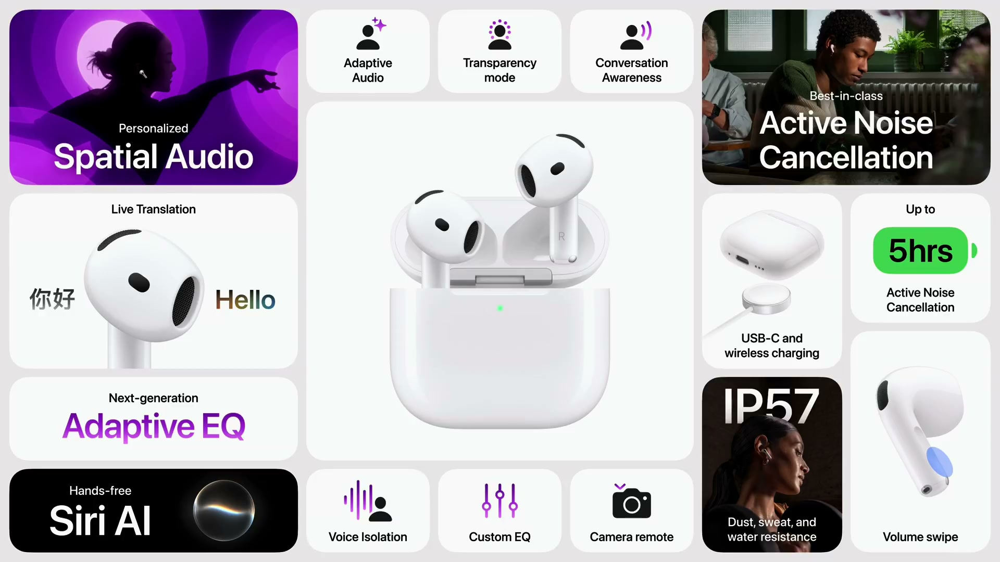
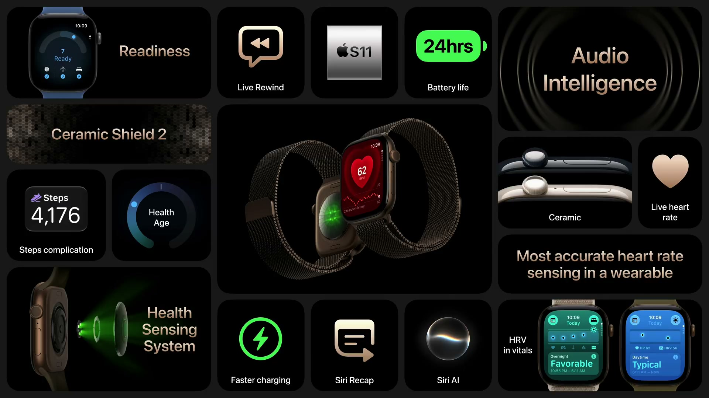
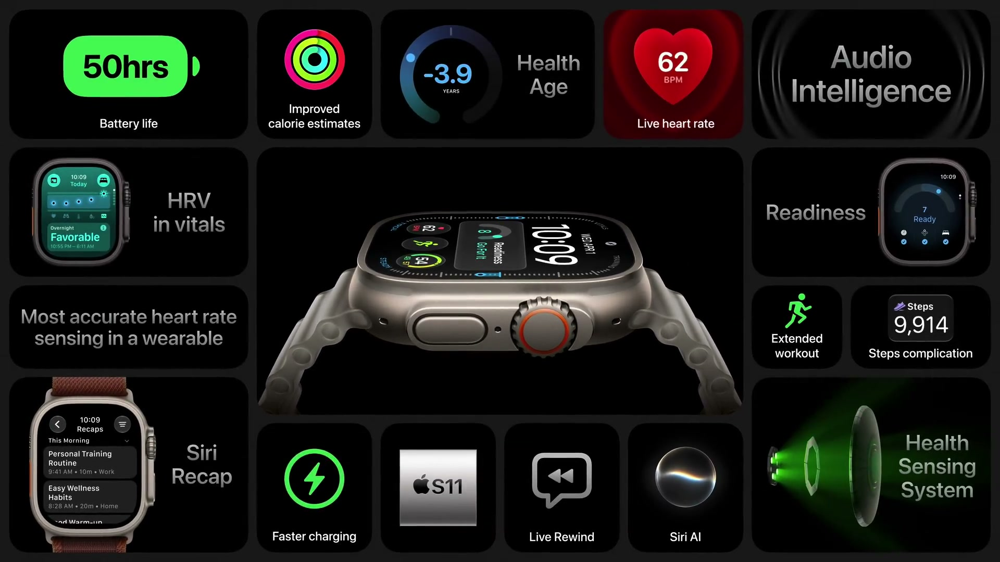
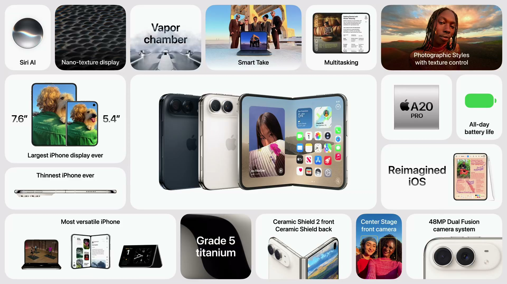

2026年9月9日（現地時間）、Apple は Apple Park で Apple Event を開催した。iPhone を「インテリジェントなパーソナルハブ」と位置づけ、iPhone 18 Pro、AirPods 5、Apple Watch Series 12 / Ultra 4、フォルダブルの iPhone Duo を発表した。

---

## iPhone 18 Pro

*出典：Apple*

**ハイライト**

- **A20 Pro**：2nm プロセスの新アーキテクチャ。6コア CPU（新 super core 2基は最大20%高速）、7コア GPU（最大40%向上）、Neural Engine を2基にして計32コア（演算性能2倍）
- **熱設計**：新しいベイパーチャンバーは iPhone 17 Pro の3倍の表面積。持続性能は iPhone 17 Pro 比で最大40%向上
- **バッテリー**：iPhone 18 Pro Max はバッテリー駆動時間が iPhone 史上最大の伸び。動画再生は eSIM 専用モデルで 18 Pro が36時間、18 Pro Max が45時間
- **充電**：有線充電が高速化し、約15分で50%充電
- **カメラ**：48MP Fusion メインカメラに可変絞りを新搭載。暗所では約50%多く光を取り込む
- **Pro controls**：ホワイトバランス、ヒストグラム、絞り（4段階）、シャッタースピードを手動で設定可能（新機能）
- **Apple Reference Image**：撮影時にセンサーで署名した写真データから改変不能な参照画像を作る新機能
- **Siri AI**：個人コンテキスト、画面認識、アプリ操作に対応した新しい Siri。専用の Siri アプリも追加
- **デザイン**：アルミと背面ガラスの色をそろえた。カラーは Black、Silver、Glacier（新色）、Burgundy（新色）

### A20 Pro と熱設計

A20 Pro は 2nm の新アーキテクチャで、チップ全体が強化された。

| 項目 | 内容 |
| --- | --- |
| CPU | 6コア（super core 2基は最大20%高速、efficiency core 4基）。全コアにニューラルアクセラレータを統合 |
| GPU | 7コア設計で最大40%の性能向上。内部帯域の拡大と、ハイエンドゲーム向けのマイクロアーキテクチャ改良 |
| ニューラルアクセラレータ | 新版。8ビット浮動小数点演算が2倍高速。サードパーティ LLM のオンデバイス実行を支える |
| Neural Engine | 2基目を追加し計32コア。演算性能2倍 |
| メモリ帯域 | 50%拡大。iPhone で出荷したなかで最も広いメモリインターフェイス |

- **パッケージ**：M シリーズに着想を得たカスタムパッケージで、ダイとメモリを並べて配置する。メモリが SoC の放熱経路から外れ、ダイをベイパーチャンバーに直接接続できる
- **ベイパーチャンバー**：iPhone 17 Pro の3倍の表面積。脱イオン水を循環させる。素材は80%再生ステンレススチールで、熱伝導性の高いグラファイトと組み合わせる
- **Nanotwin 銅**：業界初の素材。ディスプレイから熱を逃がしつつ強度も確保する
- **持続性能**：iPhone 17 Pro 比で最大40%向上、iPhone 16 Pro 以前と比べると最大2倍
- **ゲーム**：Monster Hunter Outlanders（Tencent Games と Capcom）が A20 Pro の7コア GPU を使い、iOS 限定の Cinematic Graphics を最大120fps で描画。MetalFX アップスケーリングと空間オーディオに対応し、年内に配信予定

### バッテリーと充電

iPhone 18 Pro は小型ながら、iPhone 17 Pro Max と同等の1日持つバッテリー駆動時間になった。A20 Pro の効率向上、システム改善、新しいバッテリー設計による。実使用データに基づく新しいバッテリー使用モデルも採用した。

| 項目 | iPhone 18 Pro | iPhone 18 Pro Max |
| --- | --- | --- |
| 動画再生（eSIM 専用モデル） | 36時間 | 45時間 |
| 使用時間（1回の充電） | 最大24時間 | 最大30時間 |

- 有線充電は約15分で50%充電
- 5分の有線充電で、約6時間分の動画再生が可能

### カメラ

メインカメラは 48MP Fusion で、可変絞りを搭載した。

- **可変絞りの構造**：ポリマー複合材のレーザーカット羽根6枚（髪の毛より薄い）、新しいローター機構、複数の絞りで画質を保つ専用設計のレンズ
- **自動調整**：シーンに応じて絞りが自動で変わる。暗い場所では開いて約50%多く光を取り込み、ナイトモードの撮影が高速化・高画質化する。最適化された f/1.8 が基準になる
- **絞りを絞る場合**：被写界深度が深くなり、奥までくっきり写る（集合写真向け）
- **シネマティックモード**：通常のビデオを撮影後にシネマティック効果付きにできる。ハーフスピード効果は60fps に対応
- **タイムラプス**：4K、Dolby Vision HDR に対応
- **AudioMix**：アルゴリズムを更新して音声の録音品質が向上し、音楽にも対応
- **スマートフォーカストラッキング**：オンデバイス AI で被写体をロックし、奥行きが変わったりフレームを出入りしても追従する
- **フォトグラフスタイル**：テクスチャとグレインの調整を追加。肌の質感なども調整でき、色と質感を同時に整えられ、あとから元に戻せる

**Pro controls**：写真・動画の両方で使える手動コントロール。よく使う設定にすぐアクセスでき、次の項目を調整できる。

- ホワイトバランス
- ヒストグラムによる露出確認
- 絞り（4段階から手動選択）
- シャッタースピード（動画ではモーションブラーの調整にも使える）

**画像の真正性**

- **SynthID**：AI で生成・編集された画像を識別する SynthID 標準に対応する
- **Apple Reference Image**：メインカメラがセンサー段階で、ピクセルレベルの写真データに署名する。Private Cloud Compute がその署名データから改変不能な画像を生成し、写真アプリで表示できる。参照画像は通常の編集可能な写真と一緒に保存される

### Apple Intelligence と Siri AI

最新の Apple Foundation Models（過去最高性能のオンデバイスモデルを含む）と、Private Cloud Compute 上のより強力なモデルを利用できる。これらが新しい Siri である Siri AI を支える。

- **Siri の利用状況**：1日の要求数は25億件超
- **個人コンテキスト**：Mail や Messages など複数アプリにまたがる情報を検索できる
- **画面認識**：見ているものを把握し、最新の幅広い世界知識と組み合わせて回答する
- **アプリ操作**：サードパーティ製を含むアプリ内で操作でき、すでに30万超のアプリに対応する（WhatsApp、Audible、Outlook、Notability、Tripsy など）。開発者が新しい機能を取り込みやすい仕組みも用意されている
- **Siri アプリ**：ホーム画面に置かれる。音声とテキストで会話でき、過去の会話を見直せる。会話は iCloud で Apple 製品間に非公開で同期される
- **カメラ連携**：カメラアプリに Siri を組み込み、複数の予定を一度にカレンダーへ追加するなどができる
- **文章の作成・編集**：文字入力できるほぼすべての場所で Siri により作成・編集できる
- **Expressive voices**：オンデバイスモデルによる音声で、複数の候補から選び、話すペースと表現力を調整できる
- **ディクテーション**：同じモデルにより、システム全体で句読点、スペル、大文字小文字がより正確になる

| 機能 | 内容 |
| --- | --- |
| Safari の Notify Me | Web ページを監視し、変化を自動で通知する |
| ショートカット | 内容を言葉で説明するだけで、パーソナライズした自動操作を作れる（例：学校からのメールを受信するたびに、カレンダーとリマインダーを更新） |
| 電話 | 事業者に電話するとき、フライトの確認コードなど関連情報を自動で表示する |
| Image Playground | 作り直され、ほぼあらゆるスタイルで高品質な画像を生成できる |
| 写真のクリーンナップ | 複雑なシーンでもより高品質に補完できるよう向上 |
| 写真の Extend | 画像を拡張し、被写体に余白を持たせる（新機能） |
| 空間リフレーミング | 撮影後にカメラの視点を変え、構図を調整できる（新機能） |

- **提供時期**：Apple Intelligence は今月の OS リリースで16言語に対応する。Siri AI は英語でベータ提供され、フランス語、日本語、韓国語、ポルトガル語、スペイン語は10月に対応する
- **利用制限**：サーバーモデルを使う一部機能には利用上限がある。ほとんどの iCloud+ プランで利用枠が増える

### Dynamic Island と iOS 27

Dynamic Island は小型化され、ライブ情報を一目で確認しやすくなった。ライブアクティビティを3つ同時に表示できる（Flighty のフライト状況、マップのナビ、タイマーなど）。

- **子どもの安全**：見られるもの、会話できる相手、使える時間帯をより柔軟に管理できる Child Safety 機能
- **Liquid Glass**：カスタマイズに対応
- **検索**：Mail などで改善
- **AirDrop**：転送が最大80%高速化
- **ネットワーク**：モバイル通信と Wi-Fi の切り替えが賢くなった
- **iPhone Handoff**：1つの電話番号を2台の iPhone で使え、手に取った側で即座に有効になる新機能。T-Mobile と Telecom Germany で開始し、Verizon と EE は年末までに対応する。ほかのキャリアも順次追加予定

### アクセサリと購入プログラム

- **ケース**：Clear Case を更新。Tech Woven と Silicone に新色を追加し、同色の Crossbody Strap と組み合わせられる
- **Wrist Strap**：新登場。iPhone ケースと AirPods Pro の両方に対応する
- **ストレージ**：2TB の選択肢が加わる
- **Apple Upgrade**：米国で開始する新しいリース プログラム。12か月または24か月の月払いで、リース終了時に新しい iPhone へ簡単に乗り換えられる
- **下取り**：米国で iPhone 14 以降の下取りで最大1,200ドル引き
- **AppleCare One Family**：米国で導入する家族向けプランで、iPhone から簡単に申し込める

---

## AirPods 5

*出典：Apple*

**ハイライト**

- **ノイズキャンセリング向上**：新しい音響構造と高度な演算オーディオにより、前世代より ANC のノイズ低減効果が 50% 向上
- **音響設計を刷新**：オープンイヤーの装着感を保ったまま、マルチポート音響アーキテクチャと次世代 Adaptive EQ を新搭載
- **ANC が全 AirPods の標準に**：オープンイヤー型で ANC を搭載し、AirPods ラインナップ全体で ANC が標準になる
- **Siri AI にハンズフリーで対応**：iPhone の Apple Intelligence と連携し、個人のコンテキストを使った回答に対応
- **ライブ翻訳に対応**：iPhone と組み合わせて会話をリアルタイムに翻訳
- **耐久性向上**：耐雨・耐汗・耐ダスト性能を高める再設計
- **バッテリー**：ANC オン時で最大 4 時間、充電ケース併用で最大 20 時間
- **上位モデルを追加**：ステム上のボリュームスワイプ、最大 5 時間のバッテリー、ワイヤレス充電ケースを備えた第2のモデルを用意

### サウンド

オープンイヤーの形状は変えず、内部構造を作り直している。マルチポート音響アーキテクチャと次世代 Adaptive EQ により、より幅広い耳の形状で豊かで細かい音を再生できる。

パーソナライズされた空間オーディオも、より没入感のある立体的な音になる。

### ノイズコントロール

- **ANC**：新しい音響アーキテクチャと高度な演算オーディオにより、前世代比で 50% 多くノイズを低減する
- **外部音取り込み**：周囲の声や音の聞こえ方がより自然になった
- **適応型オーディオ**：周囲の騒音に応じて ANC と外部音取り込みを自動で切り替える。モードを手動で変える必要がない

### Apple Intelligence との連携

- **Siri AI**：個人のコンテキストと幅広い世界知識を使った回答を、ハンズフリーで得られる。メッセージ内の店の話題を踏まえた回答や、徒歩経路の案内も音声で依頼できる
- **ライブ翻訳**：前年秋に提供が始まった機能。相手の話す言語（例：スペイン語）を英語に翻訳して聞ける。iPhone と組み合わせて使う

### 耐久性とバッテリー

雨・汗・ダストへの耐性を従来より高める再設計を行った。ANC オンで最大 4 時間、小型の充電ケース併用で最大 20 時間使える。

### 2つのモデルの違い

| | AirPods 5 | AirPods 5（ワイヤレス充電ケース搭載モデル） |
|---|---|---|
| ANC | 搭載 | 搭載 |
| ボリュームスワイプ（ステムを上下にスワイプして音量調整） | — | 搭載（このスタイルの AirPods で初） |
| バッテリー（ANC オン時） | 最大 4 時間 | 最大 5 時間（バッテリーセルを再設計し、同じサイズでエネルギー密度を向上） |
| 充電ケース | 通常の充電ケース（最大 20 時間） | ワイヤレス充電ケース（Apple Watch の充電器と Qi 充電器に対応） |

---

## Apple Watch Series 12

*出典：Apple*

**ハイライト**

- **Health Sensing System（新機能）**：電極面積の拡大、リング状に配置した新設計のフォトダイオード、大型で低消費電力の緑色 LED を採用した新しい心拍センサー群
- **心拍データの頻度（向上）**：バックグラウンドの心拍測定が5秒ごとになり、従来の60倍の頻度
- **HRV の測定頻度（向上）**：最短5分ごとにサンプリングし、従来の24倍の頻度
- **Readiness（新機能）**：活動、バイタル、睡眠から毎朝1つのスコアを出し、その日の体の余力を示す
- **Audio Intelligence（新機能）**：Sound Recognition、Live Rewind、Siri Recap を含む、マイクと Apple Intelligence を使う新しい機能群
- **S11 チップ（新機能）**：A20 Pro 由来の CPU・GPU・Neural Engine を持ち、Apple Watch 用として最も高性能
- **Ceramic Shield 2（新機能）**：アルミニウムモデルの前面ガラスが、従来の Ion-X ガラスより60%強くなる
- **新しい仕上げ（新機能）**：ダークブロンズ、セラミックケース（パールホワイト、ナイトブルー）などを追加

### Health Sensing System

- 心電図（ECG）測定時の肌との接触を良くするため、同じ小さな面積のまま電極の表面積を拡大
- 光学センシングのため、フォトダイオードを再設計してリング状に配置し、光をより効率よく取り込む
- 緑色 LED を大型化し、消費電力を抑えつつ、動いている間も1日を通して正確な心拍測定を支える
- ECG チェストストラップを基準に、他社のウェアラブルと比較する試験を実施。数百人の参加者がランニング、サイクリング、HIIT を行い、ウェアラブルの中で最も正確な心拍センシングという結果が出た

### 心拍・HRV・Readiness

- 高頻度の心拍データを、更新された心拍数 App と新しい文字盤コンプリケーションで表示
- HRV（心拍変動）が Vitals App に加わり、夜間ビューに加えて新しい日中ビューを用意。夜間の指標に出る前の変化を見つけやすくする
- HRV は体のストレスや回復への反応を示す指標で、変動が大きいほど回復が良い傾向がある
- Readiness は毎朝のスコアで、結果は「Recover」「Pace Yourself」「Ready」「Go For It」の4段階。日中にスコアが更新されることもある
- Readiness は Apple Watch と iPhone の Fitness App で確認できる

### 新しい Health App

Health Sensing System の測定値はすべて iPhone の Health App に集まる。Health App は全面的に再設計され、Apple Intelligence を中心にした個別ガイダンスを提供する。今年後半に米国英語から提供を始め、順次言語を追加する。

- **Insights タブ**：Apple Intelligence が生成した要約で、睡眠の最新状況や VO2 Max の新記録など、時宜にかなった情報を表示。Readiness、Fitness、心臓の健康などを掘り下げられる
- **個別ガイダンス**：たとえば有酸素運動に取り組んでいる場合、朝のランにインターバルを取り入れる提案が出る。提案は本人のデータに合わせて動的に変わる
- **Health Age**：VO2 max や睡眠などの Apple Watch の指標と、血液検査のバイオマーカーを組み合わせ、主要な健康指標が実年齢とどう対応するかを示す。どの習慣が影響しているか、どう改善するかも分かる
- **Longevity タブ**：iPhone と Apple Watch の指標から、睡眠、運動、心臓の健康などの全体像を評価。カテゴリごとに状態を色の濃淡で示し、各指標を最新の臨床ガイダンスに照らして分類する

### 検査結果と動作アセスメント

- 検査結果は手動入力、医療記録の同期のほか、米国では Quest の検査パネル（50を超える主要バイオマーカー、119ドル）を注文して取り込める
- 検査結果は Apple Watch のデータと組み合わせて iPhone 上で分析され、結果に関連する専門家の動画も表示される
- iPhone と Apple Watch だけで、体の動きや可動性を詳しく評価するアセスメントを受けられ、けがからの回復の経過も追える
- VO2 max テストでは iPhone のカメラが動きを検出する。トレーナーの手本を見ながら、拍に合わせてその場で足踏みし、画面表示と音声で動作のフォームについてリアルタイムに指示が出る。結果はすぐに出て、何度でも再測定できる

### Audio Intelligence

Series 12 と Ultra 4 の内蔵マイク、Apple silicon、最新の AI モデルを使い、聞こえる音を理解する新しい Apple Intelligence 機能群。処理は手首の上でプライバシーを保って行われる。

- **Sound Recognition**：サイレン、アラーム、ドアベル、赤ちゃんの泣き声などを検知し、オンデバイス AI で通知する。iPhone が手元になくても動作する
- **Live Rewind**：15秒前までさかのぼれる。Digital Crown をダブルプレスすると直前の発言を文字起こしし、内容を Siri に質問することも、新しい Siri App に保存することもできる
- **Siri Recap**：周囲の会話を聞き取って要点をメモする。Apple Intelligence が会話ごとにタイトル、要約、キーポイントを生成し、Siri App で見返せる
- Siri Recap は「常時」または「職場のみ」「夜は使わない」などのスケジュールで設定でき、コントロールセンターからいつでもオン・オフを切り替えられる
- 新しい Siri モジュラー文字盤は Smart Stack の動的な上部ウィジェットを備え、過去の Siri の会話をタップして Siri を呼び出したり、Siri Recap を表示したりできる
- Shazam による曲の即時検出にも対応
- Live Rewind と Siri Recap は Siri AI が必要で、今年後半にベータ版として英語から提供し、順次言語を追加する

### プライバシーと S11 チップ

- Audio Intelligence は音声の録音を作成・保存せず、処理に使う生の音声には Apple も一切アクセスできない
- 話者の特定や帰属は行わない
- Siri App の Live Rewind の文字起こしと Siri Recap は、iCloud 同期でエンドツーエンド暗号化される
- S11 チップは省電力の常時動作プロセッサを持ち、新しいセキュアエクスクレーブ内の専用オーディオバッファが、生の音声を処理専用に安全に管理する
- CPU、GPU、Neural Engine が高速化し、いずれも A20 Pro 由来

### 仕上げとバッテリー

| 項目 | 内容 |
| --- | --- |
| アルミニウム | スペースグレイ、ブラック、ライトゴールド、新色のダークブロンズ。100% リサイクルアルミニウム製で、前面は Ceramic Shield 2 |
| チタニウム | ラディアントゴールド、ナチュラルの2種類の研磨仕上げ。100% リサイクルチタン製 |
| セラミック | パールホワイト、ナイトブルー |
| バッテリー | 最大24時間 |

- Nike のものを含む新色のバンドを追加
- Apple Watch Hermès のシリーズにラディアントゴールドチタニウムを追加

---

## Apple Watch Ultra 4

*出典：Apple*

**ハイライト**

- **Series 12 と共通**：Health Sensing System、Audio Intelligence、S11 チップ
- **バッテリー（向上）**：大型バッテリー、S11 の電力効率、Health Sensing System により、2日を超えて使える
- **ワークアウト（向上）**：GPS と心拍を使うワークアウトで最大18時間
- **Max Extended Workout モード（新機能）**：最大45時間で、100マイルのレースに対応できる
- **仕上げ**：ブラックとナチュラルチタニウム。新色のバンドと、チタニウム製の新しい Hermès バンドを追加

### バッテリーとワークアウト

| 項目 | Ultra 4 |
| --- | --- |
| 通常使用 | 2日超 |
| ワークアウト（フル GPS と心拍） | 最大18時間 |
| Max Extended Workout モード | 最大45時間 |

### 仕上げとバンド

- ケースはブラックとナチュラルチタニウムの2種類
- バンドのラインナップ全体に新色を追加
- チタニウム製の Hermès バンドを新たに用意

---

## iPhone Duo

*出典：Apple*

**ハイライト**

- **折りたたみ式の新デザイン**：開くと7.6インチの Super Retina XDR ディスプレイになる折りたたみ型 iPhone。iPhone 18 Pro Max より50%、iPhone 18 Pro より80%大きい
- **外側ディスプレイ**：5.4インチで、iPhone 18 Pro の90%の画面面積
- **Apple Pencil 対応（新機能）**：USB-C 版 Apple Pencil を内側・外側どちらの画面でも使える。年内に提供予定
- **iOS 27 の折りたたみ対応**：操作系を側面に寄せ、Split View やピン留め表示など2画面を使うマルチタスクを追加
- **A20 Pro と C2 モデム**：持続性能は iPhone 17 Pro より最大35%向上。C2 は C1X より最大50%高速なアップロードで、消費電力は15%低減
- **バッテリー**：内側ディスプレイで最大31時間、外側で最大44時間のビデオ再生。両方を同じ割合で使うと最大24時間
- **カメラ**：Fusion Main、2倍光学品質の望遠、48MP の Fusion Ultra Wide、Center Stage フロントカメラ、ディスプレイ下の FaceTime カメラ
- **新しい撮影機能**：Duo Preview、Kid Cue、Smart Take、Duo FaceTime、Dual Capture と FaceTime の併用

### デザインと耐久性

- 本体サイズはパスポート程度で、片手で持てる。角が2か所丸い非対称な形状
- 2つの画面で共通のアスペクト比を採用。開閉の前後で表示が連続する
- 内側ディスプレイは均一な細いベゼルで、横向き・縦向きの両方に対応
- FaceTime カメラはディスプレイの下に配置（初搭載）
- ヒンジは可変トルク特性を持ち、開閉を制御する。内蔵のマグネットアレイで閉じた状態を保持し、開いたときは画面中央を支えて平らに保つ。ヒンジは100点を超える精密部品で構成される
- 開いた状態では iPhone で最も薄い。主要部品をカメラプラトーに集約し、バッテリー用の空間を確保している
- フレームは航空宇宙グレードのチタン（Grade 5）で、鏡面仕上げ。中央の構造プレーンにリブを設け、アンテナ分割部にはセラミック繊維のインサートを使用（Grade 5 チタンの3倍の強度）
- 背面は Ceramic Shield、前面は Ceramic Shield 2。IP68 の防塵・防水性能
- 認証はサイドボタン一体の Touch ID で、複数の指を登録できる。Apple Watch によるロック解除にも対応
- 上下のスピーカーで、横向き・縦向きともに空間オーディオに対応
- カラーは Star White と Night Sky の2色
- アクセサリは、キックスタンド内蔵の iPhone Duo Folio と、両側それぞれを覆う2パーツ構成の iPhone Duo ケース

### ディスプレイ

| | 内側ディスプレイ | 外側ディスプレイ |
|---|---|---|
| サイズ | 7.6インチ Super Retina XDR | 5.4インチ |
| 比較 | iPhone 18 Pro Max より50%大きい、iPhone 18 Pro より80%大きい | iPhone 18 Pro の90%の画面面積 |

- 独自のナノテクスチャ仕上げでグレアと映り込みを大きく低減し、折り目を目立ちにくくする。マスクレスのレーザーリソグラフィで、マイクロレンズを1ピクセルずつ描画して作る
- 多層ラミネート構造：カバー層はカスタムポリマーで、業界で使われる他の素材より剛性が最大40%高く、Apple 設計の耐擦傷コーティングを施す
- OLED パネルの上下を高強度ガラスで挟み、粘弾性接着剤が折りたたみ時に層同士を滑らせる。最下層はチタンプレート
- カーボンファイバーの支持プレートがディスプレイを支える
- 製造時は AI アルゴリズムで各ヒンジと最適な筐体を組み合わせる。共焦点レーザーで形状を走査し、カスタムフォトポリマーを最大25のマイクロ層で3D プリントして、残留するうねりを除去する
- A20 Pro の新ディスプレイエンジンが2つの画面を同時に駆動し、ディスプレイ下カメラ領域の画素配列をなじませる

### iOS 27 とマルチタスク

- Liquid Glass を新しいアスペクト比と大型の内側ディスプレイに適応。操作系を側面に移し、縦方向のスペースを広げて親指の届く位置に置く
- ホーム画面の Dock が縦向きになり、ステータスバーは角に収まるコンパクトな構成になる
- 外側から内側ディスプレイへ切り替えると、操作系は側面の同じ位置に残り、コンテンツが拡大する
- 内側ディスプレイでホーム画面を2ページ同時表示、受信トレイとメッセージの同時表示、2つのアプリの並列表示に対応
- Split View：アプリを片側に寄せて別のアプリを反対側に起動する。Safari のように同じアプリの2つ目のウインドウも開ける。操作は既存のジェスチャで、左右の入れ替えも可能。仕切りをタップするとアプリをペアにして、後から戻れる
- 縦向きで動画を見ながらのマルチタスクでは、動画を上部にピン留めして大きく表示し、下で別のアプリを使える
- 折りたたみ・横向き・裏返しに応じて表示が切り替わる。各半分のセンサーで本体の角度を検知し、机に置いて外側ディスプレイをスタンドなしで見たり、下側の操作系を使ったりできる。ポーズごとのスピーカー間距離に合わせた音響チューニングを行う
- 半分だけ折った状態では、折り目付近のタップしづらい領域からコンテンツを遠ざける
- StandBy を再設計：充電していなくても置くだけで起動する。Weather と Calendar の新しい文字盤、Music などのウィジェット、通知表示に対応。ベッドサイドクロックとして、アラームに合わせた光で起こす機能もある
- ロック画面は壁紙を引き立てるミニマルな表示に対応
- デベロッパ向けに新規・更新された API を提供し、アプリを iPhone Duo に最適化できる。Zoom は共有コンテンツと参加者を同時表示し、Slack はワークスペース全体を表示。Detail は新しい Core AI フレームワークでオンデバイスの AI モデルを実行する。Netflix は外側で Clips をスクロールし、開くと大画面で表示する

### チップ・通信・バッテリー

| 項目 | 内容 |
|---|---|
| チップ | A20 Pro。持続性能は iPhone 17 Pro より最大35%向上 |
| 熱設計 | direct die-to-thermal の新チップパッケージでオンデバイス AI の最高性能にすぐ到達。ベイパーチャンバーが高フレームレートのゲームで性能を維持 |
| モデム | C2。ベースバンド、トランシーバー、電力管理、ファームウェア、ソフトウェアを刷新 |
| 通信の改善 | アップロードは C1X より最大50%高速、米国で5G mmWave に対応、消費電力は15%低減。AI アルゴリズムで接続の信頼性を高め、電波の弱い場所での再接続が速い |
| SIM | 世界共通で eSIM のみ |
| バッテリー | 両側に1つずつ搭載し、専用シリコンとアルゴリズムが充放電と残量の再配分を制御して1つのバッテリーとして動作 |

- ビデオ再生：内側ディスプレイで最大31時間、外側で最大44時間。新しいバッテリー使用モデルでは、両方を同じ割合で使うと1回の充電で最大24時間
- 急速充電：約20分で最大50%。5分の充電で、外側ディスプレイなら最大5時間のビデオ再生

### カメラ

| カメラ | 内容 |
|---|---|
| Fusion Main | 48MP。ゼロシャッターラグ、大型センサー、明るい絞り、センサーシフト光学式手ぶれ補正で低照度に強い。4K 120 のビデオ（スローモーション）に対応 |
| 2倍望遠 | 光学品質の2倍の望遠 |
| Fusion Ultra Wide | 48MP。iPhone 18 Pro と同じカメラ |
| フロント | Center Stage フロントカメラ。本体を回さず、どの向きでも写真・ビデオを撮れ、横向きのセルフィーも可能 |
| FaceTime | 内側ディスプレイの下に新しい FaceTime カメラ。全開時でも、置いた状態でも通話できる |

- 自立できるため、4K Dolby Vision HDR のタイムラプスなどが撮れる
- 更新された Photographic Styles に対応し、テクスチャとグレインを調整できる。新しい Film テクスチャを追加
- Dual Capture と FaceTime：前面と背面のカメラ映像を同時に共有できる
- Duo FaceTime：そばにいる人が外側ディスプレイから通話に加わる
- Duo Preview：外側ディスプレイに被写体自身が映り、ポーズや構図を確認できる。背面の高解像度カメラでのセルフィーでも構図を確認しやすい
- Kid Cue：子どもの注意をカメラに向けるアニメーションを再生する
- Smart Take：A20 Pro とオンデバイスモデルでシーンをリアルタイムに追い、全員の準備が整ったら自動で撮影する。全身の広角セルフィーにも使える

---

## 価格・発売日

| 製品 | 価格 | 税込換算 | 発売日 |
| ------ | ------ | ------ | -------- |
| iPhone 18 Pro | $1,199〜 | 約20万2,000円〜 | 9月18日（9月12日から予約受付） |
| iPhone 18 Pro Max | $1,299〜 | 約21万9,000円〜 | 9月18日（9月12日から予約受付） |
| AirPods 5 | $129 | 約2万2,000円 | 9月18日（発表当日から予約受付） |
| AirPods 5（ワイヤレス充電ケース・ボリュームスワイプ搭載モデル） | $149 | 約2万5,000円 | 9月18日（発表当日から予約受付） |
| Apple Watch Series 12 | $399 | 約6万7,000円 | 9月18日（発表当日から予約受付） |
| Apple Watch Ultra 4 | $799 | 約13万5,000円 | 9月18日（発表当日から予約受付） |
| iPhone Duo | $1,999〜 | 約33万7,000円〜 | 10月23日（10月16日から予約受付） |

※日本円は、米国の価格（税抜き）を発表日（2026年9月9日）の為替レート（1ドル＝153.27円、欧州中央銀行の参考レート）で換算し、消費税10%を加えた参考値。実際の日本での販売価格とは異なる。
